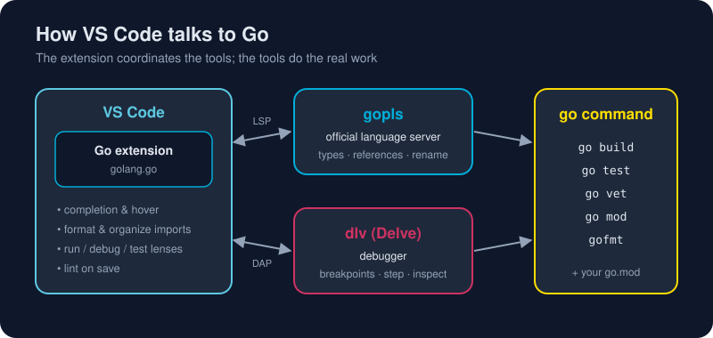

# Configuring VS Code for Go

*This is the moment your editor stops being a text box and starts understanding your code.*



> **In 30 seconds:** Install the **Go** extension published by the **Go Team at Google** (ID `golang.go`). Run **Go: Install/Update Tools** to fetch `gopls` (smart editing), `dlv` (debugging) and `staticcheck` (linting). Paste the `settings.json` below. You now have autocomplete, go-to-definition, format-and-organize-imports on save, inline errors, a debugger, and *run test* buttons above every test.

You're at **steps 3 and 4** of the setup journey. This is the step that makes Go *fun*.

## How the pieces fit together

The diagram above shows the architecture. Knowing it makes every troubleshooting step obvious:

- **The Go extension** is the coordinator inside VS Code. It doesn't understand Go by itself.
- **`gopls`** (say "go please") is the official Go language server.[^gopls] It does completion, hover docs, diagnostics, rename and find-references. It speaks the Language Server Protocol (**LSP**).
- **`dlv` (Delve)** is the Go debugger.[^delve] The extension talks to it through the Debug Adapter Protocol (**DAP**).
- **The `go` command** is the base layer that builds, tests and formats. Everything else calls into it.

If autocomplete breaks, suspect `gopls`. If breakpoints break, suspect `dlv`. If everything breaks, suspect `PATH`.

## Step 3: Install the Go extension

1. Open the Extensions view: `Ctrl+Shift+X` (`Cmd+Shift+X` on macOS).
2. Search for **Go**.
3. Pick the one by **Go Team at Google** (identifier `golang.go`) and click **Install**.[^vscode-go-repo]

Or from a terminal:

```bash
code --install-extension golang.go
```

> **Note:** Several extensions have "Go" in the name. Only `golang.go` is the official one, so check the publisher.

## Step 4: Install the Go analysis tools from the Command Palette

The extension is the steering wheel; the **tools are the engine**. Without them you get syntax colours and not much else. This one command installs the engine.

> The first time you open a `.go` file, VS Code may pop up *"The 'gopls' command is not available… Install"*. Clicking **Install All** does the same thing as the steps below. Doing it yourself means you know how to repair it later.

1. **Open the Command Palette**
   - Windows / Linux: `Ctrl+Shift+P`
   - macOS: `Cmd+Shift+P`
2. **Type** `Go: Install/Update Tools` and press **Enter**.
3. A checklist of tools appears. **Tick the checkbox at the very top** to select all of them.
4. Click **OK** (or press **Enter**).
5. Watch the **OUTPUT** panel. It opens automatically on the **Go** channel; if not, use *View → Output* and pick **Go** from the drop-down. You'll see something like this (Windows shown):

```text
Tools environment: GOPATH=C:\Users\you\go
Installing 7 tools at C:\Users\you\go\bin in module mode.
  gotests
  gomodifytags
  impl
  goplay
  dlv
  staticcheck
  gopls

Installing github.com/cweill/gotests/gotests@latest (C:\Users\you\go\bin\gotests.exe) SUCCEEDED
Installing github.com/fatih/gomodifytags@latest (C:\Users\you\go\bin\gomodifytags.exe) SUCCEEDED
Installing github.com/josharian/impl@latest (C:\Users\you\go\bin\impl.exe) SUCCEEDED
Installing github.com/haya14busa/goplay/cmd/goplay@latest (C:\Users\you\go\bin\goplay.exe) SUCCEEDED
Installing github.com/go-delve/delve/cmd/dlv@latest (C:\Users\you\go\bin\dlv.exe) SUCCEEDED
Installing honnef.co/go/tools/cmd/staticcheck@latest (C:\Users\you\go\bin\staticcheck.exe) SUCCEEDED
Installing golang.org/x/tools/gopls@latest (C:\Users\you\go\bin\gopls.exe) SUCCEEDED

All tools successfully installed. You are ready to Go. :)
```

That last line is the one you want. 🎉 The exact list and count can vary with the extension version.

### What you just installed

| Tool | Role | What it gives you |
|---|---|---|
| `gopls` | **Language server** | Autocomplete, hover docs, errors as you type, go-to-definition, rename, organize imports |
| `dlv` (Delve) | **Debugger** | Breakpoints, stepping, watching variables, inspecting goroutines |
| `staticcheck` | **Linter** | Finds bugs, dead code and deprecated APIs that `go vet` misses |
| `gotests` | Test generator | **Go: Generate Unit Tests For Function** scaffolds table-driven tests |
| `impl` | Stub generator | **Go: Generate Interface Stubs** writes the methods needed to satisfy an interface |
| `gomodifytags` | Struct tag editor | **Go: Add/Remove Tags To Struct Fields** adds `json:"name"` tags in bulk |
| `goplay` | Playground runner | **Go: Run on Go Playground** shares a snippet at go.dev/play |

### Where the binaries land

Every tool is built with `go install` and placed in **`$GOPATH/bin`**:

| OS | Typical location |
|---|---|
| Windows | `%USERPROFILE%\go\bin` (for example `C:\Users\you\go\bin`) |
| macOS / Linux | `~/go/bin` |

If you set `GOBIN`, they go there instead. Check with `go env GOPATH GOBIN`.

### Verify

Open a **new** terminal (``Ctrl+` `` in VS Code) and run:

```bash
gopls version
dlv version
staticcheck -version
```

Each should print a version. If you get *command not found*, see the troubleshooting table below. The extension itself still works, because it finds tools by absolute path, but you'll want them on your `PATH` for the terminal.

### Re-run it after every Go upgrade

The tools are compiled **with** your Go version. After upgrading Go (or if the editor starts acting strangely), run **Go: Install/Update Tools** again, select all, and click OK. It takes a minute and fixes a lot of mysterious problems. With `"go.toolsManagement.autoUpdate": true` (in the settings below), the extension also keeps the tools current for you.

### When tool installation fails

| Symptom in OUTPUT → Go | Cause | Fix |
|---|---|---|
| `dial tcp ... i/o timeout`, `proxyconnect tcp`, `403 Forbidden` | Firewall or corporate proxy blocks `proxy.golang.org` | Point Go at an allowed proxy: `go env -w GOPROXY=https://your.company.proxy,direct`. If you need an HTTP proxy, set `HTTPS_PROXY` before launching VS Code. Then re-run the command |
| `x509: certificate signed by unknown authority` | TLS-inspecting proxy | Install your company's root certificate in the OS trust store, then restart VS Code |
| `Go binary not found` / `go: command not found` | VS Code started before Go was on `PATH` | Quit **all** VS Code windows and reopen; check `go version` in the integrated terminal |
| `gopls: command not found` in a terminal (but installs "SUCCEEDED") | `$GOPATH/bin` is not on `PATH` | Add `%USERPROFILE%\go\bin` (Windows, via *Edit environment variables*) or `export PATH=$PATH:$HOME/go/bin` (macOS/Linux, in `~/.zshrc` or `~/.profile`), then open a new terminal |
| `permission denied` writing to `.../go/bin` | `GOPATH` folder owned by another user (often from an old `sudo go install`) | Fix ownership: `sudo chown -R $USER ~/go` |
| One tool fails, others succeed | Tool needs a newer Go | Upgrade Go ([Installing Go](/01-getting-started/environment-setup/installing-go.md)), then re-run |

## Step 5: A settings.json that just works

Open **Preferences: Open User Settings (JSON)** from the Command Palette and merge this in:

```jsonc
{
  // Go files: format and fix imports every time you save.
  "[go]": {
    "editor.defaultFormatter": "golang.go",
    "editor.formatOnSave": true,
    "editor.codeActionsOnSave": {
      "source.organizeImports": "explicit"
    }
  },

  // Linting with staticcheck, across the whole package, on save.
  "go.lintTool": "staticcheck",
  "go.lintOnSave": "package",

  // Keep gopls, dlv & friends up to date automatically.
  "go.toolsManagement.autoUpdate": true,

  // Show verbose test output in the Test Results panel.
  "go.testFlags": ["-v"],

  // Language-server tuning.
  "gopls": {
    "ui.semanticTokens": true,
    "ui.inlayhint.hints": {
      "assignVariableTypes": true,
      "compositeLiteralFields": true,
      "constantValues": true,
      "parameterNames": true,
      "rangeVariableTypes": true
    }
  }
}
```

What you just enabled:

- **Format on save**: `gofmt` style, every time. There are no style debates in Go.
- **Organize imports**: missing imports are added and unused ones removed when you save.
- **Inlay hints**: faint inline labels showing parameter names and inferred types. They're great while learning; turn them off later if they feel noisy.
- **staticcheck**: catches subtle bugs and deprecated API use.

## Run, debug and test

### Run

Open the integrated terminal (``Ctrl+` ``) and use the real tool:

```bash
go run .
```

### Debug with breakpoints

1. Click in the gutter left of a line number. A red dot means a breakpoint.
2. Press **F5**. With no configuration, the extension debugs the current package.
3. Step with `F10` (over), `F11` (into) and `Shift+F11` (out). Hover any variable to see its value.

For repeatable setups, such as passing arguments, create `.vscode/launch.json` (**Run → Add Configuration… → Go: Launch Package**):

```json
{
  "version": "0.2.0",
  "configurations": [
    {
      "name": "Launch hello",
      "type": "go",
      "request": "launch",
      "mode": "auto",
      "program": "${workspaceFolder}/assets/code/ch01/hello",
      "args": ["Gopher"]
    }
  ]
}
```

### Tests with one click

Above every `func TestXxx(t *testing.T)` you'll see small **run test | debug test** links (code lenses). The **Testing** view (beaker icon) lists every test in the workspace with green and red status. You'll use this constantly in [Chapter 5](/05-production-go/).

## Snippets: let the editor type for you

Start typing `func`, `for`, `if` or `switch` and choose the snippet entry from the completion list. To make your own, open **Snippets: Configure Snippets → go.json**:

```json
{
  "if err != nil": {
    "prefix": "iferr",
    "body": ["if err != nil {", "\treturn ${1:err}", "}"],
    "description": "Return early on error"
  }
}
```

You'll write that pattern hundreds of times, and now it's six keystrokes.

## Handy Go commands in the palette

| Command | Why it's great |
|---|---|
| **Go: Locate Configured Go Tools** | Full health report: Go version, `GOPATH`, tool paths |
| **Go: Install/Update Tools** | Repairs or upgrades `gopls`, `dlv` and the rest |
| **Go: Generate Unit Tests For Function** | Instant test scaffolding (`gotests`) |
| **Go: Add Tags To Struct Fields** | Adds `json:"name"` tags in one go |
| **Go: Toggle Test File** | Jumps between `foo.go` and `foo_test.go` |
| **Go: Restart Language Server** | Fixes 90% of "the editor is confused" moments |

## Troubleshooting

| Symptom | Fix |
|---|---|
| "Go binary not found" / tools fail to install | Quit VS Code fully and reopen; check `go version` works in the integrated terminal |
| No autocomplete, red squiggles everywhere | Open the **folder that contains `go.mod`** (or a parent), not a single file; then **Go: Restart Language Server** |
| `gopls` keeps crashing | **Go: Install/Update Tools** → tick `gopls`; check **Output → gopls** for errors |
| Breakpoints show as hollow / ignored | Make sure you started with **F5** (debug), not `go run`; update `dlv` |
| Imports not added on save | Confirm `editor.codeActionsOnSave` is inside the `"[go]"` block |
| Multi-module repo is confusing gopls | Create a `go.work` at the root: `go work init ./path/to/module` |

Running **Go: Locate Configured Go Tools** and reading the output solves most problems.

## Try it

1. Open this repository's `assets/code` folder: `code assets/code`.
2. Open `ch01/hello/main.go`.
3. Hover `Printf` to see its docs. Press `F12` on `strings.Join` to jump into the standard library.
4. Set a breakpoint on the `fmt.Printf` line and press **F5**.

Expected output in the Debug Console:

```text
Hello, World! Welcome to Go.
```

## Watch out

- Install the **official** `golang.go` extension, not a look-alike.
- `gopls` needs a module. Open the folder that has `go.mod`, not a lone file.
- After upgrading Go, run **Go: Install/Update Tools** so the tools are rebuilt with the new version.

## Key takeaways

- The extension coordinates; `gopls`, `dlv` and the `go` command do the work.
- Format-on-save plus organize-imports means you'll never think about style or import lists again.
- F5 debugs, code lenses run tests, and the Command Palette fixes everything else.

[^vscode-go-docs]: Go in Visual Studio Code
[^vscode-go-repo]: golang/vscode-go - Go extension for Visual Studio Code
[^gopls]: gopls: The language server for Go
[^delve]: Delve: a debugger for the Go programming language

Further reading: the official walkthrough in *Go in Visual Studio Code*.[^vscode-go-docs]

---
⬅️ [Installing VS Code](/01-getting-started/environment-setup/installing-vscode.md) · 🏠 [Index](/index.md) · ➡️ [Hello, World!](/01-getting-started/hello-world.md)
