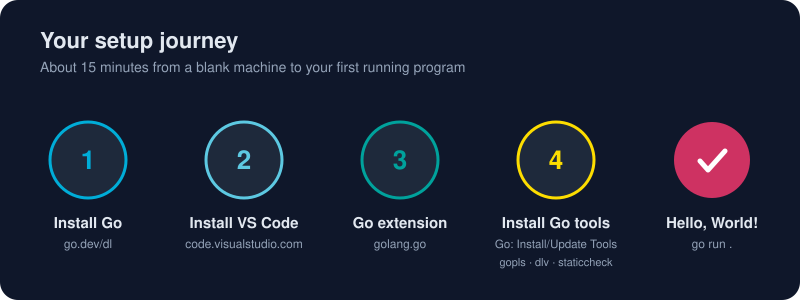

# Environment Setup

Three short lessons take you from a blank machine to an editor that understands Go. Do them in order; the whole thing takes about 15 minutes.

* [Installing Go](/01-getting-started/environment-setup/installing-go.md) - Go from zero to a working `go version` on Windows, macOS or Linux in about five minutes, then learn what GOROOT, GOPATH and PATH really mean.
* [Installing VS Code](/01-getting-started/environment-setup/installing-vscode.md) - Install Visual Studio Code on any OS, put the `code` command on your PATH, and learn the dozen shortcuts that make it feel like an extension of your hands.
* [Configuring VS Code for Go](/01-getting-started/environment-setup/configuring-vscode-go.md) - Turn VS Code into a Go powerhouse with the official extension, gopls, Delve and a battle-tested settings.json, so you get autocomplete, formatting on save, linting, debugging and one-click tests.

# Up next

* [Hello, World!](/01-getting-started/hello-world.md) - Write, run and dissect your first Go program, and see why every line in it is there on purpose.
