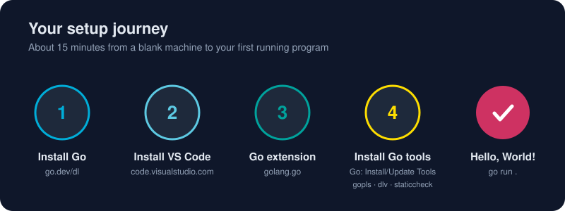

# Installing Go

*Five minutes from now, your machine will speak Go.*



> **In 30 seconds:** Download the installer for your OS from **go.dev/dl**, run it, open a *new* terminal, and type `go version`. Installers put Go in a standard place and add it to your `PATH` for you. Linux users unpack a tarball and add one line to their shell profile. That's it: no SDK manager, no JVM, no virtualenv.

You are at **step 1** of the journey above. Pick your operating system below and follow only that section.

## Step 0: Check whether Go is already installed

```bash
go version
```

If you see something like `go version go1.26.3 windows/amd64`, you already have Go. Skip to [Upgrading](#upgrading-go) if it's old. If you get `command not found` or `'go' is not recognized`, read on.

## 🪟 Windows

### Option A: the MSI installer (recommended)

1. Open **https://go.dev/dl/** and click the featured **Microsoft Windows** download (`go1.xx.x.windows-amd64.msi`; choose `arm64` on ARM laptops).[^go-dl]
2. Run the `.msi` and accept the defaults. Go installs to `C:\Program Files\Go`, and the installer adds `C:\Program Files\Go\bin` to your `PATH`.
3. **Close every open terminal** (and VS Code) and open a fresh PowerShell window. Terminals only read `PATH` when they start.
4. Verify:

```powershell
go version
go env GOROOT GOPATH
```

### Option B: winget (one command)

```powershell
winget install --id GoLang.Go -e
```

Then open a new terminal and run `go version`.

## 🍎 macOS

### Option A: the .pkg installer (recommended)

1. Download the macOS package from **https://go.dev/dl/**. Pick `darwin-arm64` for Apple Silicon (M1–M4) and `darwin-amd64` for Intel Macs.
2. Open the `.pkg` and follow the prompts. Go lands in `/usr/local/go`, and `/usr/local/go/bin` is added to your `PATH` through `/etc/paths.d/go`.
3. Open a **new** Terminal tab and verify with `go version`.

### Option B: Homebrew

```bash
brew install go
go version
```

> **Tip:** Pick **one** method. Having both a Homebrew Go and a `.pkg` Go makes `which go` a guessing game.

## 🐧 Linux

The official method is a tarball, which works on every distribution:[^go-install]

```bash
# 1. Download (replace the version with the latest one from go.dev/dl)
curl -LO https://go.dev/dl/go1.26.3.linux-amd64.tar.gz

# 2. Remove any previous install, then extract to /usr/local
sudo rm -rf /usr/local/go
sudo tar -C /usr/local -xzf go1.26.3.linux-amd64.tar.gz

# 3. Put Go and the binaries you install on PATH (add to ~/.profile or ~/.bashrc)
echo 'export PATH=$PATH:/usr/local/go/bin:$HOME/go/bin' >> ~/.profile
source ~/.profile

# 4. Verify
go version
```

> **Warning:** Never extract a new tarball *on top of* an existing `/usr/local/go`. Leftover files from the old version can break the toolchain. That's why step 2 removes it first.

Distribution packages (`apt install golang`, `dnf install golang`) work, but they often lag several releases behind. Snap users can run `sudo snap install go --classic`.

## The three words you'll hear: PATH, GOROOT, GOPATH

| Name | What it is | Typical value | Do you set it? |
|---|---|---|---|
| `PATH` | Where your shell looks for programs | includes `.../go/bin` | The installer does |
| `GOROOT` | Where the Go toolchain itself lives | `C:\Program Files\Go`, `/usr/local/go` | **No.** Go works it out |
| `GOPATH` | Your Go workspace: module cache and installed tools | `%USERPROFILE%\go`, `~/go` | No; the default is fine |
| `GOBIN` | Where `go install` puts binaries | `$GOPATH/bin` when unset | Optional |

Two things to remember:

1. **Modules replaced the old "GOPATH workspace".** You can create projects *anywhere* on disk. You never have to put code inside `GOPATH`.
2. **Add `$GOPATH/bin` to your `PATH`** (the Linux snippet above does) so tools you `go install`, like `gopls` or `dlv`, can run from any terminal. On Windows this is `%USERPROFILE%\go\bin`, and the MSI usually adds it for you.

Inspect everything with:

```bash
go env              # every setting
go env GOPATH GOOS GOARCH GOVERSION
```

## Upgrading Go

- **Windows/macOS installers:** download the new installer and run it. It replaces the old version.
- **Homebrew:** `brew upgrade go`.
- **winget:** `winget upgrade --id GoLang.Go`.
- **Linux tarball:** repeat steps 1–2 with the new version.

### Automatic toolchains (Go 1.21+)

The `go` line in a project's `go.mod` says which Go version the project needs. If your installed Go is older, the `go` command can download the right toolchain for you automatically. This behaviour is controlled by `GOTOOLCHAIN`.[^toolchain] Most of the time you never notice it happening.

## Running multiple versions side by side

Need to test against an older release? Install it as a separate command:[^manage-install]

```bash
go install golang.org/dl/go1.22.12@latest
go1.22.12 download
go1.22.12 version
```

Your main `go` stays untouched.

## Troubleshooting

| Symptom | Likely cause | Fix |
|---|---|---|
| `'go' is not recognized` / `command not found` | Terminal opened before install | Open a **new** terminal; on Windows sign out and back in if needed |
| `go version` shows an old version | Two installs on `PATH` | `where go` (Windows) or `which -a go` (macOS/Linux); remove the extra one |
| `go: cannot find GOROOT directory` | `GOROOT` set by hand to a wrong path | Unset `GOROOT`; let Go detect it |
| `permission denied` on Linux | Extracted without `sudo` | Re-run step 2 with `sudo` |
| Tools like `gopls` "not found" | `$GOPATH/bin` not on `PATH` | Add `~/go/bin` (or `%USERPROFILE%\go\bin`) to `PATH` |
| Corporate proxy blocks downloads | `proxy.golang.org` unreachable | `go env -w GOPROXY=https://your-proxy,direct` (ask IT) |

## Try it

From the [`assets/code`](/assets/code/) folder of this book:

```bash
go run ./ch01/platform
```

```text
Go version: go1.26.3
OS/Arch:    windows/amd64
CPUs:       24
```

Your version, OS and CPU count will differ. What matters is that it runs.

## Watch out

- Always **reopen your terminal** after installing. It's the #1 "it doesn't work" cause.
- Don't set `GOROOT` by hand unless you really know why.
- Don't mix package managers for the same tool.

## Key takeaways

- Get Go from **go.dev/dl**; installers handle `PATH` for you.
- `go version` and `go env` are your two health checks.
- Projects can live anywhere; `GOPATH` is now just a cache and a tool folder.

[^go-install]: Download and install - The Go Programming Language
[^go-dl]: All releases - The Go Programming Language
[^manage-install]: Managing Go installations
[^toolchain]: Go Toolchains

---
⬅️ [Why Go?](/01-getting-started/why-go.md) · 🏠 [Index](/index.md) · ➡️ [Installing VS Code](/01-getting-started/environment-setup/installing-vscode.md)
