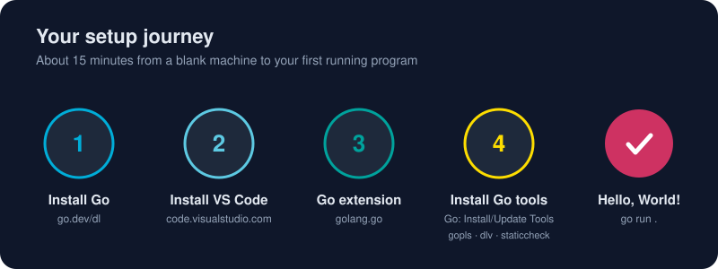

# Installing VS Code

*A great editor doesn't write code for you. It gets out of your way so you can.*



> **In 30 seconds:** Visual Studio Code is a free, fast, cross-platform editor. With the official Go extension it's one of the most popular Go setups in the world. Download it from **code.visualstudio.com**, install it, make sure the `code` command works in your terminal, and learn the Command Palette (`Ctrl+Shift+P` / `Cmd+Shift+P`). The Command Palette is the one shortcut that unlocks all the others.

You're at **step 2**. Go is installed; now let's give it a home.

## 🪟 Windows

1. Go to **https://code.visualstudio.com/download** and pick **Windows → User Installer (x64)**, or ARM64 on ARM laptops.[^vscode-download]
   - The *User* installer needs no admin rights and updates itself quietly. Choose *System* only if several people share the machine.
2. During setup, tick these boxes:
   - ✅ **Add to PATH** (lets you type `code .` in any terminal)
   - ✅ **Add "Open with Code" action to Windows Explorer file and directory context menu**
3. Finish, then open a **new** terminal and check:

```powershell
code --version
```

Prefer the command line? This does the same thing:

```powershell
winget install -e --id Microsoft.VisualStudioCode
```

## 🍎 macOS

1. Download the **Universal** build from the download page, or use Homebrew:

```bash
brew install --cask visual-studio-code
```

2. If you downloaded the zip, drag **Visual Studio Code.app** into **Applications**. Running it from Downloads causes update problems.
3. Launch it, open the Command Palette (`Cmd+Shift+P`), and run **Shell Command: Install 'code' command in PATH**.
4. Open a new terminal tab and run `code --version`.

## 🐧 Linux

Choose the package that matches your distribution:[^vscode-setup]

```bash
# Debian / Ubuntu: download the .deb from the site, then
sudo apt install ./code_*.deb

# Fedora / RHEL: download the .rpm, then
sudo dnf install ./code-*.rpm

# Any distro with snap
sudo snap install code --classic
```

The `.deb` and `.rpm` packages add Microsoft's repository, so VS Code updates with the rest of your system. The `code` command is on your `PATH` automatically.

## Your first launch: a 60-second tour

```text
┌──┬───────────────┬──────────────────────────────────────┐
│A │  Side Bar     │  Editor (tabs, split views)          │
│c │  Explorer     │                                      │
│t │  Search       │                                      │
│i │  Source Ctrl  │                                      │
│v │  Run & Debug  ├──────────────────────────────────────┤
│i │  Extensions   │  Panel: Terminal · Problems · Output │
│ty│               │         Debug Console                │
└──┴───────────────┴──────────────────────────────────────┘
                      Status Bar (branch · errors · Go version)
```

- **Activity Bar** (far left): switches what the Side Bar shows.
- **Editor**: where code lives. Drag tabs to split it.
- **Panel**: your integrated terminal. It opens in the project folder.
- **Status Bar**: after you set up Go, it shows the Go version and the language server's status.

The best way to work is folder-first: `cd` into a project and run `code .`.

## Shortcuts worth memorizing

| Action | Windows / Linux | macOS |
|---|---|---|
| **Command Palette** (do anything) | `Ctrl+Shift+P` | `Cmd+Shift+P` |
| Quick Open file | `Ctrl+P` | `Cmd+P` |
| Toggle terminal | ``Ctrl+` `` | ``Ctrl+` `` |
| Toggle Side Bar | `Ctrl+B` | `Cmd+B` |
| Go to definition | `F12` | `F12` |
| Find all references | `Shift+F12` | `Shift+F12` |
| Rename symbol everywhere | `F2` | `F2` |
| Quick fix / code action | `Ctrl+.` | `Cmd+.` |
| Format document | `Shift+Alt+F` | `Shift+Option+F` |
| Search across files | `Ctrl+Shift+F` | `Cmd+Shift+F` |
| Start debugging | `F5` | `F5` |
| Multi-cursor at next match | `Ctrl+D` | `Cmd+D` |

> **Tip:** Forget a shortcut? Open the Command Palette and type what you want. The shortcut is printed next to each command.

## Make it yours (optional)

- **Theme:** Command Palette → *Preferences: Color Theme*.
- **Font size:** `Ctrl+=` / `Cmd+=` to zoom, or set `editor.fontSize` in Settings.
- **Settings Sync:** click the account icon (bottom-left) → *Backup and Sync Settings*. Your settings, extensions and keybindings then follow you to every machine.[^vscode-sync]
- **Auto Save:** *File → Auto Save* stops "why didn't my change run?" moments.

## Troubleshooting

| Symptom | Fix |
|---|---|
| `code: command not found` (macOS) | Run **Shell Command: Install 'code' command in PATH** from the Command Palette |
| `code` not recognized (Windows) | Reinstall with **Add to PATH** ticked, then open a *new* terminal |
| Integrated terminal can't find `go` | Fully quit VS Code (all windows) and reopen it so it picks up the new `PATH` |
| Updates fail on macOS | Move the app into `/Applications` |
| Blurry text on Linux (Wayland) | Launch with `code --ozone-platform=wayland`, or update to the latest version |

## Try it

```bash
cd golang-knowledge-bundle
code .
```

Press ``Ctrl+` `` to open the terminal inside VS Code and run:

```bash
go version
```

If both work, you've finished step 2. 🎉

## Watch out

- Restart VS Code **completely** after installing Go. The editor inherits its `PATH` when it starts.
- Don't confuse **VS Code** (this editor) with **Visual Studio** (Microsoft's heavyweight IDE for .NET and C++).

## Key takeaways

- Install from **code.visualstudio.com**, or use winget, Homebrew or your package manager.
- Make sure `code .` works from a terminal.
- `Ctrl+Shift+P` / `Cmd+Shift+P` is the key to everything else.

[^vscode-setup]: Setting up Visual Studio Code
[^vscode-download]: Download Visual Studio Code
[^vscode-sync]: Settings Sync in Visual Studio Code

---
⬅️ [Installing Go](/01-getting-started/environment-setup/installing-go.md) · 🏠 [Index](/index.md) · ➡️ [Configuring VS Code for Go](/01-getting-started/environment-setup/configuring-vscode-go.md)
