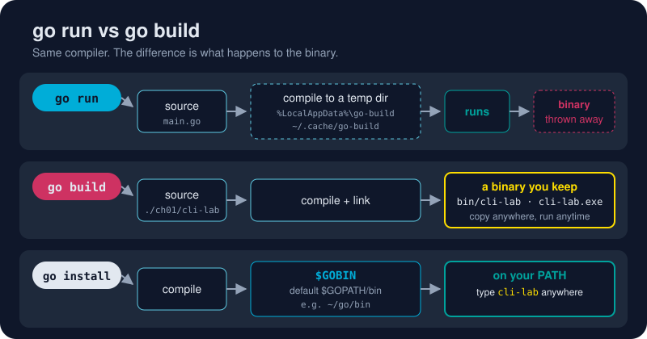

# go build

*One command. One file. Runs anywhere you copy it. This is Go's party trick.*



> **In 30 seconds:** `go build` compiles a `main` package and its dependencies,
> including the Go runtime, into **one executable file**. There's no VM to
> install and no `node_modules` or `.dll`s to ship alongside it. `-o` chooses where the
> file goes, `-ldflags` stamps in a version, and `GOOS`/`GOARCH` build for
> another operating system.

## Your first binary

```sh
cd assets/code
go build -o bin/ ./ch01/cli-lab
```

```text
bin/
└── cli-lab.exe      ← Windows   (cli-lab on macOS / Linux)
```

Run it like any other program:

```sh
./bin/cli-lab -name Gopher     # Hello, Gopher!
```

Now copy that file to another machine with the same OS and CPU. It runs. No
Go installed, no setup. That one property is a big reason Go took over
containers and cloud tooling: a `FROM scratch` Docker image can hold just
your binary.

## Where does the output go?

| You type | Result |
|---|---|
| `go build` (inside a `main` package) | a binary named after the folder, dropped *right here* |
| `go build -o bin/ ./ch01/cli-lab` | `bin/cli-lab(.exe)`. A trailing `/` means "into this folder" |
| `go build -o greeter ./ch01/cli-lab` | a binary called `greeter` |
| `go build ./...` | compiles **everything** as a check, and discards non-main results |

That last form is a great pre-commit sanity check: "does the whole module
still compile?"[^cmd-go-build]

## Stamp a version in at build time

`cli-lab` declares `var version = "dev"`. The linker can overwrite that string
for you, so the version comes from your build script and not from a source
edit:[^cmd-link]

```sh
go build -ldflags="-X main.version=1.0.0" -o bin/ ./ch01/cli-lab
./bin/cli-lab -version
```

```text
cli-lab 1.0.0
```

Release pipelines do exactly this with a git tag:
`-ldflags="-X main.version=$(git describe --tags)"`.

## The flags worth memorizing

```sh
go build -o bin/ ./...                 # build every main package into bin/
go build -ldflags="-s -w" -o bin/ .    # strip debug info → noticeably smaller
go build -trimpath -o bin/ .           # remove your local paths: reproducible builds
go build -race -o bin/ .               # add the race detector (testing only, slower)
go build -v ./...                      # print each package as it compiles
```

## Build for a different OS, from your laptop

Two environment variables, no extra toolchain:

```sh
# macOS / Linux / Git Bash
GOOS=linux   GOARCH=arm64 go build -o bin/cli-lab-linux-arm64 ./ch01/cli-lab
GOOS=darwin  GOARCH=arm64 go build -o bin/cli-lab-mac        ./ch01/cli-lab
GOOS=windows GOARCH=amd64 go build -o bin/cli-lab.exe        ./ch01/cli-lab
```

```powershell
# PowerShell
$env:GOOS="linux"; $env:GOARCH="arm64"; go build -o bin/cli-lab-linux-arm64 ./ch01/cli-lab
Remove-Item Env:GOOS, Env:GOARCH
```

The [toolchain tour](/01-getting-started/toolchain-tour.md) goes further.

## Try it

```sh
cd assets/code
go build -o bin/ ./ch01/cli-lab && ./bin/cli-lab -version
go build -ldflags="-X main.version=1.0.0" -o bin/ ./ch01/cli-lab && ./bin/cli-lab -version
```

```text
cli-lab dev
cli-lab 1.0.0
```

The `bin/` folder is git-ignored, so build there as much as you like.

## Watch out

- **Building a library prints nothing.** `go build ./greet` compiles the package and throws the result away. Silence means success.
- **`-X` needs the full import path for non-main packages**, e.g. `-X gokb/ch01/cli-lab/greet.Prefix=hi`, and it only works on `string` variables, not constants.
- **cgo breaks easy cross-compiling.** If a dependency uses C, set `CGO_ENABLED=0` or install a C cross-compiler.
- **Don't commit binaries.** Keep them in a git-ignored `bin/`.

## Key takeaways

- `go build` → one static, self-contained executable.
- `-o bin/` keeps your tree clean; `go build ./...` checks that everything compiles.
- `-ldflags="-X main.version=…"` stamps in a version without editing source.
- `GOOS` + `GOARCH` = any platform, from any platform.

[^cmd-go-build]: Command go: Compile packages and dependencies
[^cmd-link]: Command link

---
⬅️ [go run](/01-getting-started/go-cli/go-run.md) · 🏠 [Index](/index.md) · ➡️ [go install](/01-getting-started/go-cli/go-install.md)
