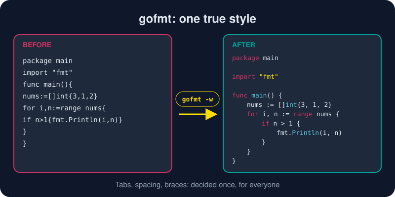

# go fmt

*Tabs or spaces? Braces on a new line? In Go, nobody asks, because the answer ships with the compiler.*



> **In 30 seconds:** `go fmt ./...` rewrites every Go file in your module into
> the standard layout: tabs for indentation, spaces around operators, aligned
> comments and struct fields, braces where Go wants them. You can't configure
> it, and that's the point. Code reviews stop debating whitespace, and every
> Go codebase you open reads the same way.

## Watch it work

The lab includes a file nobody should have to read,
[`messy.go.txt`](/assets/code/ch01/cli-lab/messy.go.txt):

```go
package main
import "fmt"
func main(){
nums:=[]int{3,1,2}
for i,n:=range nums{
if n>1{fmt.Println(i,n)}
}
}
```

Give it to `gofmt`, which prints the result and leaves the file alone:

```sh
gofmt ch01/cli-lab/messy.go.txt
```

```go
package main

import "fmt"

func main() {
	nums := []int{3, 1, 2}
	for i, n := range nums {
		if n > 1 {
			fmt.Println(i, n)
		}
	}
}
```

Same program, now readable. This is the only style any Go code you meet will
use.

## `go fmt` vs `gofmt`

There are two front doors to the same formatter:[^cmd-gofmt]

| Command | Works on | Default behavior |
|---|---|---|
| `go fmt ./...` | **packages** | rewrites files in place, prints the names it changed |
| `gofmt -w file.go` | **files and folders** | `-w` writes changes; without it, prints to stdout |
| `gofmt -l .` | files and folders | **lists** files that need formatting and changes nothing |
| `gofmt -d .` | files and folders | shows a **diff** of what it would change |
| `gofmt -s -w .` | files and folders | also **simplifies** (e.g. `[]T{T{1}}` → `[]T{{1}}`) |

The everyday habit is `go fmt ./...`. The CI habit is `gofmt -l .`, which
fails the build if any file isn't formatted:

```sh
test -z "$(gofmt -l .)" || { echo "run go fmt"; gofmt -l .; exit 1; }
```

## What it decides for you

- **Tabs** for indentation, **spaces** for alignment.
- Spaces around binary operators, none inside parentheses: `a := b + c*d` (tighter binding stays tight).
- Opening braces on the **same line**. In Go this is required syntax, not style, because of automatic semicolon insertion.
- Aligned columns for struct fields, comments and `const` blocks.
- Sorted, grouped `import` blocks.

## Let your editor do it

You'll rarely run it by hand. With the setup from
[Configuring VS Code for Go](/01-getting-started/environment-setup/configuring-vscode-go.md),
every save runs the formatter (through `gopls`) and also organizes imports,
adding missing ones and removing unused ones.

> *"Gofmt's style is no one's favorite, yet gofmt is everyone's favorite."*
> — Go Proverbs[^proverbs]

## Try it

```sh
cd assets/code
gofmt ch01/cli-lab/messy.go.txt       # print the formatted version
gofmt -l ch01                         # list unformatted .go files (prints nothing: all clean)
go fmt ./ch01/...                     # format the chapter's packages in place
```

## Watch out

- **`go fmt` won't fix syntax errors.** If the file doesn't parse, it reports the error and changes nothing.
- **It formats; it doesn't lint.** Unused variables, bad names and real bugs are a job for `go vet` and staticcheck. See the [toolchain tour](/01-getting-started/toolchain-tour.md).
- **Generated code is formatted too.** Tools like `stringer` run gofmt on their output, so a diff in a generated file usually means it needs regenerating.
- **Don't fight it.** If gofmt's layout looks ugly, rewrite the code (split the long expression, name the value). Don't reach for a formatter override.

## Key takeaways

- `go fmt ./...` formats a whole module; `gofmt -l .` checks it in CI.
- No configuration, no debate. The style is part of the language culture.
- Format on save, and you'll never think about it again.[^gofmt-blog]

[^gofmt-blog]: go fmt your code
[^cmd-gofmt]: Command gofmt
[^proverbs]: Go Proverbs

---
⬅️ [go install](/01-getting-started/go-cli/go-install.md) · 🏠 [Index](/index.md) · ➡️ [go test](/01-getting-started/go-cli/go-test.md)
