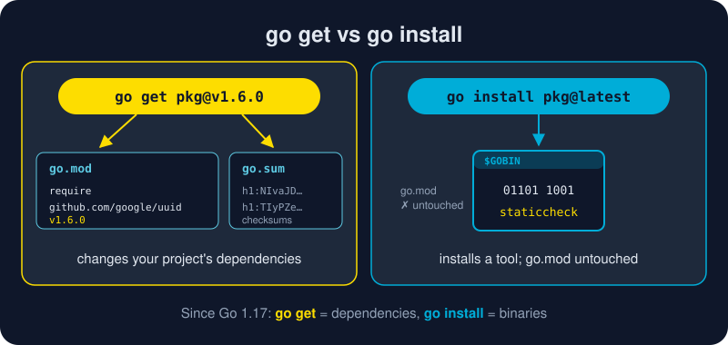

# go get

*Your program needs a UUID generator. Someone already wrote a great one. `go get` brings it in, pins it, and checksums it.*



> **In 30 seconds:** Inside a module, `go get example.com/pkg@version` adds or
> changes a dependency. It downloads the code, records the version in
> **go.mod**, and stores cryptographic checksums in **go.sum** so nobody can
> swap the code under you. `@latest` upgrades, `@v1.2.3` pins, and `@none`
> removes. Follow it with `go mod tidy` to keep everything consistent.

## A dependency, from zero

This one needs a fresh scratch module, so the book's own `go.mod` stays
clean. Make an empty folder anywhere:

```sh
mkdir getlab && cd getlab
go mod init example.com/getlab
```

Write a `main.go` that uses Google's UUID package:

```go
package main

import (
	"fmt"

	"github.com/google/uuid"
)

func main() {
	fmt.Println("your order id:", uuid.NewString())
}
```

Run it, and Go tells you exactly what's missing:

```text
main.go:6:2: no required module provides package github.com/google/uuid; to add it:
	go get github.com/google/uuid
```

Do what it says, pinning a version so the result matches this page:

```sh
go get github.com/google/uuid@v1.6.0
```

```text
go: added github.com/google/uuid v1.6.0
```

```sh
go run .
```

```text
your order id: f8cebe67-2b28-430b-9f9b-8617767c7fd7
```

## What just changed

**go.mod** is the human-readable manifest:

```text
module example.com/getlab

go 1.26.3

require github.com/google/uuid v1.6.0 // indirect
```

**go.sum** is the tamper-proof lock. It holds one hash for the code and one
for its `go.mod`:

```text
github.com/google/uuid v1.6.0 h1:NIvaJDMOsjHA8n1jAhLSgzrAzy1Hgr+hNrb57e+94F0=
github.com/google/uuid v1.6.0/go.mod h1:TIyPZe4MgqvfeYDBFedMoGGpEw/LqOeaOT+nhxU+yHo=
```

Commit **both** files. Every teammate and CI machine then builds with exactly
the same bytes, checked against Go's public checksum database.[^managing-deps]

## Wait, why `// indirect`?

`go get` records versions; it doesn't read your imports. So it can't tell
that your code uses the package directly. **`go mod tidy`** does read your
imports. It fixes the comment, adds anything missing, and removes anything
unused:

```sh
go mod tidy
```

```text
require github.com/google/uuid v1.6.0
```

The habit to build: **`go get` to choose a version, `go mod tidy` to clean up.**

## The version suffixes

| Command | Effect |
|---|---|
| `go get pkg` | add at the latest release (or keep the current version if already present) |
| `go get pkg@latest` | upgrade to the newest release |
| `go get pkg@v1.6.0` | pin an exact version, up *or* down |
| `go get pkg@v1` | the newest `v1.x.y` |
| `go get pkg@master` | a branch, resolved to a pseudo-version like `v0.0.0-2025…-abc123` |
| `go get pkg@none` | **remove** the dependency |
| `go get -u ./...` | upgrade all direct and indirect dependencies (minor and patch) |
| `go get -u=patch ./...` | upgrade patch versions only, the cautious option |
| `go get go@1.26.0` | raise the module's `go` version line |

See what you have, and what's newer:

```sh
go list -m all          # every module in the build
go list -m -u all       # ...with available upgrades shown in [brackets]
```

## `go get` vs `go install`

These two used to overlap. Since Go 1.17 each has one job:[^go-install-blog]

| | `go get` | `go install` |
|---|---|---|
| Purpose | manage **dependencies** of *this* module | build and install a **program** |
| Touches go.mod? | ✅ yes | ❌ no (with `@version`) |
| Output | updated go.mod / go.sum | a binary in `$GOBIN` |
| Example | `go get github.com/google/uuid@v1.6.0` | `go install golang.org/x/tools/gopls@latest` |

If you want a **command** you can run, use [`go install`](/01-getting-started/go-cli/go-install.md).
If you want a **library** you can import, use `go get`.

## Try it

From an empty folder, run the whole cycle:

```sh
go mod init example.com/getlab
# ...create main.go as above...
go get github.com/google/uuid@v1.6.0
go mod tidy
go run .
go get github.com/google/uuid@none   # remove it again
```

```text
go: added github.com/google/uuid v1.6.0
your order id: <a fresh random UUID>
go: removed github.com/google/uuid v1.6.0
```

## Watch out

- **Outside a module, `go get` refuses to work.** Run `go mod init` first, or use `go install pkg@version` if you wanted a tool.
- **`-u` upgrades more than you think.** `go get -u ./...` touches indirect dependencies too. Review the go.mod diff and run your tests.
- **Major version 2+ is a different import path.** `github.com/foo/bar/v2` is a separate module from `github.com/foo/bar`.
- **Behind a corporate proxy?** Downloads go through `GOPROXY` (default `https://proxy.golang.org,direct`). For private repos, set `GOPRIVATE=github.com/your-org/*`.
- **Never hand-edit go.sum.** If it looks wrong, delete the lines in question and run `go mod tidy`.

## Key takeaways

- `go get pkg@version` adds or changes a dependency; `@none` removes it.
- go.mod says *what* you depend on; go.sum proves *it's the same code*. Commit both.
- Follow `go get` with `go mod tidy`.
- Dependencies: `go get`. Tools: `go install`.

[^managing-deps]: Managing dependencies
[^cmd-go-get]: Command go: Add dependencies to current module
[^go-install-blog]: Deprecation of 'go get' for installing executables

---
⬅️ [go test](/01-getting-started/go-cli/go-test.md) · 🏠 [Index](/index.md) · ➡️ [A Tour of the Toolchain](/01-getting-started/toolchain-tour.md)
