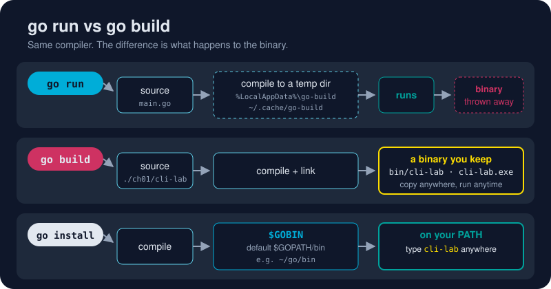

# go install

*`go build` gives you a binary. `go install` puts it somewhere your shell can always find it.*



> **In 30 seconds:** `go install` is `go build` plus a fixed destination:
> **`$GOBIN`**, which defaults to `$GOPATH/bin` (`~/go/bin`, or
> `%USERPROFILE%\go\bin` on Windows). Put that folder on your `PATH` once, and
> every program you install becomes a command you can type anywhere. Add
> `@version` to install someone else's tool straight from the internet.

## Where installed binaries live

```sh
go env GOPATH GOBIN
```

```text
C:\Users\you\go
                      ← GOBIN empty: Go uses GOPATH\bin
```

| OS | Default install folder |
|---|---|
| Windows | `%USERPROFILE%\go\bin` |
| macOS / Linux | `~/go/bin` |

If [Installing Go](/01-getting-started/environment-setup/installing-go.md)
put that folder on your `PATH`, you're set. If not, the binaries install fine,
but your shell won't find them.

## Install your own program

```sh
cd assets/code
go install ./ch01/cli-lab
cli-lab -name "from anywhere"      # works in any folder, any terminal
```

```text
Hello, from anywhere!
```

The binary is named after the package's folder (`cli-lab`). Edit the code,
run `go install` again, and the command updates in place.

## Install someone else's tool

The `@version` suffix means "fetch this module at this version, build it, and
install it. Don't touch my project."[^cmd-go-install]

```sh
go install golang.org/x/example/hello@latest
hello
```

```text
go: downloading golang.org/x/example/hello v0.0.0-20250915201037-7f05d217867b
Hello, world!
```

Tools Go developers install this way:

| Tool | Install command | What it does |
|---|---|---|
| staticcheck | `go install honnef.co/go/tools/cmd/staticcheck@latest` | a deep linter |
| gopls | `go install golang.org/x/tools/gopls@latest` | the language server behind your editor |
| dlv | `go install github.com/go-delve/delve/cmd/dlv@latest` | the debugger |
| govulncheck | `go install golang.org/x/vuln/cmd/govulncheck@latest` | scans for known vulnerabilities |

(VS Code's **Go: Install/Update Tools** command runs these `go install`s for
you. See [Configuring VS Code for Go](/01-getting-started/environment-setup/configuring-vscode-go.md).)

## Pin it, or ride latest

```sh
go install honnef.co/go/tools/cmd/staticcheck@latest    # newest release
go install honnef.co/go/tools/cmd/staticcheck@2025.1.1  # exact version, reproducible
```

In CI, pin exact versions so a new release can't break your build overnight.

## Try it

```sh
cd assets/code
go install ./ch01/cli-lab
cli-lab -version
```

```text
cli-lab dev
```

Want it somewhere else? Set `GOBIN` first: `go env -w GOBIN=$HOME/bin`.

## Watch out

- **"command not found" after installing?** Your `GOBIN`/`GOPATH/bin` folder isn't on `PATH`. Add it and open a new terminal.
- **Use `go install`, not `go get`, for tools.** Since Go 1.17, `go get` only manages dependencies. It no longer builds binaries.[^go-install-blog]
- **`@version` ignores your `go.mod`.** That's intended. Without `@version`, `go install` uses the current module's versions.
- **Name clashes.** Your `hello` might shadow another `hello` on `PATH`. Run `which hello` (or `Get-Command hello` in PowerShell) to see which one runs.

## Key takeaways

- `go install` = build + copy into `$GOBIN`.
- Put `~/go/bin` on your `PATH` once; every installed program becomes a command.
- `go install module/path@latest` installs any Go tool without touching your project.
- Pin `@vX.Y.Z` when reproducibility matters.

[^cmd-go-install]: Command go: Compile and install packages and dependencies
[^go-install-blog]: Deprecation of 'go get' for installing executables

---
⬅️ [go build](/01-getting-started/go-cli/go-build.md) · 🏠 [Index](/index.md) · ➡️ [go fmt](/01-getting-started/go-cli/go-fmt.md)
