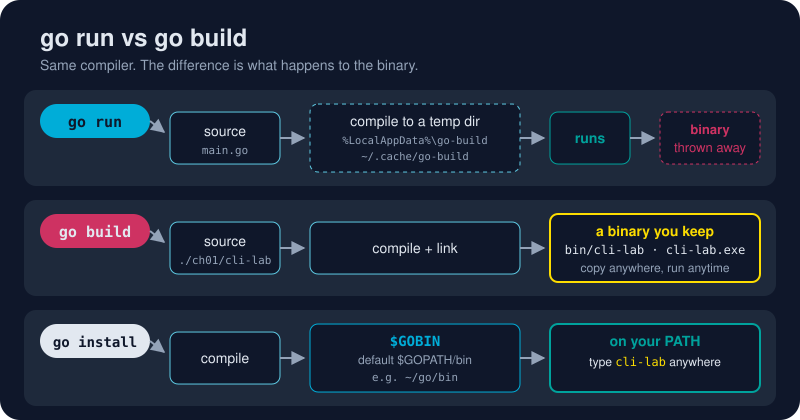

# go run

*Edit. Save. `go run`. See it. That loop is the heartbeat of writing Go.*



> **In 30 seconds:** `go run` compiles your `main` package into a temporary
> binary, runs it, and deletes it when the program exits. You never see the
> binary. It feels like a scripting language, but it's real compiled code.
> Anything after the package path goes to *your* program as arguments.

## Meet the practice project

Every lesson in this topic uses one tiny program,
[`cli-lab`](/assets/code/ch01/cli-lab/main.go). It greets people, and it is
small on purpose so the `go` command gets your full attention:

```go
func main() {
	name := flag.String("name", "World", "who to greet")
	shout := flag.Bool("shout", false, "greet in capitals")
	showVersion := flag.Bool("version", false, "print the version and exit")
	flag.Parse()

	if *showVersion {
		fmt.Println("cli-lab", version)
		return
	}
	fmt.Println(greet.Hello(*name, *shout))
}
```

## The three ways to say "run this"

| You type | Go runs | Use it when |
|---|---|---|
| `go run .` | the `main` package in the current folder | you're inside the project (the most common form) |
| `go run ./ch01/cli-lab` | the `main` package at that path | you're at the module root |
| `go run main.go` | just that one file | quick throwaway experiments only |

Prefer the **folder** forms. `go run main.go` compiles *only* the files you
name. As soon as your `main` package has a second file, you'll get
`undefined:` errors and wonder why.

## Passing arguments to your program

Everything after the package goes to your program, not to `go`:

```sh
go run ./ch01/cli-lab -name Gopher -shout
#      └── package ──┘ └── your program's flags ──┘
```

Flags for the `go` command itself go *before* the package:

```sh
go run -race ./ch01/cli-lab          # build with the race detector, then run
go run -ldflags="-X main.version=dev2" ./ch01/cli-lab -version
```

## So where did the binary go?

Into the build cache, and then into the bin. Ask for help and the program
prints its own temporary path, which gives the trick away:

```text
Usage of C:\Users\you\AppData\Local\go-build\ea\eadad3...-d\cli-lab.exe:
```

The cache is why the *second* `go run` is nearly instant: Go only recompiles
packages that changed.[^cmd-go-run]

## Try it

From [`assets/code`](/assets/code/):

```sh
go run ./ch01/cli-lab -name Gopher
go run ./ch01/cli-lab -name Gopher -shout
go run ./ch01/cli-lab -h
```

```text
Hello, Gopher!
HELLO, GOPHER!
Usage of ...\cli-lab.exe:
  -name string
    	who to greet (default "World")
  -shout
    	greet in capitals
  -version
    	print the version and exit
```

You just ran a compiled program, with real flags and help text, without
building anything by hand.

## Watch out

- **`go run` is for development.** It recompiles every time and leaves nothing behind. Ship the output of [`go build`](/01-getting-started/go-cli/go-build.md).
- **`package main` + `func main()` are required.** Run a library package and you get `package ... is not a main package`.
- **The exit code is passed through.** If your program calls `os.Exit(3)`, `go run` exits non-zero too, which matters in scripts.
- **Mind the argument order.** `go run -name Gopher .` makes `go` try to parse `-name` and fail. Your flags go *after* the package.

## Key takeaways

- `go run .` = compile + run + clean up, in one command.
- Use folder paths, not file names.
- `go` flags go before the package; your program's flags go after it.
- The build cache makes repeat runs fast.

[^cmd-go-run]: Command go: Compile and run Go program

---
⬅️ [Modules and Packages](/01-getting-started/go-packages/modules-and-packages.md) · 🏠 [Index](/index.md) · ➡️ [go build](/01-getting-started/go-cli/go-build.md)
