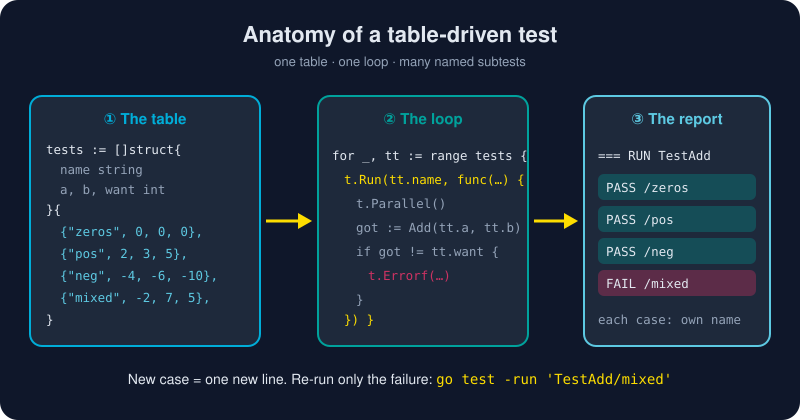

# go test

*In most languages, you choose a test framework first. In Go, you just write a function whose name starts with `Test`.*



> **In 30 seconds:** Put tests in files ending in `_test.go`, write
> `func TestXxx(t *testing.T)`, and run `go test ./...`. Go finds them,
> compiles a test binary, runs `go vet` checks, and reports
> `ok` or `FAIL` per package. Add `-v` for detail, `-run` to pick one test,
> and `-cover` to see how much code your tests exercise.

## The three rules

1. Test files end in **`_test.go`**. They're left out of normal builds.
2. Test functions look like **`func TestXxx(t *testing.T)`**, where `Xxx` starts with a capital letter.
3. Call **`t.Errorf`** (report and keep going) or **`t.Fatalf`** (report and stop) when something's wrong.

That's all you need. No assertion library, no runner config.[^pkg-testing]

## A real test from the lab

[`greet_test.go`](/assets/code/ch01/cli-lab/greet/greet_test.go) checks
`greet.Hello` with a **table-driven test**, the most common Go testing style:

```go
func TestHello(t *testing.T) {
	tests := []struct {
		name  string
		input string
		shout bool
		want  string
	}{
		{"plain", "Gopher", false, "Hello, Gopher!"},
		{"shout", "Gopher", true, "HELLO, GOPHER!"},
		{"empty name", "", false, "Hello, World!"},
		{"spaces only", "   ", false, "Hello, World!"},
	}
	for _, tt := range tests {
		t.Run(tt.name, func(t *testing.T) {
			if got := Hello(tt.input, tt.shout); got != tt.want {
				t.Errorf("Hello(%q, %v) = %q, want %q", tt.input, tt.shout, got, tt.want)
			}
		})
	}
}
```

Adding a new case is one new line in the table.

## Documentation that is also a test

```go
func ExampleHello() {
	fmt.Println(Hello("Ada", false))
	// Output: Hello, Ada!
}
```

`go test` runs it and compares stdout with the `// Output:` comment. The same
function appears as a runnable example on pkg.go.dev, so this documentation
can't silently go out of date.

## The flags you'll use daily

| Command | What it does |
|---|---|
| `go test ./...` | test every package in the module |
| `go test -v ./ch01/cli-lab/greet` | verbose: show every test and subtest |
| `go test -run 'TestHello/shout' ./...` | run only matching tests (a regex; `/` selects subtests) |
| `go test -cover ./...` | print the percentage of statements covered |
| `go test -coverprofile=c.out ./... && go tool cover -html=c.out` | a coverage map in your browser |
| `go test -race ./...` | run with the race detector (needs cgo) |
| `go test -count=1 ./...` | skip cached results and really re-run |
| `go test -short ./...` | skip tests that check `testing.Short()` |

Unchanged packages show `(cached)` and finish instantly. Go remembers that
nothing has changed since the last pass.[^cmd-go-test]

## Try it

```sh
cd assets/code
go test ./ch01/cli-lab/...
go test -v ./ch01/cli-lab/greet
go test -cover ./ch01/cli-lab/greet
```

```text
?   	gokb/ch01/cli-lab	[no test files]
ok  	gokb/ch01/cli-lab/greet	0.152s

=== RUN   TestHello
=== RUN   TestHello/plain
=== RUN   TestHello/shout
=== RUN   TestHello/empty_name
=== RUN   TestHello/spaces_only
--- PASS: TestHello (0.00s)
    --- PASS: TestHello/plain (0.00s)
    --- PASS: TestHello/shout (0.00s)
    --- PASS: TestHello/empty_name (0.00s)
    --- PASS: TestHello/spaces_only (0.00s)
=== RUN   ExampleHello
--- PASS: ExampleHello (0.00s)
PASS
ok  	gokb/ch01/cli-lab/greet	0.134s

ok  	gokb/ch01/cli-lab/greet	0.156s	coverage: 100.0% of statements
```

**Now break it on purpose.** Change `"Hello, "` to `"Hi, "` in
[`greet.go`](/assets/code/ch01/cli-lab/greet/greet.go), run the tests again,
and read how clearly Go tells you what went wrong. Then change it back.

## Watch out

- **Spaces become underscores** in subtest names: `"empty name"` → `TestHello/empty_name`. Use the underscore form with `-run`.
- **`(cached)` isn't a bug.** Use `-count=1` when a test depends on something outside Go's view, like files or the network.
- **Tests run with the package folder as the working directory**, so `testdata/` paths are relative to the test file. That's handy.
- **`t.Fatal` inside a goroutine doesn't stop the test.** Report failures from the test's own goroutine.

## Key takeaways

- `_test.go` + `func TestXxx(t *testing.T)` + `go test ./...`. That's the whole framework.
- Table-driven tests and `t.Run` subtests scale from 3 cases to 300.
- `Example` functions are documentation that can't go out of date.
- `-v`, `-run`, `-cover`, `-race` and `-count=1` cover almost every day.
- Chapter 5's [Testing in Go](/05-production-go/testing.md) goes deeper: fuzzing, benchmarks, helpers and parallel tests.

[^cmd-go-test]: Command go: Test packages
[^pkg-testing]: Package testing

---
⬅️ [go fmt](/01-getting-started/go-cli/go-fmt.md) · 🏠 [Index](/index.md) · ➡️ [go get](/01-getting-started/go-cli/go-get.md)
