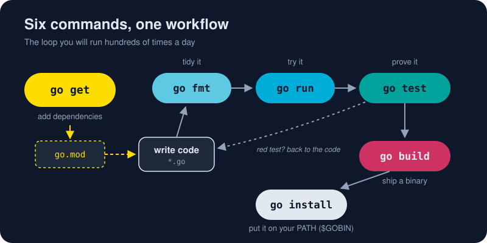

# Go CLI

One binary, `go`, replaces the build tool, formatter, test runner, package manager and installer that other languages make you choose and configure. These six lessons cover the commands you'll type every day. They all use one small practice project, [`cli-lab`](/assets/code/ch01/cli-lab/main.go), so each command has something real to work on. Read them in order: by the end you'll have formatted, run, tested, built and installed a Go program, and added a dependency to a project.

# The big six

* [go run](/01-getting-started/go-cli/go-run.md) - Compile and launch your program in one breath, the fastest feedback loop in Go and the command you will type more than any other.
* [go build](/01-getting-started/go-cli/go-build.md) - Turn your source into one self-contained binary you can copy to any machine and run, with no runtime, no installer and no dependencies.
* [go install](/01-getting-started/go-cli/go-install.md) - Compile a program and drop it into your personal bin folder, so the command works from any terminal, whether it's your own tool or someone else's.
* [go fmt](/01-getting-started/go-cli/go-fmt.md) - One command, one style, zero arguments, so all Go code everywhere looks like it was written by the same careful person.
* [go test](/01-getting-started/go-cli/go-test.md) - Go's built-in test runner finds, compiles and runs your tests, examples and coverage with no framework to install and nothing to configure.
* [go get](/01-getting-started/go-cli/go-get.md) - Add, upgrade, downgrade and remove your project's dependencies with one command, recorded in go.mod and locked by checksums in go.sum.

# Then

* [A Tour of the Toolchain](/01-getting-started/toolchain-tour.md) - Meet the `go` command, the Swiss Army knife that builds, tests, formats, vets, documents and cross-compiles your code with no plugins required.
