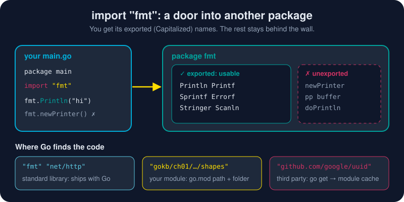

# Import Statements

*Nobody writes `Println` from scratch. One line, `import "fmt"`, and decades of other people's careful work are yours to use.*



> **In 30 seconds:** An `import` statement gives your file access to the code
> in **another package**. After `import "fmt"`, you call its functions with
> the package name as a prefix: `fmt.Println("hi")`. You get everything the
> package **exports**, meaning every name that starts with a **Capital letter**.
> Lowercase names stay private. The quoted string is an **import path**,
> which Go finds in the standard library, in your own module, or in a downloaded
> dependency. Go refuses to compile an import you don't use.

## Your first import: `"fmt"`

```go
package main

import "fmt" // give this file access to package fmt

func main() {
	fmt.Println("Hello, imports!") // package name + . + exported name
}
```

Three things happen in that one line:

1. **Go finds the package.** `"fmt"` is in the standard library, which ships with Go itself.
2. **Its name joins your file's scope.** The identifier `fmt` now refers to that package.
3. **Its exported names become available**: `fmt.Println`, `fmt.Sprintf`, `fmt.Errorf`, `fmt.Stringer`, and the rest of its exported API.[^pkg-fmt]

## What you get, and what you don't

An import gives you a package's **public surface**, not all its code. Go's
only visibility rule is the first letter of a name:[^spec-exported]

| Name in package fmt | Starts with | From your code |
|---|---|---|
| `Println`, `Sprintf`, `Errorf` | Capital | ✅ `fmt.Println(...)` works |
| `newPrinter`, `pp`, `doPrintln` | lowercase | ❌ invisible, as if it didn't exist |

Try to reach a lowercase name and the compiler acts as if it isn't there:

```text
private\main.go:9:31: undefined: lib.secret
```

This is how package authors keep their freedom: they can rewrite everything
lowercase without breaking you.

## The grouped form (what real files look like)

One `import` per package works, but every real Go file uses a single
parenthesized block:

```go
import (
	// Standard library: short paths, no domain name.
	"fmt"
	"math"
	str "strconv" // alias: refer to strconv as str in this file
	"strings"

	// Your own module: module path + folder.
	"gokb/ch01/pkgmain/shapes"

	// Blank import: run the package's init(), use nothing from it.
	_ "gokb/ch01/imports/plugin"
)
```

`gofmt` sorts each group alphabetically by **path**. That's why aliased
`strconv` sits *before* `strings`. By convention there are separate groups for
standard library, your module and third-party packages. The editor's
organize-imports feature maintains them for you.

## The four import forms

| Form | Example | You write | Use it for |
|---|---|---|---|
| **Normal** | `import "strings"` | `strings.ToUpper(s)` | 99% of imports |
| **Alias** | `import str "strconv"` | `str.Itoa(42)` | name clashes (`crand "crypto/rand"` vs `math/rand`), or long names |
| **Blank** `_` | `import _ "image/png"` | nothing | running a package's `init()` for its side effect, e.g. registering a PNG decoder or a database driver |
| **Dot** `.` | `import . "math"` | `Sqrt(2)` | almost never. It hides where names come from (sometimes seen in tests) |

The name you write before the dot is the **package name** declared inside
the package. That's almost always the last element of the path:
`"net/http"` → `http.Get`, `"math/rand"` → `rand.Intn`.[^spec-imports]

## Where Go looks for an import path

| The path looks like… | Go finds it in… | Example |
|---|---|---|
| no dot in the first element | the **standard library** (installed with Go) | `"fmt"`, `"net/http"`, `"encoding/json"` |
| starts with **your module path** from `go.mod` | **your own module**, path = module + folder | `"gokb/ch01/pkgmain/shapes"` |
| a domain name | a **dependency** listed in `go.mod`, downloaded to the module cache by [`go get`](/01-getting-started/go-cli/go-get.md) | `"github.com/google/uuid"` |

The standard library alone has more than 150 packages, covering HTTP servers,
JSON, crypto, compression, testing and templates.[^std]

## Finding package documentation

Before you import a package, you'll want to know what's inside. There are three
places to look:

| Where | Address | Best for |
|---|---|---|
| 📚 **Standard library index** | **[golang.org/pkg](https://golang.org/pkg/)**, which now redirects to **[pkg.go.dev/std](https://pkg.go.dev/std)** | browsing every built-in package: `fmt`, `strings`, `net/http`… |
| 🔎 **Any package, any author** | **[pkg.go.dev](https://pkg.go.dev)** (search box at the top) | third-party packages like `github.com/google/uuid`, with versions, license and "Imported by" counts[^pkgsite-about] |
| 💻 **Your terminal, offline** | `go doc` | quick lookups without leaving the editor |

**On the web:** open [golang.org/pkg](https://golang.org/pkg/), click **fmt**, and
you'll land on [pkg.go.dev/fmt](https://pkg.go.dev/fmt). Every page has the
same layout: an **Overview** of what the package is for, an **Index** of every
exported function and type, runnable **Examples**, and a link to the
**source code**. That last one is worth using. Go's standard library is some of
the most readable Go anywhere.

> The address changed when the Go website moved from golang.org to go.dev,
> but old links like `golang.org/pkg/fmt` still redirect to the right page.

**In the terminal:**

```sh
go doc fmt              # what package fmt offers
go doc fmt.Println      # one function's docs
go doc -all strings     # every exported name in strings
go doc -src fmt.Println # show the source code itself
```

**In VS Code:** hover over `fmt.Println` to see its docs, or press **F12** to
jump to its source.

That documentation is written by package authors as plain comments above
exported names. Write a sentence above each exported name in your own packages
and you get the same pages for free.

## Try it

From [`assets/code`](/assets/code/):

```sh
go run ./ch01/imports
```

```text
plugin: registered itself via init()
  shapes: package variable initialized (registered square)
  shapes: init() runs
fmt:      Println comes from package fmt
strings:  SHOUT gogogo
math:     4 3.141592653589793
strconv:  42 is now a string
shapes:   16
```

The first line is the **blank import** at work: `plugin` printed from its
`init()` even though `main` never calls it. (Since Go 1.21, packages that
don't depend on each other initialize in import-path order, so `…/imports/plugin`
runs before `…/pkgmain/shapes`.)

**Experiment:** add `"os"` to the import block without using it, and run again.

## Watch out

- **Unused imports are compile errors**, not warnings:
  `"os" imported and not used`. Delete it, or use `_` if you only want its `init()`. Format-on-save in VS Code removes unused imports automatically.
- **Import cycles are forbidden.** If `a` imports `b`, `b` can't import `a`:
  `imports example.com/implab/a from b.go: import cycle not allowed`. Move the shared code into a third package.
- **You import a package, never a file or a single function.** There's no `from fmt import Println`.
- **Don't shadow a package name.** `fmt := "x"` inside a function hides the `fmt` package for the rest of that scope.
- **`main` packages can't be imported.** Shared code belongs in a [reusable package](/01-getting-started/go-packages/package-main.md).

## Key takeaways

- `import "fmt"` → use its exported names as `fmt.Name`.
- Capital letter = exported = usable. lowercase = private.
- The path tells Go where to look: standard library, your module, or a dependency.
- Four forms: normal, alias, blank `_` (side effects), dot (avoid).
- Look packages up at golang.org/pkg (now pkg.go.dev/std), pkg.go.dev for everything else, or `go doc` offline.
- Unused imports and import cycles don't compile, which keeps every file honest.

[^spec-imports]: The Go Programming Language Specification: Import declarations
[^spec-exported]: The Go Programming Language Specification: Exported identifiers
[^pkg-fmt]: Package fmt
[^std]: Standard library
[^pkgsite-about]: About pkg.go.dev

---
⬅️ [What package main Means](/01-getting-started/go-packages/package-main.md) · 🏠 [Index](/index.md) · ➡️ [Package vs Module vs Workspace](/01-getting-started/go-packages/package-module-workspace.md)
