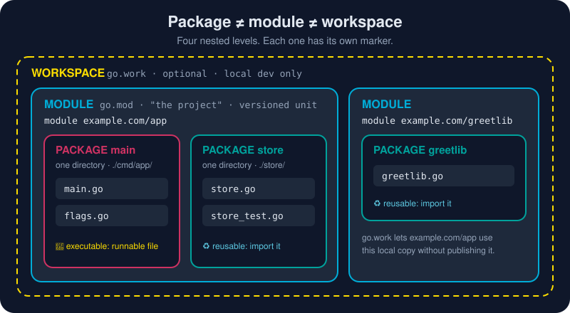

# Go Packages

What does `package main` actually mean? Is a package a project? Is a module a workspace? These four lessons answer all of that. First the special `main` package and how a program starts. Then how `import` gives you other packages' code. Then the four levels of Go code (file → package → module → workspace). Finally, you build a multi-package module yourself.

# Lessons

* [What package main Means](/01-getting-started/go-packages/package-main.md) - The two types of Go package, executable (package main, which builds a runnable file) and reusable (helper code you import), and how a Go program starts up.
* [Import Statements](/01-getting-started/go-packages/import-statements.md) - An import statement opens a door into another package, like "fmt", and gives your code its exported functions, types and constants, from the standard library, your own module, or the wider Go world.
* [Package vs Module vs Workspace](/01-getting-started/go-packages/package-module-workspace.md) - Is a package the same as a project? Is a module a workspace? No, and once you see the four nesting levels of Go code, every import path and go.mod makes sense.
* [Modules and Packages](/01-getting-started/go-packages/modules-and-packages.md) - Learn how Go organizes code (files into packages, packages into modules) and how a single capital letter decides what the world can see.

# Then

* [Go CLI](/01-getting-started/go-cli/) - The six commands you'll type every day: run, build, install, fmt, test and get.
