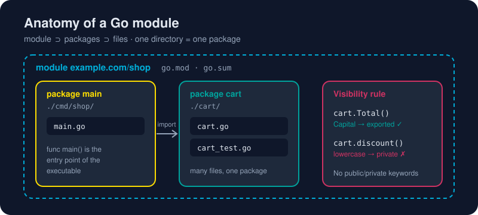

# Modules and Packages

*Big programs are just small packages that agreed on how to talk to each other.*



> **In 30 seconds:** A **package** is a directory of `.go` files that share a `package` name. A **module** is a tree of packages with a `go.mod` file at its root, giving it a name (the *module path*) and a list of dependencies. Names starting with a **Capital letter** are exported; lowercase names are private to the package. `go mod tidy` keeps your dependencies in sync with your imports.

## Three levels, one rule each

| Level | Defined by | Rule |
|---|---|---|
| **File** | `package xyz` on the first line | All files in a directory use the same package name |
| **Package** | A directory | The unit of compilation, import and visibility |
| **Module** | A `go.mod` file | The unit of versioning and distribution |

## Creating a module

```bash
mkdir shop && cd shop
go mod init example.com/shop
```

That writes `go.mod`:

```text
module example.com/shop

go 1.23
```

- **`module`** is the import path prefix for every package inside. Use your repository URL for code you'll publish (`github.com/you/shop`); anything works for local experiments.
- **`go`** is the minimum Go version the module needs.[^mod-ref]

## Building a multi-package program

```text
shop/
├── go.mod
├── cart/
│   └── cart.go        → package cart
└── cmd/shop/
    └── main.go        → package main
```

`cart/cart.go`:

```go
// Package cart models a shopping cart.
package cart

// Item is exported: other packages can use it.
type Item struct {
	Name  string
	Cents int
}

// Total is exported (capital T).
func Total(items []Item) int {
	sum := 0
	for _, it := range items {
		sum += it.Cents
	}
	return sum - discount(sum)
}

// discount is unexported (lowercase d): only code inside package cart can call it.
func discount(sum int) int {
	if sum > 10_000 {
		return sum / 10
	}
	return 0
}
```

`cmd/shop/main.go`:

```go
package main

import (
	"fmt"

	"example.com/shop/cart" // module path + directory
)

func main() {
	items := []cart.Item{
		{Name: "keyboard", Cents: 7_500},
		{Name: "mouse", Cents: 4_000},
	}
	fmt.Printf("total: $%.2f\n", float64(cart.Total(items))/100)
	// cart.discount(1) // compile error: cannot refer to unexported name
}
```

```bash
go run ./cmd/shop
# total: $103.50
```

> **The capital-letter rule** is Go's whole access-control system. There are no `public`, `private` or `protected` keywords. `cart.Total` is visible everywhere; `cart.discount` is not.[^effective-go]

## Adding a third-party dependency

```bash
go get github.com/google/uuid@latest
```

Import it and use it:

```go
import "github.com/google/uuid"

id := uuid.NewString()
```

Two files now track it:

| File | Purpose | Commit it? |
|---|---|---|
| `go.mod` | Your direct and indirect requirements, with minimum versions | ✅ Yes |
| `go.sum` | Cryptographic checksums so downloads can't be tampered with | ✅ Yes |

Downloaded code lives in the module cache (`$GOPATH/pkg/mod`), not in your project. Run `go mod vendor` if you ever need a local copy.

## The commands you'll use every week

```bash
go mod tidy            # add missing and remove unused requirements (run it often)
go get pkg@v1.4.2      # add or upgrade one dependency to a specific version
go get -u ./...        # upgrade all dependencies to their latest minor/patch versions
go list -m all         # show the full dependency graph
go mod why pkg         # explain why a dependency is needed
```

## Package design in one breath

- Name packages with **short, lowercase, single words**: `cart`, `http`, `json`. Avoid `utils` and `common`.
- Don't stutter. Write `cart.Total`, not `cart.CartTotal`.
- A package comment (`// Package cart ...`) goes above `package cart` in one file.
- Put code you don't want other modules to import under an **`internal/`** directory. Go enforces that.

## Try it

This book's examples are one module. Look at [`assets/code/go.mod`](/assets/code/go.mod):

```bash
cd assets/code
go list ./...       # every package in the module
go run ./ch01/hello
```

```text
gokb/ch01/hello
gokb/ch01/platform
...
Hello, World! Welcome to Go.
```

## Watch out

- **Import cycles are forbidden.** If `a` imports `b`, `b` cannot import `a`. Refactor shared code into a third package.
- The **directory name** and the **package name** should match (except `main`), or readers get confused.
- Don't hand-edit `go.sum`. Let `go mod tidy` manage it.
- Forgetting `go mod init` gives `go: cannot find main module`.

## Key takeaways

- Directory = package; `go.mod` = module.
- Capitalized identifiers are exported; lowercase ones are private.
- `go mod tidy` is your dependency janitor; commit both `go.mod` and `go.sum`.

[^create-module]: Tutorial: Create a Go module
[^mod-ref]: Go Modules Reference
[^effective-go]: Effective Go

For a guided walkthrough, see the official module tutorial.[^create-module]

---
⬅️ [Package vs Module vs Workspace](/01-getting-started/go-packages/package-module-workspace.md) · 🏠 [Index](/index.md) · ➡️ [go run](/01-getting-started/go-cli/go-run.md)
