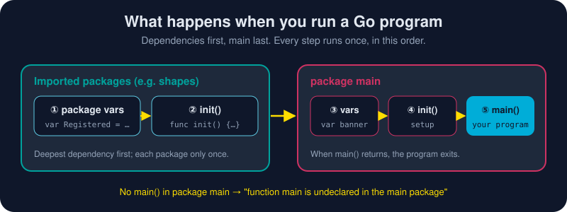

# What `package main` Means

*Every Go file starts by declaring which package it belongs to. One package name is special: it's the one that becomes a program.*



> **In 30 seconds:** Every `.go` file starts with `package <name>`. If the
> name is **`main`** and the package has a **`func main()`**, Go builds an
> **executable**, and `main()` is where it starts. Any other name makes a
> **reusable package** (a library): helper code that other packages import and that never runs on its own.
> Before `main()` runs, Go initializes every imported package (its variables,
> then its `init()` functions), deepest dependency first.

## Types of packages: Executable vs Reusable

Go has exactly two types of package, and the name on line one decides which
you're writing:

- 🚀 **Executable package** (`package main`): *generates a runnable file*. You
  run it with `go run`, or `go build` it into a binary (`app`, `app.exe`)
  that you can ship. It's the front door of your program.
- ♻️ **Reusable package** (any other name: `package shapes`, `package store`):
  *helper code*. It never runs by itself. It exists to be **imported**,
  so it's the right place for logic you want to share, test and reuse across
  programs.

A healthy Go program keeps its **executable** package thin (read flags, wire
things up, call functions) and puts the real logic in **reusable**
packages. Then that logic can be tested on its own and reused by other
programs.

| | 🚀 Executable: `package main` | ♻️ Reusable: `package anything-else` |
|---|---|---|
| What it builds | a **runnable** program / executable file | a **library** of helper code |
| Needs `func main()` | ✅ yes, exactly one | ❌ no, and it wouldn't be called |
| `go run` / `go build` | runs / produces a binary | `go run`: error · `go build`: compiles, then discards |
| Can be imported? | ❌ no | ✅ yes, that's its whole purpose |
| Typical location | `./`, or `./cmd/<name>/` | `./store/`, `./internal/auth/` … |

`main` isn't a magic folder or a special file name. It's a **package name**
that tells the toolchain "link this into a program". The spec puts it
plainly: a program is a `main` package linked with everything it imports,
and running it means calling `main.main`.[^spec-exec]

## See it in code

The example [`pkgmain`](/assets/code/ch01/pkgmain/main.go) has one of each.

**The library**, `shapes/shapes.go`:

```go
package shapes // a library: no main, meant to be imported

var Registered = register("square") // ① initialized first

func init() { fmt.Println("  shapes: init() runs") } // ② then init

// Area is capitalized, so other packages can call it.
func Area(side float64) float64 { return side * side }
```

**The program**, `main.go`:

```go
package main // this directory builds an executable

import "gokb/ch01/pkgmain/shapes" // the import path = module path + folder

var banner = makeBanner()                  // ③
func init() { fmt.Println("  main: init() runs") } // ④

func main() { // ⑤ the program starts here
	fmt.Println(banner)
	fmt.Println("area of a 3x3 square:", shapes.Area(3))
}
```

## The startup sequence

When you run the program, Go works from the bottom of the import graph up:[^spec-init]

1. **Imported packages first.** Each one is initialized once, even if ten packages import it.
2. Within a package, **package-level variables** come first, in dependency order.
3. Then that package's **`init()` functions**, in the order the files are presented to the compiler. You can have several, even in one file.
4. Then the same for **package `main`**.
5. Finally **`main()`**. When it returns, the program exits, even if other goroutines are still running.

`init()` is for setup that can't be written as a simple declaration, like
registering a driver or checking an environment variable. Use it sparingly.
Hidden work at startup is hard to test and surprising to read.[^effective-go-init]

## Try it

From [`assets/code`](/assets/code/):

```sh
go run ./ch01/pkgmain
```

```text
  shapes: package variable initialized (registered square)
  shapes: init() runs
  main: package variable initialized
  main: init() runs
  main: main() starts. Your program begins here
=== area calculator ===
area of a 3x3 square: 9
```

Now try to *run the library* and watch Go refuse:

```sh
go run ./ch01/pkgmain/shapes
```

```text
package gokb/ch01/pkgmain/shapes is not a main package
```

`go build ./ch01/pkgmain/shapes` prints nothing at all. For a library,
that means it compiled fine.

## Watch out

- **One directory = one package.** Mixing names fails right away:
  `found packages main (main.go) and util (util.go) in …/mixed`.
  (The only exception is `_test.go` files, which may use `package util_test`.)
- **Forget `func main()`** and the linker complains:
  `function main is undeclared in the main package`.
- **You can't import a `main` package.** Move shared code into a library package, and have `main` import it.
- **Several programs in one module?** Give each its own folder: `cmd/server/main.go`, `cmd/cli/main.go`, each with `package main`.
- **The package name normally matches the folder name** (`shapes/` → `package shapes`). `main` is the one common exception.

## Key takeaways

- `package main` + `func main()` = an executable. Anything else = a library.
- Libraries hold the logic; `main` is the thin layer that wires them together.
- Startup order: dependencies → package vars → `init()` → `main()`.
- One directory, one package, one name.

[^spec-exec]: The Go Programming Language Specification: Program execution
[^spec-init]: The Go Programming Language Specification: Package initialization
[^effective-go-init]: Effective Go: The init function

---
⬅️ [Hello, World!](/01-getting-started/hello-world.md) · 🏠 [Index](/index.md) · ➡️ [Import Statements](/01-getting-started/go-packages/import-statements.md)
