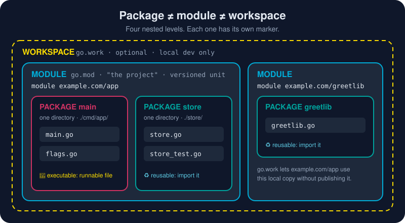

# Package vs Module vs Workspace

*"Package == project == workspace?" It's the most common mix-up in a newcomer's first week of Go. Let's settle it for good.*



> **In 30 seconds:** They're **not** the same. They nest like boxes inside boxes:
> a **package** is *one directory* of `.go` files, the unit you `import`. A
> **module** is a tree of packages with a `go.mod` at its root. It's what
> people usually mean by "a project", and it's the unit you version and
> publish. A **workspace** is an *optional* `go.work` file that lets you
> develop several modules side by side on your machine. Files → packages →
> modules → workspace.

## The four levels

| Level | Marker | What it is | Unit of… |
|---|---|---|---|
| **File** | `*.go` | source code, starting with `package <name>` | nothing on its own |
| **Package** | a **directory** | every `.go` file in one folder, sharing one package name | **import** and **visibility** (Capitalized = exported) |
| **Module** | **`go.mod`** | a tree of packages with one module path and one dependency list | **versioning**, **publishing**, dependency management |
| **Workspace** | **`go.work`** (optional) | a local list of modules to build together | **local multi-module development** |

One question finds the level you're at:

- *"Which folder is this file in?"* → its **package**.
- *"Which `go.mod` is above this folder?"* → its **module**.
- *"Is there a `go.work` above that?"* → a **workspace** is active (`go env GOWORK` tells you).

## Package: the unit you import

```text
store/
├── store.go        package store
├── cache.go        package store
└── store_test.go   package store
```

Three files, **one package**. Everything inside can see everything else, even
lowercase names. Code *outside* sees only the capitalized names. You import
the directory, not a file:

```go
import "example.com/app/store"   // module path + folder path
```

## Module: what you mean by "project"

```text
app/                          ← module root
├── go.mod                    module example.com/app
├── main.go                   package main          → import path example.com/app
├── store/store.go            package store         → example.com/app/store
└── internal/auth/auth.go     package auth          → example.com/app/internal/auth
```

**Import path = module path + directory.** That's the whole rule.[^code-org]
One module usually means one git repository, released with tags like
`v1.4.0`. When someone runs `go get example.com/app@v1.4.0`, they get the
*whole module*, but they still import individual *packages* from it.

## Workspace: several modules, on your machine

Say you're changing a library and the app that uses it **at the same time**,
before the library is published. Without a workspace, the app can't see your
local copy:

```text
workspace/
├── app/        go.mod: module example.com/app       (imports example.com/greetlib)
└── greetlib/   go.mod: module example.com/greetlib  (not published yet)
```

```sh
cd workspace/app && go run .
```

```text
main.go:6:2: no required module provides package example.com/greetlib; to add it:
	go get example.com/greetlib
```

One command ties them together:[^workspaces-tutorial]

```sh
cd workspace
go work init ./app ./greetlib
```

That creates `go.work`:

```text
go 1.26.3

use (
	./app
	./greetlib
)
```

And now:

```sh
cd app && go run .
```

```text
Hello from greetlib, workspace!
```

`go list -m` lists both modules, and `go env GOWORK` prints the path of the
active `go.work`. Neither `go.mod` was changed.

> **Keep `go.work` out of git** (this repo's `.gitignore` already does). It
> describes *your* machine's folder layout, not the project's. Each module's
> `go.mod` stays the source of truth.

## "But in my last language…"

The words overlap with other ecosystems, which is where the confusion comes from:

| You know… | Closest Go idea | Careful! |
|---|---|---|
| Java **package** (`com.acme.store`) | Go **package** | Go packages are *flat*. `store/cache` is a separate package, not a sub-package |
| Maven / Gradle **project** | Go **module** | dependencies live in `go.mod`, not XML or a build script |
| npm **package** (`package.json`) | Go **module** | an npm "package" is a Go *module*; a Go *package* is just one folder inside it |
| Python **module** (one `.py` file) | a Go **file** | Python's *package* (folder) ≈ Go package |
| .NET **solution** / Cargo **workspace** | Go **workspace** (`go.work`) | optional, and local-only in Go |
| Old Go **GOPATH workspace** | *(retired)* | before 2018 all code lived in `$GOPATH/src`. Modules replaced that |

That last row is why old tutorials say "workspace" to mean something else.
Before modules (Go 1.11+, the default since 1.16), your **GOPATH** *was* your
workspace and there was no `go.mod`. Today GOPATH mainly holds the download
cache and `go install`ed binaries. A *workspace* now means `go.work`.[^mod-ref]

## Try it

Use any scratch folder:

```sh
mkdir -p workspace/greetlib workspace/app
cd workspace/greetlib && go mod init example.com/greetlib
#   greetlib.go:  package greetlib
#                 func Hello(name string) string { return "Hello from greetlib, " + name + "!" }
cd ../app && go mod init example.com/app
#   main.go:      package main; import "example.com/greetlib"; call greetlib.Hello("workspace")
go run .                       # fails: no required module provides package
cd .. && go work init ./app ./greetlib
cd app && go run .             # Hello from greetlib, workspace!
```

## Watch out

- **A folder is a package, but a folder with its own `go.mod` is a separate module.** A nested `go.mod` cuts that subtree out of the parent module.
- **Package name ≠ import path.** You import `example.com/app/store` and then write `store.Get()`. The last part of the path *usually* matches the package name. Keep it that way.
- **Don't reach for workspaces too early.** One module with many packages is right for most projects. `go.work` is for coordinated local changes across modules.
- **`internal/` is enforced by the compiler.** Packages under `app/internal/` can only be imported by code inside `app/`.

## Key takeaways

- **Package** = one directory = the unit of import and visibility.
- **Module** = `go.mod` + its packages = "the project", the unit you version.
- **Workspace** = optional `go.work` = several local modules developed together.
- Import path = module path + directory. Remember that, and Go code organization makes sense.
- Next, build a multi-package module yourself in [Modules and Packages](/01-getting-started/go-packages/modules-and-packages.md).

[^code-org]: How to Write Go Code
[^mod-ref]: Go Modules Reference
[^workspaces-tutorial]: "Tutorial: Getting started with multi-module workspaces"

---
⬅️ [Import Statements](/01-getting-started/go-packages/import-statements.md) · 🏠 [Index](/index.md) · ➡️ [Modules and Packages](/01-getting-started/go-packages/modules-and-packages.md)
