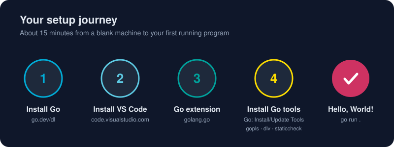

# Hello, World!

*Every journey of a thousand goroutines begins with a single `main`.*



> **In 30 seconds:** A Go program is a `package main` with a `func main()`. You import what you use (the compiler *refuses* to build if you import something you don't use) and run it with `go run .`. Ten lines of code, zero configuration, and you have a native program.

## Create a project from scratch

```bash
mkdir hello && cd hello
go mod init example.com/hello   # creates go.mod: "this folder is a module"
code .                          # open it in VS Code
```

Create `main.go`:

```go
package main // 1. This file belongs to the "main" package: it builds an executable.

import "fmt" // 2. Import the standard library's formatting package.

// 3. Execution starts here. main takes no arguments and returns nothing.
func main() {
	fmt.Println("Hello, World!") // 4. Exported names start with a capital letter.
}
```

Run it:

```bash
go run .
```

```text
Hello, World!
```

That's a compiled, native program. `go run` compiled it to a temporary binary and ran it in one step.[^getting-started]

## Dissecting the four lines

| Line | What it means | Why Go does it this way |
|---|---|---|
| `package main` | Every file starts by naming its package; `main` is special because it produces a binary | No ambiguity about what a file belongs to |
| `import "fmt"` | Brings in a package by its import path | Unused imports are **compile errors**, so files stay lean |
| `func main()` | The program's entry point | One obvious starting point |
| `fmt.Println` | Call the exported `Println` from package `fmt` | Capital letter = public. No `public` keyword needed |

Notice what's **missing**: no semicolons (the compiler inserts them), no class wrapper, no `static void`, and no build file beyond `go.mod`.

## Level up: read input from the command line

The book's version at [`assets/code/ch01/hello/main.go`](/assets/code/ch01/hello/main.go) greets whoever you name:

```go
package main

import (
	"fmt"
	"os"
	"strings"
)

func main() {
	// os.Args[0] is the program itself; everything after it is user input.
	name := "World"
	if len(os.Args) > 1 {
		name = strings.Join(os.Args[1:], " ")
	}
	fmt.Printf("Hello, %s! Welcome to Go.\n", name)
}
```

New ideas you just met:

- **Grouped imports** in parentheses. `gofmt` keeps them sorted.
- **`:=`** declares a variable *and* infers its type (`name` is a `string`).
- **`os.Args`** is a slice of strings; `os.Args[1:]` drops the program name.
- **`fmt.Printf`** formats with verbs like `%s` (string), `%d` (integer) and `%v` (any value).

## From `run` to `build`

```bash
go build -o hello .   # produces ./hello (hello.exe on Windows)
./hello Gopher
```

That file is self-contained. Copy it to another machine with the same OS and architecture and it just runs, with no Go installation required.

## Try it

From [`assets/code`](/assets/code/):

```bash
go run ./ch01/hello
go run ./ch01/hello Gopher
```

```text
Hello, World! Welcome to Go.
Hello, Gopher! Welcome to Go.
```

Then take the interactive [Tour of Go](https://go.dev/tour/) for a browser-based warm-up.[^go-tour]

## Watch out

- **`"fmt" imported and not used`** is a compile error, not a warning. Delete the import, or let VS Code's organize-imports do it on save.
- **`declared and not used`**: same rule for local variables. Use `_` to discard a value on purpose.
- The opening brace `{` **must** be on the same line as `func main()`. Automatic semicolon insertion breaks the code otherwise.
- Only `package main` with a `func main()` produces an executable. Any other package name is a library.

## Key takeaways

- `package main` + `func main()` = a program.
- `go run .` for quick feedback, `go build` for a shippable binary.
- Go's strictness about unused code is a feature: your codebase stays clean.

[^getting-started]: Tutorial: Get started with Go
[^go-tour]: A Tour of Go

---
⬅️ [Configuring VS Code for Go](/01-getting-started/environment-setup/configuring-vscode-go.md) · 🏠 [Index](/index.md) · ➡️ [What package main Means](/01-getting-started/go-packages/package-main.md)
