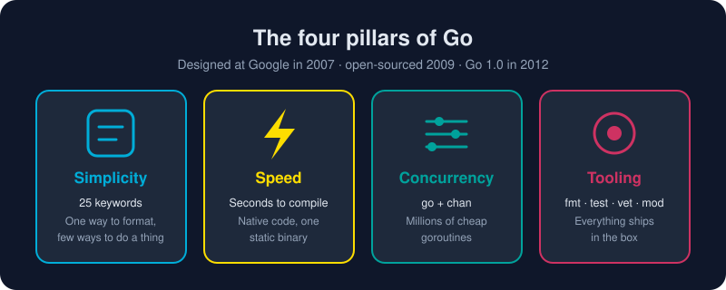

# Chapter 1 · Getting Started

Why Go exists, how to set up a professional environment, how Go organizes code into packages and modules, and the six `go` commands you'll use every day.

# Start here

* [Why Go?](/01-getting-started/why-go.md) - The origin story of a language built at Google to make large-scale software boring to build, and how it quietly came to run much of the cloud.

# Environment Setup

* [Environment Setup](/01-getting-started/environment-setup/) - Install Go, install VS Code, and configure the official Go extension, from a blank machine to a debugger-ready editor in about 15 minutes.
* [Installing Go](/01-getting-started/environment-setup/installing-go.md) - Go from zero to a working `go version` on Windows, macOS or Linux in about five minutes, then learn what GOROOT, GOPATH and PATH really mean.
* [Installing VS Code](/01-getting-started/environment-setup/installing-vscode.md) - Install Visual Studio Code on any OS, put the `code` command on your PATH, and learn the dozen shortcuts that make it feel like an extension of your hands.
* [Configuring VS Code for Go](/01-getting-started/environment-setup/configuring-vscode-go.md) - Turn VS Code into a Go powerhouse with the official extension, gopls, Delve and a battle-tested settings.json, so you get autocomplete, formatting on save, linting, debugging and one-click tests.

# First program

* [Hello, World!](/01-getting-started/hello-world.md) - Write, run and dissect your first Go program, and see why every line in it is there on purpose.

# Go Packages

* [Go Packages](/01-getting-started/go-packages/) - What package main means, the two types of package (executable and reusable), how imports work, and why package, module and workspace are not the same thing.
* [What package main Means](/01-getting-started/go-packages/package-main.md) - The two types of Go package, executable (package main, which builds a runnable file) and reusable (helper code you import), and how a Go program starts up.
* [Import Statements](/01-getting-started/go-packages/import-statements.md) - An import statement opens a door into another package, like "fmt", and gives your code its exported functions, types and constants, from the standard library, your own module, or the wider Go world.
* [Package vs Module vs Workspace](/01-getting-started/go-packages/package-module-workspace.md) - Is a package the same as a project? Is a module a workspace? No, and once you see the four nesting levels of Go code, every import path and go.mod makes sense.
* [Modules and Packages](/01-getting-started/go-packages/modules-and-packages.md) - Learn how Go organizes code (files into packages, packages into modules) and how a single capital letter decides what the world can see.

# Go CLI

* [Go CLI](/01-getting-started/go-cli/) - The six commands you'll type every day: run, build, install, fmt, test and get, practiced on one small project.
* [go run](/01-getting-started/go-cli/go-run.md) - Compile and launch your program in one breath, the fastest feedback loop in Go and the command you will type more than any other.
* [go build](/01-getting-started/go-cli/go-build.md) - Turn your source into one self-contained binary you can copy to any machine and run, with no runtime, no installer and no dependencies.
* [go install](/01-getting-started/go-cli/go-install.md) - Compile a program and drop it into your personal bin folder, so the command works from any terminal, whether it's your own tool or someone else's.
* [go fmt](/01-getting-started/go-cli/go-fmt.md) - One command, one style, zero arguments, so all Go code everywhere looks like it was written by the same careful person.
* [go test](/01-getting-started/go-cli/go-test.md) - Go's built-in test runner finds, compiles and runs your tests, examples and coverage with no framework to install and nothing to configure.
* [go get](/01-getting-started/go-cli/go-get.md) - Add, upgrade, downgrade and remove your project's dependencies with one command, recorded in go.mod and locked by checksums in go.sum.
* [A Tour of the Toolchain](/01-getting-started/toolchain-tour.md) - Meet the `go` command, the Swiss Army knife that builds, tests, formats, vets, documents and cross-compiles your code with no plugins required.
