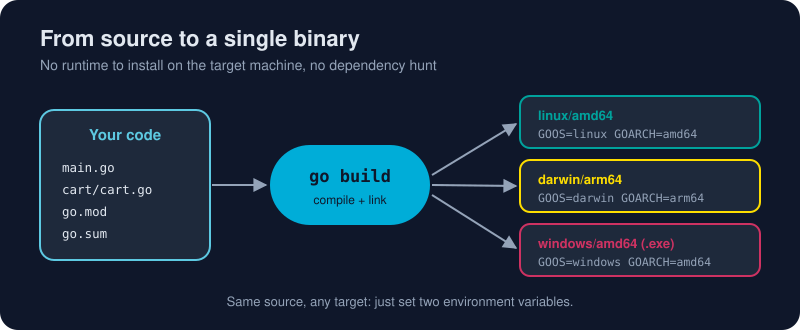

# A Tour of the Toolchain

*You have met the big six in the [Go CLI](/01-getting-started/go-cli/) topic. Here is the rest of the toolbox: vet, doc, env, list, and building for every platform.*



> **In 30 seconds:** The `go` command builds (`build`, `run`, `install`), tests (`test`), cleans up (`fmt`, `vet`, `mod tidy`) and documents (`doc`). It needs no config files. Set `GOOS` and `GOARCH` and the same source compiles for Linux, macOS, Windows, ARM boards and more.

## The everyday dozen

| Command | What it does | When you'll use it |
|---|---|---|
| `go run .` | Compile and run in one step | Constantly, while developing |
| `go build` | Compile to a binary | Shipping |
| `go install pkg@latest` | Build and drop a binary in `$GOPATH/bin` | Installing CLI tools |
| `go test ./...` | Run every test in the module | Before every commit |
| `go fmt ./...` | Rewrite code in standard format | Usually automatic on save |
| `go vet ./...` | Catch suspicious code (bad `Printf` verbs, copied locks…) | CI and pre-commit |
| `go mod tidy` | Sync `go.mod` with your imports | After adding or removing imports |
| `go get pkg@v1.2.3` | Add or upgrade a dependency | Managing deps |
| `go doc fmt.Printf` | Show docs in the terminal | Quick lookups |
| `go env` | Print the toolchain settings | Debugging setup |
| `go list ./...` | List packages | Scripts and CI |
| `go clean -cache` | Clear the build cache | Rarely, when things get weird |

The `./...` pattern means "this directory and everything below it".[^cmd-go]

## `gofmt`: the end of style wars

```go
// Before: what you typed
func add(a int,b int)int{return a+b}

// After `go fmt`: what everyone's Go looks like
func add(a int, b int) int { return a + b }
```

Tabs for indentation, aligned comments, sorted imports, one style. Nobody argues about it because nobody can change it, and that frees code reviews to talk about logic.[^gofmt-blog]

## `go vet`: a second pair of eyes

```go
name := "gopher"
fmt.Printf("hello %d\n", name) // vet: Printf format %d has arg name of wrong type string
```

`vet` runs automatically as part of `go test`. Run it on its own in CI too.

## `go doc`: docs without a browser

```bash
go doc strings.Fields
go doc -all net/http | less
```

The same comments render on **pkg.go.dev** for published modules. Write a sentence above every exported name and you get documentation for free.

## Cross-compiling: the party trick

```bash
# From any OS, build for Linux on ARM (Raspberry Pi, AWS Graviton):
GOOS=linux GOARCH=arm64 go build -o app-linux-arm64 .

# For Windows:
GOOS=windows GOARCH=amd64 go build -o app.exe .

# For Apple Silicon:
GOOS=darwin GOARCH=arm64 go build -o app-mac .
```

In PowerShell, set the variables first:

```powershell
$env:GOOS="linux"; $env:GOARCH="arm64"; go build -o app-linux-arm64 .
Remove-Item Env:GOOS, Env:GOARCH   # reset afterwards
```

See every supported target with `go tool dist list`. There are more than 40 combinations.

## Useful build flags

```bash
go build -o bin/app .                     # choose the output name
go build -ldflags="-s -w" .               # strip debug info → smaller binary
go build -ldflags="-X main.version=1.2.0" # inject a version string at build time
go build -race .                          # build with the race detector (Chapter 4!)
go build -gcflags=-m .                    # show inlining and escape-analysis decisions
```

## Try it

From [`assets/code`](/assets/code/):

```bash
go run ./ch01/platform
```

```text
Go version: go1.26.3
OS/Arch:    windows/amd64
CPUs:       24
```

Now cross-compile it for Linux and check the file you got (on macOS/Linux, or Git Bash on Windows):

```bash
GOOS=linux GOARCH=arm64 go build -o platform-linux ./ch01/platform
file platform-linux   # ELF 64-bit LSB executable, ARM aarch64 ...
```

You just built a Linux ARM program on your laptop.

## Watch out

- `go run` is for development. Ship the output of `go build`.
- Cross-compiling is trivial **unless** you use cgo (C code). Then you need a C cross-compiler, or set `CGO_ENABLED=0`.
- Remember to unset `GOOS`/`GOARCH` in long-lived shells, or later builds will surprise you.

## Key takeaways

- One `go` command covers build, test, format, vet, docs and dependencies.
- `gofmt` and `go vet` keep every Go codebase consistent and safer.
- `GOOS` + `GOARCH` = instant cross-platform binaries.

[^cmd-go]: Command go
[^gofmt-blog]: go fmt your code

---
⬅️ [go get](/01-getting-started/go-cli/go-get.md) · 🏠 [Index](/index.md) · ➡️ [Variables and Types](/02-language-basics/variables-and-types.md)
