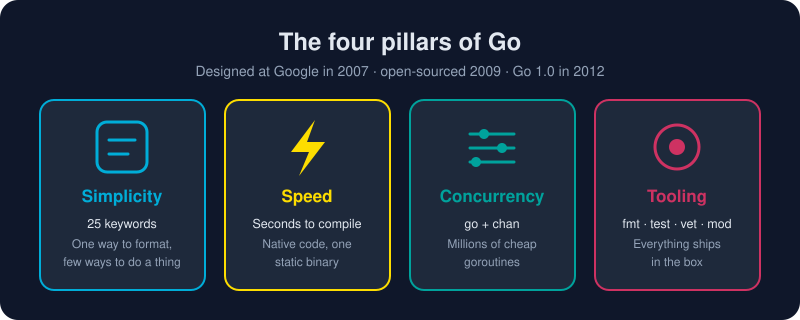

# Why Go?

*"Clear is better than clever." — a Go proverb, and a fair summary of the whole language.*

> **In 30 seconds:** Go was designed at Google in 2007 by Robert Griesemer, Rob Pike and Ken Thompson. They were tired of slow builds, tangled dependencies and languages that took years to master. The result is a small, fast, garbage-collected language with concurrency built in and a toolchain that does the chores for you. It powers Docker, Kubernetes, Terraform and a long list of cloud services.

## The 45-minute build that started it all

Picture a Google engineer in 2007. They change one line of C++ and start a build. They get coffee, come back, and the build is *still running*. Multiply that by thousands of engineers and you have a productivity crisis.

According to the Go team, the language was born "out of frustration with existing languages and environments" for systems programming.[^go-faq] Programmers had to pick two of three: efficient compilation, efficient execution, or ease of programming. Go set out to give them all three.

## The design bet: less is more

Most languages grow by adding features. Go grew by **refusing** them.

| Go deliberately left out… | …and gave you this instead |
|---|---|
| Class hierarchies and inheritance | Small interfaces and composition |
| Exceptions | Errors as ordinary values |
| A dozen ways to format code | `gofmt`: one format for everyone |
| Header files and slow includes | Packages that compile in seconds |
| Threads you manage by hand | Goroutines and channels |

With only **25 keywords**, you can hold the whole language in your head. When you read someone else's Go, it looks like your Go. That is a quiet superpower on a team of 5 or 5,000. Rob Pike put it this way: Go is "language design in the service of software engineering".[^go-at-google]

## What makes it magnetic

- **Fast feedback.** Large programs compile in seconds, so `go run` feels like a scripting language.
- **One file to ship.** `go build` produces a single static binary. Copy it to a server and run it. There is no runtime to install.
- **Concurrency for everyone.** Start a goroutine with one keyword: `go doWork()`. You can run hundreds of thousands of them at once.
- **Batteries included.** Testing, benchmarking, formatting, vetting, profiling, docs and dependency management all ship with the `go` command.
- **A rock-solid promise.** The Go 1 compatibility guarantee means code written in 2012 still compiles today.

## Who uses it?

Go is the language of the cloud. Docker, Kubernetes, Prometheus, Terraform, etcd, Caddy and Hugo are all written in Go. Companies including Google, Uber, Cloudflare, PayPal, Twitch and American Express run critical systems on it.[^go-solutions]

It shines for:

- **Web services and APIs**: the standard library includes a production-grade HTTP server.
- **Cloud and DevOps tooling**: CLIs that ship as one binary for every OS.
- **Networking and distributed systems**: proxies, load balancers, databases.
- **Data pipelines**: concurrent fan-out/fan-in processing.

## Where Go is *not* the obvious pick

Being honest makes you a better engineer. Go is a weaker choice for GUI desktop apps, for hard real-time systems where a garbage collector's pauses (tiny as they are) matter, and for heavy numerical or ML work, where Python's ecosystem dominates.

## How this book works

Read it **in order** and it is a tutorial. Jump around and it is a reference. Every lesson has:

1. A diagram and a 30-second summary.
2. Code you can run from [`assets/code`](/assets/code/).
3. A **Watch out** list of traps and a **Key takeaways** recap.

## Watch out

- Do not expect Go to look like Java, C# or Python. Fighting its simplicity is the most common beginner mistake.
- "Go" is the name; "golang" is just the search-friendly nickname (and the old domain).

## Key takeaways

- Go trades features for **clarity, speed and maintainability**.
- Fast compiles, single binaries and built-in concurrency are its signature strengths.
- It is the backbone of modern cloud infrastructure.

[^go-faq]: Frequently Asked Questions (FAQ) - The Go Programming Language
[^go-at-google]: Go at Google: Language Design in the Service of Software Engineering
[^go-solutions]: Why Go - Case Studies

---
⬅️ [Cover](/README.md) · 🏠 [Index](/index.md) · ➡️ [Installing Go](/01-getting-started/environment-setup/installing-go.md)
