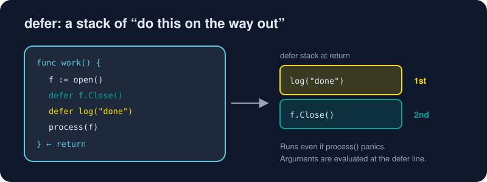

# Functions

*Functions in Go are plain, honest and surprisingly powerful. They're values you can pass, return and close over.*



> **In 30 seconds:** Functions can return **several values**; the convention is `(result, error)`. A trailing `...T` parameter accepts any number of arguments. Functions are first-class values, and **closures** capture variables from their surroundings. **`defer`** schedules a call to run when the function returns, which is perfect for closing files and unlocking mutexes.

## The basics

```go
func add(a, b int) int { // consecutive params of the same type share it
	return a + b
}
```

Types come **after** names. That reads left to right: "add takes a and b, both ints, and returns an int."

## Multiple return values

```go
func divide(a, b float64) (float64, error) {
	if b == 0 {
		return 0, errors.New("division by zero")
	}
	return a / b, nil
}

q, err := divide(10, 4)
if err != nil {
	log.Fatal(err)
}
```

This `value, err` pair is the heartbeat of Go. There are no exceptions; errors are ordinary values you check. You'll go deep in [Errors as Values](/03-types-and-abstraction/errors.md).

### Named results

```go
func split(sum int) (x, y int) {
	x = sum * 4 / 9
	y = sum - x
	return // "naked" return: returns x, y
}
```

Named results are good for documentation. Keep naked returns to **short** functions.

## Variadic functions

```go
func sum(nums ...int) int { // nums is a []int
	total := 0
	for _, n := range nums {
		total += n
	}
	return total
}

sum()            // 0
sum(1, 2, 3)     // 6
xs := []int{4, 5, 6}
sum(xs...)       // spread a slice: 15
```

`fmt.Println(a ...any)` is variadic. That's how it takes any number of arguments.

## Functions are values

```go
func apply(xs []int, f func(int) int) []int {
	out := make([]int, 0, len(xs))
	for _, x := range xs {
		out = append(out, f(x))
	}
	return out
}

squares := apply([]int{1, 2, 3}, func(x int) int { return x * x }) // [1 4 9]
```

Give function types a name when they show up often:

```go
type Handler func(req string) string
```

## Closures: functions with memory

```go
func counter() func() int {
	count := 0 // captured: lives as long as the closure does
	return func() int {
		count++
		return count
	}
}

next := counter()
next() // 1
next() // 2
```

Each call to `counter()` creates a fresh, private `count`. It's a tiny object built out of a function.

## `defer`: cleanup you schedule up front

```go
func readConfig(path string) ([]byte, error) {
	f, err := os.Open(path)
	if err != nil {
		return nil, err
	}
	defer f.Close() // runs when readConfig returns, however it returns

	return io.ReadAll(f)
}
```

The rules, from the Go blog:[^defer-blog]

1. Deferred calls run in **LIFO** order (a stack).
2. Arguments are **evaluated immediately**, at the `defer` line.
3. Deferred functions run even during a **panic**, which is how `recover` works.

```go
for i := range 3 {
	defer fmt.Print(i, " ") // prints "2 1 0 " at function exit
}
```

Putting acquire and release side by side (`Open`/`defer Close`, `Lock`/`defer Unlock`) is one of Go's most readable idioms.[^effective-go-funcs]

## Try it

From [`assets/code`](/assets/code/):

```bash
go run ./ch02/functions
```

```text
10/4 = 2.5
error: division by zero
sum: 6 0
sum of slice: 15
1 2 3
[16 25 36]
body runs
deferred 2 (runs first)
deferred 1 (runs last)
```

## Watch out

- **`defer` in a loop** waits until the *function* exits, not the iteration. Opening 10,000 files in a loop with `defer f.Close()` keeps all of them open. Move the body into its own function.
- Go has **no default parameters and no overloading**. Use different names, a config struct, or functional options.
- Ignoring an error with `_` should be a conscious, rare choice.

## Key takeaways

- `(T, error)` returns are the Go way. Check `err` right away.
- Closures capture variables, not snapshots of their values.
- `defer` keeps cleanup next to setup, and it runs LIFO.

[^defer-blog]: Defer, Panic, and Recover - The Go Blog
[^effective-go-funcs]: Effective Go - Functions

---
⬅️ [Control Flow](/02-language-basics/control-flow.md) · 🏠 [Index](/index.md) · ➡️ [Pointers](/02-language-basics/pointers.md)
