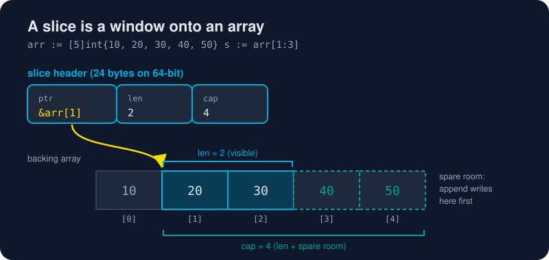

# Chapter 2 · Language Basics

The core vocabulary of Go: values, loops, functions, pointers, collections and text. After this chapter you can read most everyday Go code.

# Values and flow

* [Variables and Types](/02-language-basics/variables-and-types.md) - Declare variables three ways, meet Go's built-in types, and discover why "zero values" mean Go never hands you garbage memory.
* [Control Flow](/02-language-basics/control-flow.md) - One loop, a smarter if, and a switch that doesn't fall through. Go's control flow fits on an index card and still covers everything.
* [Functions](/02-language-basics/functions.md) - Multiple return values, variadic parameters, first-class functions, closures that remember, and `defer`, the cleanup button you press in advance.

# Memory and data

* [Pointers](/02-language-basics/pointers.md) - Pointers without the fear. Learn when Go copies, when it shares, and how escape analysis quietly decides between the stack and the heap.
* [Slices and Maps](/02-language-basics/slices-and-maps.md) - Go's two workhorse collections, explained from the inside out. See the three-word slice header that makes append fast and occasionally surprising.
* [Strings and Runes](/02-language-basics/strings-and-runes.md) - Why `len("世界")` is 6, what a rune really is, and how to slice, iterate and build text in Go without mangling a single emoji.
