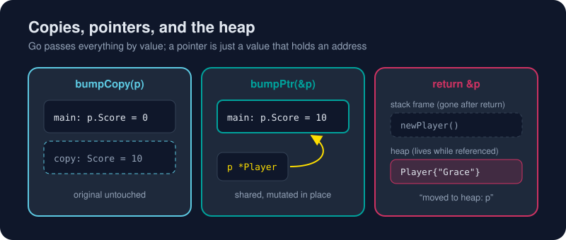

# Pointers

*A pointer is just an address written on a sticky note. Go makes sure the address is always valid.*



> **In 30 seconds:** `&x` takes the address of `x`; `*p` reads or writes the value at that address. Go **always passes by value**, so passing a struct copies it, and passing a pointer copies only the address so the callee can modify the original. There's **no pointer arithmetic** and memory is garbage collected. Returning a pointer to a local variable is perfectly safe, because the compiler moves it to the heap.

## The two operators

```go
x := 1
p := &x      // p has type *int and holds x's address
*p = 99      // write through the pointer
fmt.Println(x)  // 99
fmt.Println(p)  // 0xc000012345 (some address)
```

| Expression | Read it as | Type |
|---|---|---|
| `&x` | "address of x" | `*int` |
| `*p` | "the value p points to" | `int` |
| `*int` (in a type) | "pointer to int" | n/a |

## Copy or share?

```go
type Player struct {
	Name  string
	Score int
}

func bumpCopy(p Player) { p.Score += 10 } // works on a copy
func bumpPtr(p *Player) { p.Score += 10 } // works on the original

ada := Player{Name: "Ada"}
bumpCopy(ada)  // ada.Score is still 0
bumpPtr(&ada)  // ada.Score is now 10
```

Notice `p.Score` in `bumpPtr`. Go **auto-dereferences** field access, so you never write `(*p).Score`.

### When should I use a pointer?

| Use a pointer when… | Use a value when… |
|---|---|
| The function must **modify** the caller's data | The data is small and read-only |
| The struct is **large** (copying costs too much) | You want an independent copy |
| You need "no value" (`nil`) as a possibility | The type is a map, slice, channel or func (these already share their underlying data) |
| The type holds a `sync.Mutex` (it must never be copied) | Simple types like `int`, `time.Time` |

## Stack, heap and escape analysis

In C, returning `&local` is a disaster. In Go it's idiomatic:

```go
func newPlayer(name string) *Player {
	p := Player{Name: name}
	return &p // totally safe
}
```

The compiler runs **escape analysis**. If a value might outlive its function, it's placed on the **heap** and the garbage collector frees it later. Otherwise it stays on the fast, self-cleaning **stack**.[^faq-stack-heap] You can watch it decide:

```bash
go build -gcflags=-m ./ch02/pointers
```

```text
ch02/pointers/main.go:16:15: p does not escape
ch02/pointers/main.go:19:14: p does not escape
ch02/pointers/main.go:24:2: moved to heap: p
```

You don't control the stack or heap directly, and you rarely need to. Correctness first; reach for `-gcflags=-m` when profiling says allocations matter.

## `new` and `nil`

```go
n := new(int)       // allocates a zeroed int, returns *int
*n = 5

var none *Player    // zero value of any pointer is nil
if none == nil {
	fmt.Println("no player yet")
}
// none.Score       // runtime panic: nil pointer dereference
```

In practice `&Player{Name: "Ada"}` is more common than `new(Player)`.

## Try it

From [`assets/code`](/assets/code/):

```bash
go run ./ch02/pointers
```

```text
x = 99
after bumpCopy: 0
after bumpPtr:  10
{Name:Grace Score:7}
nil pointer? true
5
```

## Watch out

- **Nil pointer dereference** is the classic Go panic. Check for `nil` at API boundaries.
- Don't use a pointer to a slice or map "for performance". They're already small headers that share their data.
- A pointer into a slice element can go **stale** after `append` reallocates the backing array.
- There's no pointer arithmetic (outside the `unsafe` package, which you should leave alone).

## Key takeaways

- Everything is passed by value; a pointer is a value that holds an address.
- Use pointers to mutate, to avoid big copies, or to represent "absent".
- Escape analysis makes returning `&local` safe and automatic.

[^tour-pointers]: A Tour of Go - Pointers
[^faq-stack-heap]: Go FAQ - How do I know whether a variable is allocated on the heap or the stack?

Practice interactively in the Tour of Go.[^tour-pointers]

---
⬅️ [Functions](/02-language-basics/functions.md) · 🏠 [Index](/index.md) · ➡️ [Slices and Maps](/02-language-basics/slices-and-maps.md)
