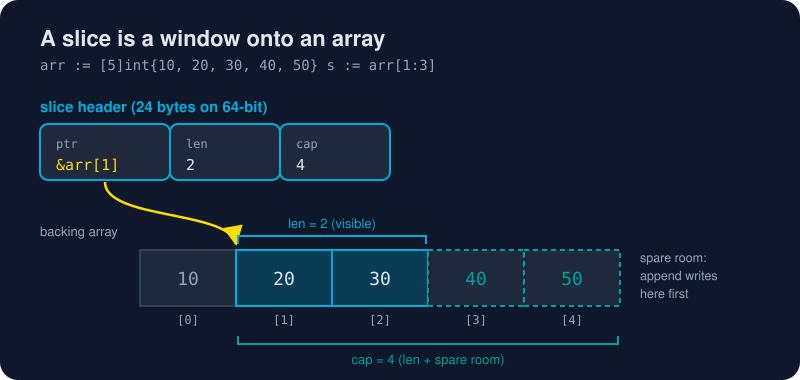

# Slices and Maps

*Master these two and you've mastered 80% of everyday Go data handling.*



> **In 30 seconds:** An **array** has a fixed size that's part of its type (`[5]int`). A **slice** (`[]int`) is a tiny header (**pointer, length, capacity**) that views part of an array. Slices share memory, `append` grows them (reallocating when capacity runs out), and you must always use the slice that `append` returns. A **map** (`map[K]V`) is a built-in hash table; looking up a missing key returns the zero value, and `v, ok := m[k]` tells you whether the key was there.

## Arrays: the foundation you rarely touch

```go
var a [3]int          // [0 0 0]. Size is part of the type
b := [...]int{1, 2, 3} // compiler counts: [3]int
c := b                 // arrays are values: c is a full copy
```

Arrays are copied on assignment and can't grow. That's why everyday code uses slices.

## Slices: a window onto an array

```go
arr := [5]int{10, 20, 30, 40, 50}
s := arr[1:3]          // elements [1, 3): [20 30]
len(s), cap(s)         // 2, 4 (room up to the end of arr)
```

The diagram above is the whole story. A slice value is just three words:

```text
┌─────────┬─────┬─────┐
│ ptr     │ len │ cap │   ← copied when you pass a slice to a function
└────┬────┴─────┴─────┘
     └──► backing array (shared!)
```

So **changing elements through a slice changes the array**, and every other slice that views it:

```go
s[0] = 99
fmt.Println(arr) // [10 99 30 40 50]
```

## Making slices

```go
var a []int                 // nil slice: len 0, ready for append
b := []int{1, 2, 3}         // literal
c := make([]int, 5)         // len 5, cap 5, all zeros
d := make([]int, 0, 100)    // len 0, cap 100: preallocated, nothing in it yet
```

## `append`: the most important built-in

```go
s = append(s, 77)          // ALWAYS assign the result back
s = append(s, 1, 2, 3)     // several at once
s = append(s, other...)    // a whole slice
```

- If `len < cap`, `append` writes into the spare room. **No allocation**, and the shared array changes.
- If `len == cap`, it allocates a bigger array, copies the elements and returns a header pointing to the **new** array.

Watch the capacity grow:

```text
len=1  cap=4
len=5  cap=8
len=9  cap=16
len=17 cap=32
```

The growth factor is roughly 2× for small slices and gentler for big ones. It's an implementation detail, so never rely on exact numbers. If you know the final size, preallocate with `make([]T, 0, n)`.[^slices-intro]

## The `slices` package (Go 1.21+)

```go
import "slices"

slices.Sort(xs)
slices.Contains(xs, 42)
slices.Index(xs, 42)
clone := slices.Clone(xs)        // independent copy
slices.Reverse(xs)
i, found := slices.BinarySearch(xs, 42)
```

The `slices` package does the work of many hand-written loops.[^pkg-slices]

## Maps: built-in hash tables

```go
ages := map[string]int{"ada": 36, "linus": 54}
ages["grace"] = 85            // insert or update
delete(ages, "linus")         // remove (no-op if missing)
n := len(ages)                // 2

age := ages["alan"]           // missing key → zero value (0)
age, ok := ages["alan"]       // the "comma ok" idiom: ok == false
if !ok {
	fmt.Println("no alan")
}
```

Keys must be **comparable**: strings, numbers, booleans, pointers, channels, and arrays or structs made only of comparable things. Slices, maps and funcs can't be keys.[^maps-blog]

### Iterating in a stable order

Map iteration order is **randomized on purpose**. For deterministic output, sort the keys:

```go
import ("maps"; "slices")

for _, k := range slices.Sorted(maps.Keys(ages)) {
	fmt.Println(k, ages[k])
}
```

### Sets, Go style

```go
seen := map[string]struct{}{}  // struct{} takes zero bytes
seen["go"] = struct{}{}
_, exists := seen["go"]
```

## Try it

From [`assets/code`](/assets/code/):

```bash
go run ./ch02/slices
```

```text
[20 30] 2 4
arr after s[0]=99: [10 99 30 40 50]
arr after append:   [10 99 30 77 50]
len=1  cap=4
len=5  cap=8
len=9  cap=16
len=17 cap=32
[3 1 2] [1 2 3] true
alan missing, zero value: 0
ada 36
grace 85
```

Notice the third line: `append` overwrote `arr[3]`, because `s` still had spare capacity. That's the aliasing trap in action. (Exact capacity numbers may differ between Go versions.)

## Watch out

- **Forgetting `s = append(s, x)`**: calling `append` without using its result loses the data.
- **Aliasing:** two slices of the same array can overwrite each other through `append`. Use `slices.Clone`, or the full slice expression `a[lo:hi:max]` to cap capacity.
- **Writing to a nil map panics** (`assignment to entry in nil map`). Create maps with `make` or a literal first. Reading a nil map is fine.
- **Maps aren't safe for concurrent writes.** Use a `sync.Mutex` or `sync.Map` ([Chapter 4](/04-concurrency/)).
- A small slice of a huge array keeps the **whole array** alive. Clone it if you only need a little.

## Key takeaways

- A slice is `{ptr, len, cap}` over a shared backing array.
- Always assign the result of `append`, and preallocate when you know the size.
- Maps return zero values for missing keys; use `v, ok :=` to tell "missing" from "zero".

[^slices-intro]: Go Slices: usage and internals - The Go Blog
[^maps-blog]: Go maps in action - The Go Blog
[^pkg-slices]: Package slices

---
⬅️ [Pointers](/02-language-basics/pointers.md) · 🏠 [Index](/index.md) · ➡️ [Strings and Runes](/02-language-basics/strings-and-runes.md)
