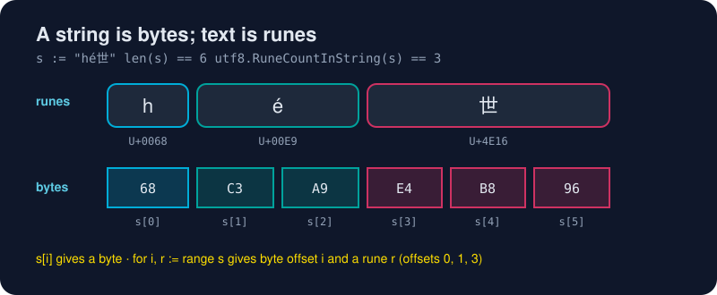

# Strings and Runes

*A Go string is a sequence of bytes that is usually UTF-8. Knowing that one sentence saves you hours.*



> **In 30 seconds:** A `string` is an **immutable sequence of bytes**, conventionally UTF-8. `len(s)` counts **bytes**, and `s[i]` gives a **byte**. A `rune` (an alias for `int32`) is one Unicode code point. `for i, r := range s` decodes UTF-8 for you, giving byte offsets and runes. Use `[]rune(s)` for character-level slicing, `strings.Builder` for building strings, and the `strings` package for everything else.

## Bytes vs runes

```go
s := "héllo, 世界"
len(s)                       // 14 bytes
utf8.RuneCountInString(s)    // 9 runes
s[1]                         // 195 (0xC3): the FIRST byte of 'é', not 'é' itself
```

Unicode characters take **1 to 4 bytes** in UTF-8:

| Character | Code point | UTF-8 bytes |
|---|---|---|
| `h` | U+0068 | `68` (1 byte) |
| `é` | U+00E9 | `C3 A9` (2 bytes) |
| `世` | U+4E16 | `E4 B8 96` (3 bytes) |
| `🚀` | U+1F680 | `F0 9F 9A 80` (4 bytes) |

## `range` decodes for you

```go
for i, r := range "é世" {
	fmt.Printf("offset %d: %c U+%04X\n", i, r, r)
}
// offset 0: é U+00E9
// offset 2: 世 U+4E16   ← jumped 2 bytes, because é is 2 bytes long
```

`i` is a **byte offset**, not a character count.[^strings-blog]

## Converting

```go
b := []byte("go")     // copy to a mutable byte slice
r := []rune("世界")    // decode to code points: [19990 30028]
string(r[1:])         // "界": safe character-level slicing
string(rune(65))      // "A"
strconv.Itoa(65)      // "65": number to text. NOT string(65)
```

## Strings are immutable

```go
s := "go"
// s[0] = 'G'   // compile error
s = "G" + s[1:] // build a new string instead
```

Because they're immutable, strings are cheap to pass around and safe to share between goroutines.

## Building strings efficiently

Repeated `+=` in a loop creates a new string every time. Use a `strings.Builder`:

```go
var b strings.Builder
for i := range 3 {
	fmt.Fprintf(&b, "[%d]", i)
}
b.String() // "[0][1][2]"
```

## The `strings` toolbox

```go
strings.Contains("gopher", "go")       // true
strings.HasPrefix(path, "/api/")
strings.Split("a,b,c", ",")            // [a b c]
strings.Fields("  a  b c ")            // [a b c]: splits on any whitespace
strings.Join([]string{"a", "b"}, "-")  // "a-b"
strings.ToUpper("go")                  // "GO"
strings.TrimSpace("  hi \n")           // "hi"
strings.ReplaceAll("a-b-c", "-", "+")  // "a+b+c"
strings.EqualFold("Go", "GO")          // true (case-insensitive)
before, after, found := strings.Cut("key=value", "=")
```

`strings` is one of the most-used packages in the standard library, so it's worth skimming its docs once.[^pkg-strings]

## Raw string literals

Backticks keep everything literally, including backslashes and newlines. They're perfect for regexes, JSON, SQL and Windows paths:

```go
path := `C:\Users\gopher\go`
query := `
SELECT id, name
FROM users
WHERE active = true`
```

## Try it

From [`assets/code`](/assets/code/):

```bash
go run ./ch02/strings
```

```text
bytes: 14
runes: 9
s[1] = 195 (0xc3)
offset 0: é U+00E9 (2 bytes)
offset 2: 世 U+4E16 (3 bytes)
世界
[0][1][2]
GO [a b c] =====
C:\path\no\escapes
```

## Watch out

- **`string(65)` is `"A"`, not `"65"`**. `go vet` warns about it. Use `strconv.Itoa`.
- Slicing with byte indices (`s[:3]`) can cut a multi-byte character in half. Slice `[]rune` when you mean characters.
- Some "characters" users see (like 👍🏽 or flag emoji) are several runes. For true grapheme handling, use a dedicated library.
- Comparing with `==` is byte-wise and case-sensitive. Use `strings.EqualFold` for case-insensitive checks.

## Key takeaways

- `len` counts bytes; `range` iterates runes.
- Strings are immutable UTF-8 bytes; convert to `[]rune` for character work.
- `strings.Builder` for building, the `strings` package for everything else.

[^strings-blog]: Strings, bytes, runes and characters in Go - The Go Blog
[^pkg-strings]: Package strings

---
⬅️ [Slices and Maps](/02-language-basics/slices-and-maps.md) · 🏠 [Index](/index.md) · ➡️ [Structs and Methods](/03-types-and-abstraction/structs-and-methods.md)
