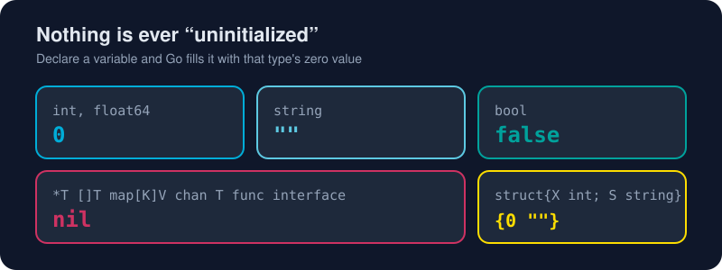

# Variables and Types

*In Go, a variable is never "undefined". It's always something, and usually something useful.*



> **In 30 seconds:** Use `x := value` inside functions and `var x T` when you want the zero value or a package-level variable. Go is **statically typed** with type inference, so you rarely write types but they're always there. There are **no implicit conversions**: an `int` won't silently become a `float64`. Constants are computed at compile time, and `iota` makes enums painless.

## Three ways to declare

```go
var count int          // explicit type, zero value (0)
var name = "gopher"    // type inferred from the value (string)
ratio := 0.75          // short declaration: inference + assignment (functions only)
```

| Form | Where | Use it when |
|---|---|---|
| `var x T` | anywhere | You want the zero value, or you're at package level |
| `var x = v` | anywhere | Package-level variables with an initial value |
| `x := v` | inside functions | Almost always. This is the idiomatic default |

Declare several at once:

```go
var (
	host    = "localhost"
	port    = 8080
	verbose bool
)
a, b := 1, 2
a, b = b, a // swap. No temp variable needed
```

## Zero values: Go's safety net

Every variable starts life with its type's **zero value**.[^spec-zero] There is no uninitialized memory and no `undefined`.

```go
var s string   // ""
var n int      // 0
var ok bool    // false
var p *int     // nil
var xs []int   // nil (but len(xs) == 0, and append works!)
```

Good Go types are designed so that **the zero value is ready to use**. `var mu sync.Mutex` is an unlocked mutex and `var b strings.Builder` is an empty builder. No constructor is needed.

## The built-in types

| Category | Types | Notes |
|---|---|---|
| Boolean | `bool` | `true` / `false` |
| Integers | `int`, `int8`…`int64`, `uint`, `uint8`…`uint64`, `uintptr` | `int` is 64-bit on 64-bit platforms; use it by default |
| Floats | `float32`, `float64` | Use `float64` by default |
| Complex | `complex64`, `complex128` | Yes, really |
| Text | `string`, `byte` (= `uint8`), `rune` (= `int32`) | See [Strings and Runes](/02-language-basics/strings-and-runes.md) |

Number literals can carry underscores for readability: `1_000_000`, `0xFF_FF`, `0b1010`.

## No implicit conversions

```go
n := 7
f := 2.5
// total := n * f        // compile error: mismatched types int and float64
total := float64(n) * f  // explicit: 17.5
back := int(total)       // truncates toward zero: 17
```

It feels strict for a week. Then you realise a whole class of silent precision bugs is gone.

## Constants and iota

Constants are evaluated at **compile time**. Untyped constants act like ideal numbers with arbitrary precision, and they adapt to the context where they're used:[^constants-blog]

```go
const Pi = 3.14159         // untyped: works as float32 or float64
const MaxUsers int = 1_000 // typed

var r float32 = 2
area := Pi * r * r         // Pi becomes float32 here. No conversion needed
```

`iota` counts up inside a `const` block, which makes it Go's enum helper:

```go
type Weekday int

const (
	Sunday Weekday = iota // 0
	Monday                // 1 (the expression repeats implicitly)
	Tuesday               // 2
)

const (
	_  = iota             // skip 0
	KB = 1 << (10 * iota) // 1 << 10 = 1024
	MB                    // 1 << 20
	GB                    // 1 << 30
)
```

## Named types

```go
type Celsius float64
type UserID string

var temp Celsius = 21.5
var id UserID = "u-42"
// temp = 30.0 + id // compile error: different types. The compiler guards your units
```

Named types let the compiler catch "you passed meters where feet were expected" bugs. You'll attach methods to them in [Chapter 3](/03-types-and-abstraction/structs-and-methods.md).

## Try it

From [`assets/code`](/assets/code/):

```bash
go run ./ch02/variables
```

```text
0 gopher 42.5
"" false <nil> true
3.5
12.56636
1 2
int float64 main.Weekday
```

The `%T` verb prints a value's type. It's a handy debugging trick.

## Watch out

- **Shadowing:** `x := 1` inside an `if` or `for` block creates a *new* `x` that hides the outer one. Linters such as `staticcheck` help spot it. Use `=` when you mean to assign.
- `:=` needs at least **one new** variable on its left side.
- `:=` doesn't work at package level. Use `var` there.
- Integer division truncates: `7 / 2 == 3`. Convert to float first if you want `3.5`.
- Integer overflow wraps silently at runtime (`int8(127) + 1 == -128`).

## Key takeaways

- `:=` inside functions, `var` for zero values and package level.
- Zero values make every variable safe to use, so design your types to exploit them.
- Conversions are always explicit; untyped constants are the friendly exception.

[^spec-vars]: The Go Programming Language Specification - Variable declarations
[^spec-zero]: The Go Programming Language Specification - The zero value
[^constants-blog]: Constants - The Go Blog

The formal rules live in the spec's section on variable declarations.[^spec-vars]

---
⬅️ [A Tour of the Toolchain](/01-getting-started/toolchain-tour.md) · 🏠 [Index](/index.md) · ➡️ [Control Flow](/02-language-basics/control-flow.md)
