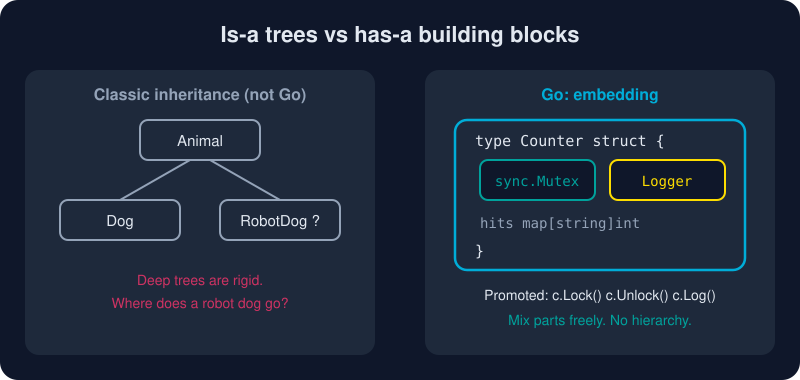

# Embedding and Composition

*Don't ask what a type **is**. Ask what it **has** and what it **does**.*



> **In 30 seconds:** Write a type inside a struct **without a field name** and it is *embedded*. Its fields and methods are **promoted**, so you can call them directly on the outer type. Interfaces can embed interfaces too. It feels like inheritance, but it is plain composition: the outer type *has* the inner one.

## Embedding a struct

```go
type Logger struct{ Prefix string }
func (l Logger) Log(msg string) { fmt.Println(l.Prefix + msg) }

type Counter struct {
    sync.Mutex          // embedded: no field name
    Logger              // embedded
    hits map[string]int // normal field
}

func (c *Counter) Hit(page string) {
    c.Lock()            // promoted from sync.Mutex
    defer c.Unlock()
    c.hits[page]++
    c.Log(page)         // promoted from Logger
}
```

The embedded value is still a real field, named after its type: `c.Logger.Prefix` and `c.Mutex` both work.[^go-spec-struct-types]

## It is *not* inheritance

| Inheritance (Java, C++) | Embedding (Go) |
|---|---|
| `Dog` **is an** `Animal` | `Counter` **has a** `Logger` |
| Can pass a `Dog` where `Animal` is expected | Can **not** pass a `Counter` where a `Logger` is expected |
| Virtual dispatch: base calls overridden child method | The inner type never knows about the outer one |

That last row trips up newcomers. When a promoted method runs, its receiver is the **inner** value. There is no "super" and no "virtual". Polymorphism in Go comes from [interfaces](/03-types-and-abstraction/interfaces.md), not embedding.[^effective-go-embedding]

## Shadowing: the outer type wins

Define a method with the same name on the outer type and it takes precedence. You can still reach the inner one explicitly:

```go
type LoudLogger struct{ Logger }

func (l LoudLogger) Log(msg string) {
    l.Logger.Log(msg + "!!!") // delegate to the embedded Logger
}
```

## Embedding interfaces

Interfaces compose the same way. That is how the standard library builds `io.ReadWriter`, `io.ReadCloser` and friends:

```go
type Speaker interface{ Speak() string }
type Walker  interface{ Walk() string }

type Robot interface {
    Speaker
    Walker
}
```

You can also embed an **interface inside a struct**, which is handy for decorators and test fakes. Implement only the methods you care about. Calling any other method panics, because the embedded interface is nil.

## Try it

```bash
cd assets/code
go run ./ch03/embedding
```

```text
[counter] /home -> 1
[counter] /home -> 2
[counter] /about -> 1
[loud] shadowed!!!
beep and roll
```

See [main.go](/assets/code/ch03/embedding/main.go).

## Watch out

* **Exported embedded fields leak API.** Embedding `sync.Mutex` in an *exported* struct lets callers call `Lock` on it. In public types, prefer a named, unexported field: `mu sync.Mutex`.
* **Name collisions** at the same depth are ambiguous. The compiler errors only when you *use* the ambiguous name.
* **Embedding a pointer** (`*Logger`) means the zero value has a nil inner pointer, so promoted calls can panic.

## Key takeaways

* Embedding = composition plus automatic method promotion.
* Outer types are **not** subtypes of embedded types. Use interfaces for polymorphism.
* Outer methods shadow promoted ones. Reach inner ones via `x.Inner.Method()`.
* Interfaces compose by embedding: build big ones from small ones.

[^effective-go-embedding]: Effective Go, Embedding
[^go-spec-struct-types]: The Go Programming Language Specification, Struct types

---
⬅️ [Interfaces](/03-types-and-abstraction/interfaces.md) · 🏠 [Index](/index.md) · ➡️ [Generics](/03-types-and-abstraction/generics.md)
