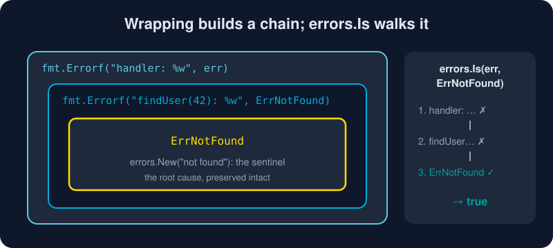

# Errors

*No exceptions, no hidden control flow. Just values you can see.*



> **In 30 seconds:** `error` is a one-method interface: `Error() string`. Functions return it as their last result, and callers check `if err != nil`. Add context with `fmt.Errorf("doing X: %w", err)`. Inspect the chain with `errors.Is` (*is it this value?*) and `errors.As` (*is it this type?*). Save `panic` for real bugs.

## Errors are values

```go
type error interface {
    Error() string
}
```

That's the whole thing. Because errors are ordinary values, you can store them, compare them, wrap them and program with them.[^errors-are-values]

```go
f, err := os.Open("config.json")
if err != nil {
    return fmt.Errorf("load config: %w", err)
}
defer f.Close()
```

Yes, you will type `if err != nil` a lot. The payoff: **every failure path is visible** right where it happens.

## Three ways to make an error

```go
// 1. Sentinel: a package-level value callers can compare against.
var ErrNotFound = errors.New("not found")

// 2. Formatted, wrapping a cause with %w.
return fmt.Errorf("findUser(%d): %w", id, ErrNotFound)

// 3. Custom type: carries structured data.
type ValidationError struct{ Field, Value string }
func (e *ValidationError) Error() string {
    return fmt.Sprintf("invalid %s: %q", e.Field, e.Value)
}
```

## Wrapping: context on the way up

Each layer adds *what it was doing*. `%w` keeps the original reachable, while `%v` would flatten it to text:

```text
handler: findUser(42): not found
└─ layer ─┘└── layer ───┘└ root ┘
```

## Reading the chain: `errors.Is` and `errors.As`

Since Go 1.13, never compare wrapped errors with `==`. Walk the chain instead:[^go113-errors]

```go
// Is: does any error in the chain equal this value?
if errors.Is(err, ErrNotFound) {
    http.Error(w, "no such user", http.StatusNotFound)
}

// As: is any error in the chain of this type? If so, give it to me.
var ve *ValidationError
if errors.As(err, &ve) {
    fmt.Println("bad field:", ve.Field)
}

// Works with the standard library too.
if errors.Is(err, fs.ErrNotExist) { /* create it */ }
```

| You want to know… | Use |
|---|---|
| "Is it *that specific* error?" | `errors.Is(err, ErrX)` |
| "Is it *that kind* of error, and what's inside?" | `errors.As(err, &target)` |
| "What's the message?" | `err.Error()` (only for logs and humans; never branch on it) |

## Many errors at once: `errors.Join`

```go
err := errors.Join(validateName(u), validateEmail(u), validateAge(u))
// nil if all are nil; otherwise one error whose message has one line per error.
// errors.Is / errors.As search every joined error.
```

## Panic and recover: the emergency brake

`panic` stops normal execution and unwinds the stack, running `defer`s. `recover`, called inside a deferred function, catches it.[^defer-panic-recover]

```go
func safeDivide(a, b int) (q int, err error) {
    defer func() {
        if r := recover(); r != nil {
            err = fmt.Errorf("recovered: %v", r)
        }
    }()
    return a / b, nil
}
```

Use `panic` for **programmer bugs and impossible states**, such as an index out of range or a nil map write. Use `recover` only at boundaries like an HTTP server or a worker loop, so one bad request cannot kill the process. **Expected failures are errors, not panics.**

## Try it

```bash
cd assets/code
go run ./ch03/errors
```

```text
handler: findUser(42): not found
is ErrNotFound? true
bad field: age
is fs.ErrNotExist? true
joined: not found
invalid email: "nope"
joined is ErrNotFound? true
recovered: runtime error: integer divide by zero
```

See [main.go](/assets/code/ch03/errors/main.go).

## Watch out

* **`%v` instead of `%w`** breaks the chain, so `errors.Is` stops working.
* **Comparing with `==`** fails once anything wraps the error.
* **Typed nil pointers** returned as `error` are non-nil. See [Interfaces](/03-types-and-abstraction/interfaces.md).
* **Log *or* return, not both.** Doing both produces duplicate logs at every layer.
* **Error strings:** lowercase, no trailing punctuation (`"open config: permission denied"`). They get concatenated.
* **Ignoring errors** with `_` must be a deliberate, commented decision.

## Key takeaways

* Errors are values. Handle them right where they happen.
* Wrap with `%w` and add *what you were doing*.
* `errors.Is` for values, `errors.As` for types, `errors.Join` for many.
* `panic` is for bugs. `recover` belongs only at boundaries.

[^errors-are-values]: Errors are values
[^go113-errors]: Working with Errors in Go 1.13
[^defer-panic-recover]: Defer, Panic, and Recover

---
⬅️ [Generics](/03-types-and-abstraction/generics.md) · 🏠 [Index](/index.md) · ➡️ [Iterators](/03-types-and-abstraction/iterators.md)
