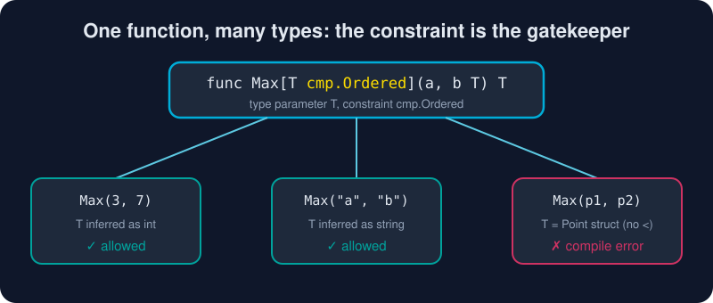

# Generics

*Write it once. Use it everywhere. Let the compiler check it.*



> **In 30 seconds:** Since Go 1.18, functions and types can take **type parameters** in square brackets: `func Max[T cmp.Ordered](a, b T) T`. The **constraint** (an interface) decides which types are allowed and which operators you may use. The compiler usually **infers** `T` for you. Reach for generics when you would otherwise copy-paste code that differs only by type.

## Your first generic function

```go
func Map[T, U any](in []T, f func(T) U) []U {
    out := make([]U, 0, len(in))
    for _, v := range in {
        out = append(out, f(v))
    }
    return out
}

lengths := Map([]string{"go", "gopher"}, func(s string) int { return len(s) })
// [2 6]: T=string and U=int were inferred
```

## Constraints: what can `T` do?

A constraint is an interface. With generics, interfaces can also list **type sets**:[^intro-generics]

| Constraint | Allows | Lets you use |
|---|---|---|
| `any` | every type | assignment, passing around |
| `comparable` | types that support `==` | `==`, `!=`, map keys |
| `cmp.Ordered` | ints, uints, floats, strings | `<`, `<=`, `>`, `>=` |
| `interface{ ~int \| ~float64 }` | listed types *and* types built on them | the operators they all share (`+`, `<`, …) |
| `fmt.Stringer` | types with `String() string` | calling `.String()` |

```go
func Max[T cmp.Ordered](a, b T) T {
    if a > b { // allowed: every type in cmp.Ordered supports >
        return a
    }
    return b
}
```

### The tilde `~`

`~float64` means "float64 **or any type whose underlying type is float64**". Without it, your own named types would be shut out:

```go
type Number interface{ ~int | ~int64 | ~float64 }

func Sum[T Number](xs []T) T {
    var total T // zero value of T
    for _, x := range xs {
        total += x
    }
    return total
}

type Celsius float64
Sum([]Celsius{21.5, 19, 23.5}) // ✓ 64, thanks to ~
```

## Generic types

```go
type Set[T comparable] struct{ m map[T]struct{} }

func NewSet[T comparable](items ...T) *Set[T] { /* ... */ }
func (s *Set[T]) Add(v T)      { s.m[v] = struct{}{} }
func (s *Set[T]) Has(v T) bool { _, ok := s.m[v]; return ok }

langs := NewSet("go", "rust", "go") // Set[string], size 2
```

> Methods cannot declare **their own** type parameters. Only the type can. Write a top-level function instead.

## The standard library already did the work

Before writing your own, check `slices`, `maps` and `cmp`:

```go
slices.Sort(xs)
slices.Contains(xs, 42)
slices.Index(names, "ada")
slices.MaxFunc(people, func(a, b Person) int { return cmp.Compare(a.Age, b.Age) })
maps.Clone(m)
```

## When *not* to use generics

The Go team's own guidance:[^when-generics]

* ✅ Use them for **containers** (sets, trees, caches) and **functions over slices, maps and channels** of any element type.
* ✅ Use them when every type would run **the exact same code**.
* ❌ Don't use them when you only call methods. A plain **interface** parameter is simpler: `func Print(s fmt.Stringer)`.
* ❌ Don't use them when each type needs **different code**. That's an interface or a type switch.
* ❌ Don't start generic. *Write the concrete version first.* Generalize when the second copy shows up.

## Try it

```bash
cd assets/code
go run ./ch03/generics
```

```text
lengths: [2 6 8]
max int: 7 | max string: banana
sum of temps: 64
set size: 3 | has go? true | has c? false
[#1 #2]
```

See [main.go](/assets/code/ch03/generics/main.go). For a guided walkthrough, try the official tutorial.[^generics-tutorial]

## Watch out

* **Forgetting `~`** rejects named types like `type UserID int`.
* **Using `any` and then needing `==`** gives a compile error. Use `comparable`.
* **Over-abstracting:** `func Do[T any, U any, V any]...` is a smell. Readability beats cleverness.
* **No type parameters on methods.** Use a generic function.

## Key takeaways

* `[T Constraint]` declares a type parameter. The constraint is an interface.
* `comparable`, `cmp.Ordered` and `~` cover most needs.
* Type inference means callers rarely write `[int]`.
* Write concrete code first. Generalize when duplication is real.

[^intro-generics]: An Introduction To Generics
[^when-generics]: When To Use Generics
[^generics-tutorial]: Tutorial: Getting started with generics

---
⬅️ [Embedding and Composition](/03-types-and-abstraction/embedding-and-composition.md) · 🏠 [Index](/index.md) · ➡️ [Errors](/03-types-and-abstraction/errors.md)
