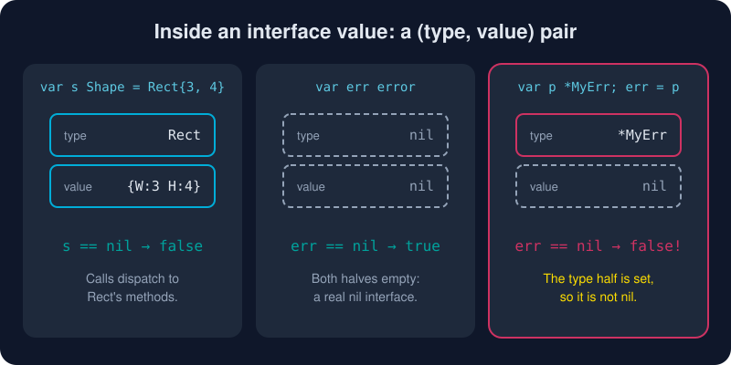

# Interfaces

*"The bigger the interface, the weaker the abstraction." (Rob Pike, Go Proverbs)*



> **In 30 seconds:** An interface is a set of method signatures. Any type with those methods satisfies it **automatically**, with no declaration needed. At runtime an interface value is a **(type, value) pair**. It equals `nil` only when *both* halves are empty. Keep interfaces small, and define them where they are *used*.

## Satisfied implicitly

```go
type Shape interface {
    Area() float64
    Perimeter() float64
}

type Rect struct{ W, H float64 }

func (r Rect) Area() float64      { return r.W * r.H }
func (r Rect) Perimeter() float64 { return 2 * (r.W + r.H) }

var s Shape = Rect{3, 4} // ✓ Rect has both methods, so that's all it takes
```

Nobody wrote `Rect implements Shape`. This is **structural typing**. It means a package you have never heard of can satisfy *your* interface, and you can define an interface for a type you do not own.

Want a compile-time guarantee anyway? Use this idiom:

```go
var _ Shape = Rect{} // fails to compile if Rect stops satisfying Shape
```

## Small is beautiful: `io.Reader` and `io.Writer`

The most important interfaces in the standard library have **one method each**:

```go
type Reader interface { Read(p []byte) (n int, err error) }
type Writer interface { Write(p []byte) (n int, err error) }
```

Files, network connections, HTTP bodies, gzip streams, hashes and `strings.Reader` all speak these. So `io.Copy(dst, src)` connects *any* source to *any* sink:

```go
type upper struct{ w io.Writer }

func (u upper) Write(p []byte) (int, error) {
    return u.w.Write([]byte(strings.ToUpper(string(p))))
}

io.Copy(upper{os.Stdout}, strings.NewReader("hello\n")) // prints HELLO
```

> **Rule of thumb:** *Accept interfaces, return concrete types.* Define the interface in the **consumer's** package, with only the methods the consumer needs.[^effective-go-interfaces]

## Looking inside: type assertions and type switches

```go
var s Shape = Circle{2}

c := s.(Circle)        // panics if s isn't a Circle
c, ok := s.(Circle)    // comma-ok: never panics

switch v := s.(type) { // type switch
case Rect:
    fmt.Println("rect", v.W, v.H)
case Circle:
    fmt.Println("circle", v.R)
default:
    fmt.Println("something else")
}
```

`any` is an alias for `interface{}`, the interface with no methods, which every type satisfies. Use it sparingly. Each `any` gives up a compile-time check.

## The (type, value) pair, and the famous nil trap

Under the hood, an interface value holds two words: a pointer to the **dynamic type** (and its method table) and the **dynamic value**.[^laws-of-reflection] An interface is `nil` only when **both** are unset.

```go
type MyErr struct{}
func (*MyErr) Error() string { return "my error" }

func mayFail() error {
    var p *MyErr // nil pointer
    return p     // ⚠️ the interface holds (type=*MyErr, value=nil)
}

err := mayFail()
fmt.Println(err == nil) // false!
```

This is the most-asked question in the Go FAQ.[^faq-nil-error] The fix is simple: **return a literal `nil`** when there is no error, never a typed nil pointer.

```go
func mayFail() error {
    if somethingWrong {
        return &MyErr{}
    }
    return nil // ✓ untyped nil gives a nil interface
}
```

## Pointer receivers and interfaces

Remember method sets from the [previous lesson](/03-types-and-abstraction/structs-and-methods.md): if `Deposit` has a pointer receiver, only `*Account` satisfies an interface that requires `Deposit`.

```go
type Depositor interface{ Deposit(int) }

var d Depositor = &Account{} // ✓
var e Depositor = Account{}  // ✗ compile error: Deposit has pointer receiver
```

## Try it

```bash
cd assets/code
go run ./ch03/interfaces
```

```text
rect 3x4     area= 12.00 perimeter= 14.00
circle r=1   area=  3.14 perimeter=  6.28
INTERFACES ARE SATISFIED IMPLICITLY
it is a circle with radius 2
err == nil? false
errors.As finds *MyErr? true
```

See [main.go](/assets/code/ch03/interfaces/main.go).

## Watch out

* **Typed nil in an interface** is not `nil`. Return a literal `nil`.
* **Interface pollution:** do not write an interface for every struct "just in case". Wait until you have two implementations, or a test that needs a fake.
* **Big interfaces** are hard to implement and hard to fake. Split them up, the way `io.ReadWriter` is built from `Reader` and `Writer`.
* **Unchecked assertions** `s.(T)` panic. Prefer comma-ok or a type switch.

## Key takeaways

* Interfaces are satisfied implicitly. Behavior, not ancestry, is what counts.
* One-method interfaces (`io.Reader`, `fmt.Stringer`, `error`) are Go's superpower.
* An interface value is (type, value). It is nil only if both are nil.
* Accept interfaces, return structs. Define interfaces at the consumer.

[^effective-go-interfaces]: Effective Go, Interfaces and other types
[^faq-nil-error]: Go FAQ, Why is my nil error value not equal to nil?
[^laws-of-reflection]: The Laws of Reflection

---
⬅️ [Structs and Methods](/03-types-and-abstraction/structs-and-methods.md) · 🏠 [Index](/index.md) · ➡️ [Embedding and Composition](/03-types-and-abstraction/embedding-and-composition.md)
