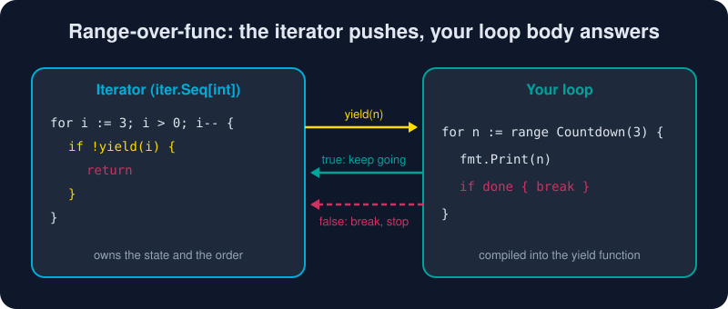

# Iterators

*Go 1.23 handed `for range` a new superpower: your own functions.*



> **In 30 seconds:** An iterator is a function that takes a `yield` callback and calls it once per value. `for v := range seq` runs your loop body as that callback. When you `break`, `yield` returns `false` and the iterator must stop. The `iter` package names the shapes: `iter.Seq[V]` and `iter.Seq2[K, V]`. `slices` and `maps` produce and consume them.

## What you can range over

| Range expression | Yields | Since |
|---|---|---|
| slice, array, string | index, element (runes for strings) | Go 1.0 |
| map, channel | key, value / received values | Go 1.0 |
| integer `n` | `0 … n-1` | Go 1.22 |
| `func(yield func() bool)` | nothing (just "times") | Go 1.23 |
| `func(yield func(V) bool)` = **`iter.Seq[V]`** | one value | Go 1.23 |
| `func(yield func(K, V) bool)` = **`iter.Seq2[K, V]`** | two values | Go 1.23 |

Source: the spec's range clause.[^go-spec-for-range]

## Writing an iterator

```go
func Countdown(from int) iter.Seq[int] {
    return func(yield func(int) bool) {
        for i := from; i > 0; i-- {
            if !yield(i) { // false means the loop body did break/return
                return
            }
        }
    }
}

for n := range Countdown(3) {
    fmt.Print(n, " ")
}
// 3 2 1
```

The compiler turns your loop body into the `yield` function. `break` becomes "return false", and `continue` becomes "return true".[^range-functions]

## Infinite and lazy, for free

Because values are produced on demand, an iterator can be **endless**. The consumer decides when to stop:

```go
func Fib() iter.Seq[int] {
    return func(yield func(int) bool) {
        a, b := 0, 1
        for {
            if !yield(a) {
                return
            }
            a, b = b, a+b
        }
    }
}
```

## Adapters: iterators that wrap iterators

```go
func Filter[T any](seq iter.Seq[T], keep func(T) bool) iter.Seq[T] {
    return func(yield func(T) bool) {
        for v := range seq {
            if keep(v) && !yield(v) {
                return
            }
        }
    }
}

for f := range Filter(Fib(), isEven) {
    if f > 100 { break }
    fmt.Print(f, " ") // 0 2 8 34
}
```

Nothing is allocated up front. Each value flows through the pipeline one at a time.

## Two-value iterators: `iter.Seq2`

```go
func Words(s string) iter.Seq2[int, string] {
    return func(yield func(int, string) bool) {
        for i, w := range strings.Fields(s) {
            if !yield(i, w) {
                return
            }
        }
    }
}
```

## The standard library speaks iterators

```go
names := slices.Sorted(maps.Keys(ages))   // map keys → sorted slice
evens := slices.Collect(Filter(slices.Values(nums), isEven))
for i, v := range slices.Backward(xs) { } // reverse order
for k, v := range maps.All(m) { }         // iter.Seq2 over a map
```

`slices.Values`, `slices.All`, `slices.Backward`, `maps.Keys`, `maps.Values`, `maps.All` *produce* sequences. `slices.Collect`, `slices.Sorted`, `maps.Collect` *consume* them.[^pkg-iter]

## Try it

```bash
cd assets/code
go run ./ch03/iterators
```

```text
3 2 1 liftoff!
0 2 8 34 
0:range 1:over 2:func 
sorted names: [ada grace linus]
evens: [2 4 6]
2c 1b 0a 
0 1 2 
```

See [main.go](/assets/code/ch03/iterators/main.go).

## Watch out

* **Ignoring `yield`'s result** is a bug. If the loop body breaks and you keep calling `yield`, the program panics at runtime.
* **Map order is random**, so `maps.Keys` yields keys in a different order each run. Sort with `slices.Sorted` when order matters.
* **Single-use iterators** (such as one that reads a stream) cannot be replayed. Document whether yours can be.
* **Don't force it.** A plain slice is still the right answer for small, finite data.

## Key takeaways

* An iterator is `func(yield func(V) bool)`. Stop when `yield` returns false.
* `iter.Seq` and `iter.Seq2` name the shapes. `slices` and `maps` build and consume them.
* Iterators are lazy and composable, and they can be infinite.
* `for i := range 10` works too (Go 1.22+).

[^range-functions]: Range Over Function Types
[^pkg-iter]: Package iter
[^go-spec-for-range]: The Go Programming Language Specification, For statements with range clause

---
⬅️ [Errors](/03-types-and-abstraction/errors.md) · 🏠 [Index](/index.md) · ➡️ [Goroutines](/04-concurrency/goroutines.md)
