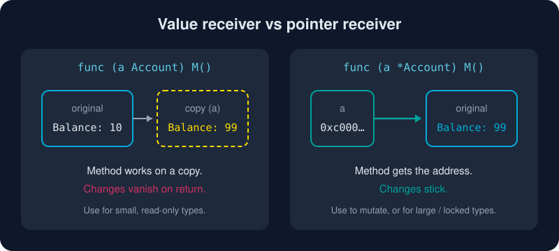

# Structs and Methods

*No classes, no constructors, no `this`. Just data, and the functions that care about it.*



> **In 30 seconds:** A struct groups fields. A method is a function with a *receiver* written before its name. A **value receiver** `(a Account)` gets a copy. A **pointer receiver** `(a *Account)` gets the address, so its changes stick. If any method needs a pointer, give them all pointers.

## A struct is a named bundle of fields

```go
type Account struct {
    Owner   string
    Balance int // cents: money as float64 rounds badly
}

a := Account{Owner: "Ada", Balance: 1050} // keyed literal (preferred)
b := Account{"Ada", 1050}                 // positional: fragile, avoid outside tiny types
var z Account                             // zero value: {"" 0}, ready to use
p := &Account{Owner: "Grace"}             // pointer to a new struct
p.Balance = 99                            // no -> operator; Go dereferences for you
```

A struct's zero value is useful on its own. Every field starts at *its* zero value: `""`, `0`, `nil`, `false`. Well-designed Go types work at their zero value, the way `sync.Mutex` and `bytes.Buffer` do.

Structs whose fields are all comparable can be compared with `==`. That makes them usable as map keys too.

## Methods: functions with a receiver

```go
// Value receiver: reads only, so a copy is fine.
func (a Account) String() string {
    return fmt.Sprintf("%s: $%d.%02d", a.Owner, a.Balance/100, a.Balance%100)
}

// Pointer receiver: must modify the caller's Account.
func (a *Account) Deposit(cents int) {
    a.Balance += cents
}
```

You can attach methods to **any named type you declare in your package**, not just structs:

```go
type Celsius float64
func (c Celsius) Fahrenheit() float64 { return float64(c)*9/5 + 32 }
```

## The decision that matters: value or pointer?

| Use a **pointer receiver** `*T` when… | Use a **value receiver** `T` when… |
|---|---|
| the method mutates the receiver | the type is small and immutable-ish (`time.Time`, `Point`) |
| the struct is large (copying is wasteful) | it is a map, func or chan type (already reference-like) |
| it contains a `sync.Mutex` or similar (must not be copied) | you want callers to be sure it cannot change |
| **any other method already uses a pointer** (consistency) | |

When in doubt, use a pointer.[^code-review-receivers]

## Method sets: why `T` and `*T` differ

The spec says:[^go-spec-method-sets]

* The method set of `T` contains the methods with value receivers.
* The method set of `*T` contains **both** value-receiver and pointer-receiver methods.

In everyday code you rarely notice, because Go auto-addresses: if `v` is addressable, `v.Deposit(5)` quietly becomes `(&v).Deposit(5)`. It matters with **interfaces**. A plain `Account` value does *not* satisfy an interface that needs `Deposit`; only `*Account` does. You will meet this in the [next lesson](/03-types-and-abstraction/interfaces.md).

## Constructors are just functions

Go has no special constructor syntax. By convention you write `NewThing`:

```go
func NewAccount(owner string) *Account {
    return &Account{Owner: owner}
}
```

Returning `&Account{...}` is safe. The compiler's escape analysis moves the value to the heap if it outlives the function. No dangling pointers.[^effective-go-methods]

## Try it

```bash
cd assets/code
go run ./ch03/structs
```

```text
Ada: $10.50
after DepositOnCopy: Ada: $10.50
Grace: $2.50
zero value: Owner="" Balance=0
equal? true
point: 3 4
```

`DepositOnCopy` added $999.99 to a copy that disappeared when the method returned. See [main.go](/assets/code/ch03/structs/main.go).

## Watch out

* **Silent no-op mutations.** A value-receiver method that "updates" a field changes a copy. Nothing warns you.
* **Copying locks.** Never copy a struct that contains a `sync.Mutex`. Use pointer receivers. `go vet` catches many of these (`copylocks`).
* **Mixed receivers.** Mixing `T` and `*T` receivers on one type makes method sets confusing. Pick one.
* **Positional literals** break when someone adds a field. Use field names.

## Key takeaways

* Structs are data. Methods are functions with a receiver.
* Pointer receiver = can mutate, no copy. Value receiver = copy.
* `*T`'s method set includes `T`'s methods, but not the other way around.
* Make the zero value useful. Use `NewX` functions when it cannot be.

[^go-spec-method-sets]: The Go Programming Language Specification, Method sets
[^code-review-receivers]: Go Code Review Comments, Receiver Type
[^effective-go-methods]: Effective Go, Methods

---
⬅️ [Strings and Runes](/02-language-basics/strings-and-runes.md) · 🏠 [Index](/index.md) · ➡️ [Interfaces](/03-types-and-abstraction/interfaces.md)
