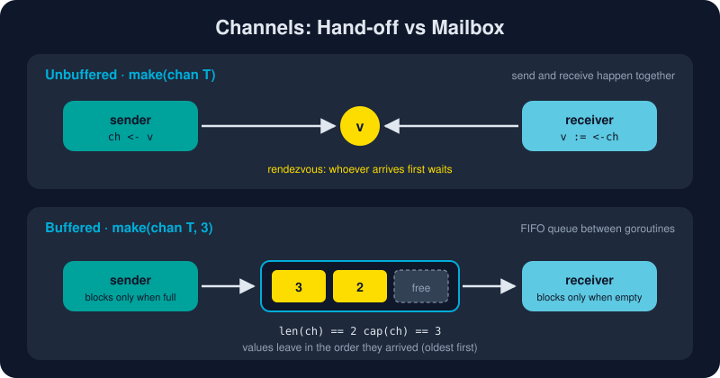

# Channels

*"Don't communicate by sharing memory; share memory by communicating."*[^share-memory]



> **In 30 seconds:** A channel `chan T` is a typed, goroutine-safe conduit. `ch <- v` sends and `v := <-ch` receives. An **unbuffered** channel makes the sender and receiver meet, like a hand-off. A **buffered** channel holds up to `cap` values, like a mailbox. The sender calls `close(ch)` to say "no more values", and receivers `range` over the channel until it is drained. Direction types (`chan<-`, `<-chan`) let the compiler enforce who may send and who may receive.

## Making and using a channel

```go
ch := make(chan int)      // unbuffered
jobs := make(chan Job, 8) // buffered, capacity 8

ch <- 42     // send
v := <-ch    // receive
v, ok := <-ch // ok == false once ch is closed and empty
```

Channels are reference values, like maps. Passing `ch` to a function passes the *same* channel. The zero value of a channel is `nil`, so always create channels with `make`.

## Unbuffered: the hand-off

An unbuffered send **blocks until a receiver takes the value**, and a receive blocks until a sender delivers one. The two goroutines meet at that moment, which is why unbuffered channels work as a *synchronization point* as well as a data path. The Go memory model guarantees that everything the sender did before the send is visible to the receiver after the receive.[^go-mem]

```go
done := make(chan struct{})
go func() {
    doWork()
    done <- struct{}{} // "I'm finished"
}()
<-done // waits right here until doWork is complete
```

> 💡 `chan struct{}` carries no data (`struct{}` takes zero bytes). It is the idiomatic type for pure signals.

## Buffered: the mailbox

With `make(chan T, n)`, sends succeed straight away while there is room in the buffer, and receives succeed while it holds values. The sender blocks only when the buffer is **full**, and the receiver only when it is **empty**.

| Expression | Meaning |
|---|---|
| `len(ch)` | values waiting in the buffer right now |
| `cap(ch)` | buffer size (0 for unbuffered) |

Buffers smooth out bursts, but they don't make a slow consumer faster. Choose a size for a reason, such as "one slot per worker" or "the number of results I know are coming". Never choose one just to make a deadlock disappear.

## Closing and ranging

Only the **sender** closes a channel, and only to tell receivers that no more values are coming:

```go
func produce(out chan<- int) {
    for i := range 5 {
        out <- i
    }
    close(out) // "that's all, folks"
}

for v := range ch { // stops automatically after close + drain
    fmt.Println(v)
}
```

What happens in each state:

| Operation | nil channel | open channel | closed channel |
|---|---|---|---|
| send `ch <- v` | blocks forever | blocks or succeeds | **panic** |
| receive `<-ch` | blocks forever | blocks or succeeds | remaining values, then zero value, `ok=false` |
| `close(ch)` | **panic** | succeeds | **panic** |

## Directional channels: let the compiler guard the door

A function's signature can promise to only send or only receive:[^go-spec-chan]

```go
func producer(out chan<- int) { ... } // send-only: receiving from out won't compile
func consumer(in <-chan int)  { ... } // receive-only: sending or closing won't compile
```

A bidirectional `chan int` converts implicitly to either direction, so you create one channel and hand each side the view it needs. Your API then *documents and enforces* who owns the channel.

## The nil-channel trick

A `nil` channel blocks forever, and that turns out to be useful. Inside a `select`, setting a channel variable to `nil` **switches that case off**. It's the standard way to merge two inputs that close at different times:

```go
for a != nil || b != nil {
    select {
    case v, ok := <-a:
        if !ok { a = nil; continue } // a is done; stop selecting on it
        fmt.Println("a:", v)
    case v, ok := <-b:
        if !ok { b = nil; continue }
        fmt.Println("b:", v)
    }
}
```

You'll learn more about `select` in the [next lesson](/04-concurrency/select.md).

## Try it

From `assets/code`:

```bash
go run ./ch04/channels
```

Expected output:

```text
unbuffered got: ping
buffered: len=2 cap=2
letter 1 | letter 2
sum of squares 1..5 = 55
first receive: 42 true
after drain:   0 false
```

## Watch out

* **`fatal error: all goroutines are asleep - deadlock!`** The runtime found that every goroutine is blocked. The usual cause is a send on an unbuffered channel with no receiver anywhere, often in `main`.
* **Never close from the receiver side**, and never close twice. If several goroutines send, close the channel *after* all of them finish, usually from a goroutine that runs `wg.Wait()` and then `close(out)`.
* **Closing is not required.** Close a channel only when a receiver needs to know the stream has ended, such as for `range`. The garbage collector reclaims unclosed channels.
* **Don't use a channel where a mutex is simpler.** Channels shine for passing *ownership* of data and for orchestration. For guarding a counter, see [Sync Primitives](/04-concurrency/sync-primitives.md).

## Key takeaways

* Unbuffered means a synchronous hand-off. Buffered means an asynchronous queue of size `cap`.
* The sender closes the channel, and receivers `range` over it until it is drained.
* `v, ok := <-ch` tells a real value apart from the zero value after close.
* Direction types (`chan<-`, `<-chan`) turn conventions into compile errors.
* A nil channel blocks forever, which is handy for disabling `select` cases.

[^share-memory]: Share Memory By Communicating
[^go-spec-chan]: The Go Programming Language Specification: Channel types
[^go-mem]: The Go Memory Model

---

⬅️ [Goroutines](/04-concurrency/goroutines.md) · 🏠 [Index](/index.md) · ➡️ [Select](/04-concurrency/select.md)
