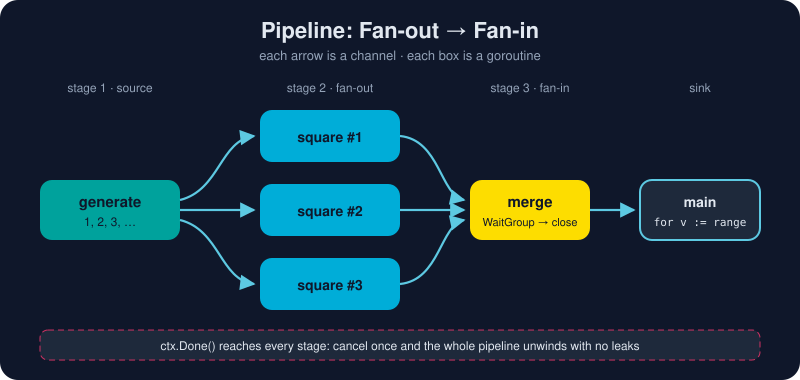

# Concurrency Patterns

*Goroutines and channels are the building blocks. These patterns are how you put them together.*



> **In 30 seconds:** A **pipeline** is a chain of stages connected by channels. Each stage receives from upstream, does its work, sends downstream, and closes its output when finished.[^pipelines] **Fan-out** runs several copies of a slow stage in parallel, and **fan-in** merges their outputs. A **worker pool** puts a fixed number of goroutines on a job queue. A **semaphore** (a buffered channel) caps concurrency. **errgroup** combines a WaitGroup, the first error and cancellation in one type. In every pattern, `ctx.Done()` makes sure nothing leaks.

## 1. Pipeline: stages connected by channels

Every stage follows the same pattern: a function that **returns a receive-only channel it owns and closes**.

```go
func generate(ctx context.Context, nums ...int) <-chan int {
    out := make(chan int)
    go func() {
        defer close(out) // the owner closes
        for _, n := range nums {
            select {
            case out <- n:
            case <-ctx.Done(): // downstream quit; unwind instead of leaking
                return
            }
        }
    }()
    return out
}

func square(ctx context.Context, in <-chan int) <-chan int {
    out := make(chan int)
    go func() {
        defer close(out)
        for n := range in {
            select {
            case out <- n * n:
            case <-ctx.Done():
                return
            }
        }
    }()
    return out
}

// Compose like Unix pipes: generate | square | print
for v := range square(ctx, generate(ctx, 1, 2, 3)) {
    fmt.Println(v)
}
```

## 2. Fan-out / fan-in: parallelize the slow stage

**Fan-out** means several goroutines read from the *same* channel. Each value goes to exactly one of them. **Fan-in** means merging many channels into one:

```go
func merge(ctx context.Context, chans ...<-chan int) <-chan int {
    out := make(chan int)
    var wg sync.WaitGroup
    for _, c := range chans {
        wg.Add(1)
        go func() {
            defer wg.Done()
            for v := range c {
                select {
                case out <- v:
                case <-ctx.Done():
                    return
                }
            }
        }()
    }
    go func() { wg.Wait(); close(out) }() // close only after ALL senders finish
    return out
}

src := generate(ctx, 1, 2, 3, 4, 5, 6, 7, 8, 9)
results := merge(ctx, square(ctx, src), square(ctx, src), square(ctx, src))
```

> 🔀 Fan-in loses ordering. If you need results in input order, attach an index to each value and sort afterwards, or write into `results[i]`.

## 3. Worker pool: bounded parallelism over a job queue

Start a fixed number of workers, all reading from one `jobs` channel. It's the go-to pattern for "process 10,000 items, but only 8 at a time".

```go
jobs := make(chan Job)
results := make(chan Result)

var wg sync.WaitGroup
for range numWorkers {
    wg.Add(1)
    go func() {
        defer wg.Done()
        for j := range jobs { // exits when jobs is closed
            results <- process(j)
        }
    }()
}

go func() { // producer
    defer close(jobs)
    for _, j := range allJobs { jobs <- j }
}()
go func() { wg.Wait(); close(results) }() // closer

for r := range results { collect(r) }
```

## 4. Semaphore: cap concurrency with a buffered channel

When each task already has its own goroutine and you just need a limit, use a buffered channel of `struct{}` as a counting semaphore:

```go
sem := make(chan struct{}, 3) // at most 3 at a time

for _, url := range urls {
    wg.Add(1)
    go func() {
        defer wg.Done()
        sem <- struct{}{}        // acquire (blocks when 3 are in flight)
        defer func() { <-sem }() // release
        download(url)
    }()
}
wg.Wait()
```

The extended library also offers a weighted semaphore, `golang.org/x/sync/semaphore`, for when tasks have different costs.

## 5. errgroup: WaitGroup + first error + cancellation

`golang.org/x/sync/errgroup` is the production favorite. It is maintained by the Go team but lives outside the standard library, so you add it with `go get golang.org/x/sync`.[^errgroup]

```go
import "golang.org/x/sync/errgroup"

func fetchAll(ctx context.Context, urls []string) ([]string, error) {
    g, ctx := errgroup.WithContext(ctx) // ctx is cancelled on the first error
    g.SetLimit(4)                       // built-in concurrency cap

    pages := make([]string, len(urls))
    for i, url := range urls {
        g.Go(func() error {
            body, err := fetch(ctx, url)
            if err != nil {
                return fmt.Errorf("fetch %s: %w", url, err)
            }
            pages[i] = body // distinct index per goroutine: no race
            return nil
        })
    }
    if err := g.Wait(); err != nil { // waits for all; returns the first error
        return nil, err
    }
    return pages, nil
}
```

> 📦 This bundle's runnable examples use only the standard library, so the errgroup code above is for reading. The `patterns` example builds the same ideas from scratch.

## Choosing a pattern

| Problem | Pattern |
|---|---|
| Sequence of transformations over a stream | pipeline |
| One stage is the bottleneck | fan-out that stage, then fan-in |
| Huge batch, limited resources | worker pool |
| Goroutine per task, but cap in-flight work | semaphore |
| Parallel calls where any failure aborts the rest | errgroup |

## Try it

From `assets/code`:

```bash
go run ./ch04/patterns
```

Expected output:

```text
pipeline squares: [1 4 9 16 25 36 49 64 81]
worker pool finished 4 jobs
semaphore peak concurrency: 2 (limit 2)
```

## Watch out

* **Every stage needs a way out.** A stage that blocks on `out <- v` after the consumer has quit is a leak. Always `select` on `ctx.Done()` as well.
* **Close in exactly one place.** In fan-in, the *merger* closes the output after `wg.Wait()`, never the individual senders.
* **Don't pipeline trivial work.** Every channel hand-off costs time. If one stage is just `n*n`, a plain loop is faster. Pipelines pay off when stages do real I/O or heavy CPU work.
* **Unbounded goroutine spawning** (`for _, x := range million { go f(x) }`) can exhaust memory or downstream services. Bound it with a pool, a semaphore or `errgroup.SetLimit`.

## Key takeaways

* A stage is a function that returns a `<-chan T` it owns and closes.
* Fan-out parallelizes, and fan-in merges. Close the merged channel after a `WaitGroup` finishes.
* Worker pools and semaphores bound concurrency, which keeps you and your dependencies healthy.
* `errgroup` is the idiomatic way to run parallel work that can fail.
* Thread `ctx` through every stage so cancellation unwinds everything.

For the classic tour of these ideas, see Rob Pike's talk[^talk] and the pipelines article.[^pipelines]

[^pipelines]: Go Concurrency Patterns: Pipelines and cancellation
[^errgroup]: Package errgroup
[^talk]: Go Concurrency Patterns (Rob Pike, 2012)

---

⬅️ [Context](/04-concurrency/context.md) · 🏠 [Index](/index.md) · ➡️ [Testing](/05-production-go/testing.md)
