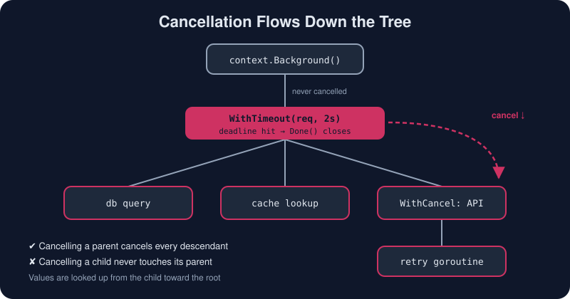

# Context

*When a user closes the browser tab, every goroutine working on that request should stop. `context` makes that happen.*



> **In 30 seconds:** A `context.Context` carries a **deadline**, a **cancellation signal** and a few **request-scoped values** across API boundaries and goroutines.[^context-pkg] You derive child contexts with `WithCancel`, `WithTimeout`, `WithDeadline` and `WithValue`. Cancelling a parent cancels every descendant. By convention, `ctx` is the first parameter of any function that might block, and you always `defer cancel()`.

## The interface

```go
type Context interface {
    Deadline() (deadline time.Time, ok bool)
    Done() <-chan struct{} // closed when this context is cancelled
    Err() error            // nil, context.Canceled, or context.DeadlineExceeded
    Value(key any) any
}
```

`Done()` is just a channel, so context fits straight into `select`:

```go
select {
case res := <-work:
    return res, nil
case <-ctx.Done():
    return nil, ctx.Err() // caller gave up; stop wasting effort
}
```

## Roots and children

Every tree starts at a root: `context.Background()` in `main`, in tests and at the top of a request. Use `context.TODO()` as a placeholder while you refactor. Every other context is *derived* from a parent:

| Constructor | Cancelled when… |
|---|---|
| `WithCancel(parent)` | you call `cancel()`, or the parent is cancelled |
| `WithTimeout(parent, d)` | `d` elapses, `cancel()` is called, or the parent is cancelled |
| `WithDeadline(parent, t)` | the clock reaches `t`, or as above |
| `WithCancelCause(parent)` | `cancel(err)`, and `context.Cause(ctx)` reports *why* (Go 1.20+) |
| `WithoutCancel(parent)` | never; it keeps the values but drops cancellation (Go 1.21+) |
| `WithValue(parent, k, v)` | the parent is cancelled; it adds one key/value pair |

```go
ctx, cancel := context.WithTimeout(r.Context(), 2*time.Second)
defer cancel() // ALWAYS: frees the timer and the child's resources

user, err := db.QueryUser(ctx, id) // the deadline flows into the driver
```

> 🌳 Cancellation flows **downward only**. A child can never cancel its parent, and siblings never affect each other.

## Cancelling a fleet of goroutines

```go
ctx, stop := context.WithCancel(context.Background())
for _, name := range workers {
    go run(ctx, name) // each worker selects on ctx.Done()
}
// ...
stop() // one call, every worker unwinds
```

Since Go 1.21, `context.AfterFunc(ctx, f)` runs `f` in its own goroutine once `ctx` is done. It's handy for closing a connection on cancel.

## Request-scoped values, used sparingly

```go
type ctxKey string                 // unexported type: no collisions with other packages
const requestIDKey ctxKey = "request-id"

ctx = context.WithValue(ctx, requestIDKey, "req-42")
id, _ := ctx.Value(requestIDKey).(string)
```

Values are for data that **crosses API boundaries with the request**, such as a request ID, trace span or authenticated user. They are *not* a way to pass optional function parameters.[^context-blog]

## The rules of context

1. Pass `ctx` **explicitly** as the first parameter, named `ctx`. Do not store it in a struct.[^context-pkg]
2. Never pass a `nil` context. Use `context.TODO()` if you're unsure.
3. Always call the `cancel` function, typically with `defer`. `go vet` warns when you lose it.
4. Contexts are immutable and safe to share across goroutines.
5. Check `ctx.Err()` or `select` on `ctx.Done()` inside long loops and before expensive steps.
6. In HTTP handlers, start from `r.Context()`. It is cancelled when the client disconnects.

## Try it

From `assets/code`:

```bash
go run ./ch04/contextdemo
```

Sample output. The order of the worker lines varies from run to run:

```text
[req-42] fast     finished
fast err: <nil>
[req-42] slow     stopped: context deadline exceeded
slow err is DeadlineExceeded: true
-- user pressed cancel --
[req-42] worker-3 stopped: context canceled
[req-42] worker-1 stopped: context canceled
[req-42] worker-2 stopped: context canceled
err:   context canceled
cause: shutting down for deploy
```

## Watch out

* **Forgetting `cancel()`** leaks the context's resources until the parent is cancelled. For a root context, that is forever.
* **Ignoring `ctx` inside your function** makes cancellation useless. A context only helps if code *checks* it.
* **`context.Background()` deep inside a call chain** silently cuts the chain, so deadlines from above stop applying. Thread the caller's context through.
* **Compare errors with `errors.Is(err, context.DeadlineExceeded)`**, not `==`, because wrapped errors are common.

## Key takeaways

* Context is how Go programs say "stop, nobody needs this anymore".
* Derive with `WithCancel`, `WithTimeout`, `WithDeadline` and `WithCancelCause`, and `defer cancel()` every time.
* Cancellation propagates parent → children, never upward.
* `ctx` goes first in the parameter list and is never stored in a struct. Use values only for request-scoped metadata.

[^context-pkg]: Package context
[^context-blog]: Go Concurrency Patterns: Context

---

⬅️ [Sync Primitives](/04-concurrency/sync-primitives.md) · 🏠 [Index](/index.md) · ➡️ [Concurrency Patterns](/04-concurrency/concurrency-patterns.md)
