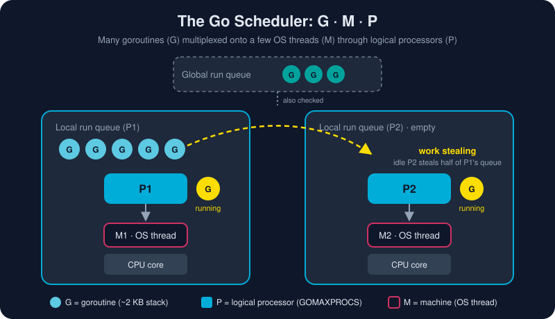

# Goroutines

*Put `go` in front of a function call and it runs alongside the rest of your program.*



> **In 30 seconds:** A goroutine is a function running concurrently with other goroutines in the same address space.[^go-spec-go] Goroutines are very cheap: each starts with a stack of a few kilobytes that grows as needed, so a single program can run hundreds of thousands of them. The Go runtime, not the operating system, decides which goroutine runs on which thread. Use `sync.WaitGroup` to wait for a group of them to finish.

## One keyword, a whole new dimension

Most languages make concurrency a library. Go makes it a keyword.

```go
func greet(name string) { fmt.Println("hello,", name) }

func main() {
    greet("sync")      // runs now; main waits for it to finish
    go greet("async")  // starts now; main moves on immediately
    time.Sleep(10 * time.Millisecond) // crude wait (we'll fix this below)
}
```

The `go` statement evaluates the function and its arguments right away, in the calling goroutine. It then starts the call in a new goroutine and returns at once. It never waits for the result.[^go-spec-go]

> 🧠 **Mental model:** A goroutine is a task the runtime runs in the background, not an OS thread. Think of a restaurant: a handful of chefs (OS threads) cook hundreds of orders (goroutines). The head chef (the scheduler) keeps every chef busy.

## Why goroutines are so cheap

| | OS thread | Goroutine |
|---|---|---|
| Initial stack | ~1–8 MB, fixed | ~2 KB, grows and shrinks as needed |
| Created by | the kernel (syscall) | the Go runtime (a function call) |
| Context switch | kernel mode, expensive | user space, cheap |
| Practical count | thousands | hundreds of thousands or more |

## Meet the scheduler: G, M and P

The diagram above shows the three actors in Go's runtime scheduler:

* **G** is a goroutine: its stack, its instruction pointer and its state.
* **M** is a *machine*, an OS thread that actually executes code.
* **P** is a *processor*, a scheduling context that holds a **local run queue** of runnable Gs. An M needs a P before it can run Go code. The number of Ps is `GOMAXPROCS`, which defaults to the number of CPUs available.

When a P's queue runs dry, the scheduler goes looking for work. It checks the **global run queue** and the network poller, then **steals half the goroutines** from another P's queue. This *work stealing* keeps every core busy without any central bottleneck. When a goroutine blocks in a system call, the runtime can hand its P to another M, so the other goroutines keep running.

Since Go 1.14 the scheduler is also **preemptive**: a goroutine stuck in a tight loop cannot starve the others.

## Waiting properly: `sync.WaitGroup`

`time.Sleep` is a guess. `sync.WaitGroup` is a promise. It is a counter: `Add(n)` raises it, `Done()` lowers it by one, and `Wait()` blocks until it reaches zero.

```go
var wg sync.WaitGroup

for _, url := range urls {
    wg.Add(1)          // count BEFORE starting the goroutine
    go func() {
        defer wg.Done() // always runs, even if fetch panics or returns early
        fetch(url)
    }()
}

wg.Wait() // blocks until every goroutine has called Done
```

> ✨ **Go 1.22+:** each loop iteration now gets a *fresh* `url` variable, so capturing it in a closure is safe.[^loopvar] In older code you will see `go func(u string) { ... }(url)`. That pattern was needed before 1.22 and is harmless now.

> 🆕 **Go 1.25+:** `wg.Go(func() { fetch(url) })` combines `Add(1)`, `go` and `defer Done()` in one call. This bundle's examples target Go 1.23, so they use the classic form.

## Getting results back

A goroutine cannot `return` a value to whoever started it. You have two ways to get results out:

1. **Send them on a channel.** This is idiomatic, and it is the subject of the [next lesson](/04-concurrency/channels.md).
2. **Write them into a slot no other goroutine touches**, for example `results[i]` with a distinct `i` per goroutine, and read them after `wg.Wait()`.

```go
results := make([]int, len(inputs))
var wg sync.WaitGroup
for i, in := range inputs {
    wg.Add(1)
    go func() {
        defer wg.Done()
        results[i] = slowSquare(in) // each goroutine owns exactly one index
    }()
}
wg.Wait()
```

## Try it

From `assets/code`:

```bash
go run ./ch04/goroutines
```

The output varies. Goroutines finish in their own order, and the CPU count depends on your machine. Here is a sample:

```text
logical CPUs Go may use (GOMAXPROCS): 8
espresso   ready after 30ms
latte      ready after 60ms
cold brew  ready after 90ms
all done in ~90ms (sequential would take 180ms)
```

Three tasks took only as long as the slowest one. That is concurrency paying off.

## Watch out

* **`main` returning kills everything.** When `main` exits, the program exits, including goroutines that are still running. Always wait for them.
* **`wg.Add` inside the goroutine is a race.** `Wait` might run before `Add`. Call `Add` *before* the `go` statement.
* **Goroutine leaks.** A goroutine blocked forever on a channel nobody will ever use is never garbage collected. Every goroutine you start needs a clear way to finish. ([Context](/04-concurrency/context.md) helps.)
* **Concurrency is not parallelism.** Concurrency is about *structuring* independent tasks. Parallelism is *running them at the same instant*, which needs more than one core. Go gives you the first, and the scheduler gives you the second for free.
* **Unrecovered panics crash the whole program**, even when they happen inside a goroutine you started.

## Key takeaways

* `go f(x)` starts `f` concurrently. Arguments are evaluated immediately.
* Goroutines are cheap, so starting thousands is normal.
* The GMP scheduler multiplexes many Gs onto a few Ms through `GOMAXPROCS` Ps, using work stealing.
* Use `sync.WaitGroup` to wait for a group of goroutines: `Add` before `go`, and `defer Done()` inside.
* Every goroutine needs an exit plan.

Want the original design rationale? Read *Effective Go* on goroutines.[^effective-go]

[^go-spec-go]: The Go Programming Language Specification: Go statements
[^effective-go]: Effective Go: Goroutines
[^loopvar]: Fixing For Loops in Go 1.22

---

⬅️ [Iterators](/03-types-and-abstraction/iterators.md) · 🏠 [Index](/index.md) · ➡️ [Channels](/04-concurrency/channels.md)
