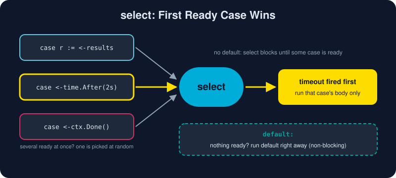

# Select

*With `select`, one goroutine can wait on several channels at once and handle whichever is ready first.*



> **In 30 seconds:** `select` waits on several channel operations and runs **the first one that can proceed**. If several are ready at once, it picks one **uniformly at random**, so no case can starve the others.[^go-spec-select] A `default` case makes the whole `select` non-blocking. Combine it with `time.After` for timeouts, a `time.Ticker` for heartbeats, and `ctx.Done()` for cancellation.

## The shape

```go
select {
case msg := <-inbox:          // a receive
    handle(msg)
case outbox <- reply:         // a send
    log.Println("sent")
case <-time.After(time.Second): // a timeout
    log.Println("gave up")
}
```

It looks like a `switch`, but every case must be a channel send or receive. The rules are:[^go-spec-select]

1. Every channel expression, and every value to be sent, is evaluated **once**, top to bottom, when `select` starts.
2. If one or more cases can proceed, one is chosen **at random**.
3. If none can proceed, `select` runs `default` if there is one. Otherwise it **blocks** until a case becomes ready.

An empty `select {}` blocks forever. You will occasionally see it at the end of a `main` whose real work happens in other goroutines.

## Pattern 1: race two sources

The first answer wins:

```go
select {
case r := <-fetchFrom("mirror-A"):
    use(r)
case r := <-fetchFrom("mirror-B"):
    use(r)
}
```

> 🧯 **Leak alert:** the loser's goroutine still tries to send. Give each fetch channel a buffer of 1 (as the example does) so the losing goroutine can deposit its value and exit instead of blocking forever.

## Pattern 2: timeouts

```go
select {
case r := <-slowQuery():
    use(r)
case <-time.After(50 * time.Millisecond):
    return errors.New("query timed out")
}
```

`time.After(d)` returns a channel that receives the current time once `d` has passed.[^time-pkg] In real services, prefer a `context.WithTimeout`. It carries the deadline to every function involved in the request (see [Context](/04-concurrency/context.md)).

## Pattern 3: non-blocking try with `default`

```go
select {
case queue <- job:
    // accepted
default:
    metrics.Dropped++ // queue full: shed load instead of waiting
}
```

The same trick works for a non-blocking receive ("is there anything there right now?").

## Pattern 4: the event loop

Most long-running goroutines are a `for` wrapped around a `select`:

```go
ticker := time.NewTicker(30 * time.Second)
defer ticker.Stop()

for {
    select {
    case <-ticker.C:
        sendHeartbeat()
    case ev := <-events:
        process(ev)
    case <-ctx.Done():
        return ctx.Err() // clean shutdown
    }
}
```

> 🎯 Put `ctx.Done()` in every long-lived loop. It gives the goroutine a way to finish.

## Try it

From `assets/code`:

```bash
go run ./ch04/selectdemo
```

Expected output (tick timing can vary slightly on a busy machine):

```text
winner: mirror-B
timeout: slow-db took too long
queued 1
queue full, dropped 2
tick 1
tick 2
tick 3
deadline reached, stopping
```

## Watch out

* **`time.After` inside a hot loop** creates a new timer on every iteration. Since Go 1.23, unreferenced timers are garbage collected promptly, but a single reusable `time.Timer` or `time.Ticker` is still clearer for repeated waits.
* **`break` inside a `select` only exits the `select`**, not the surrounding `for`. Use `return`, or a labelled `break outer`.
* **A busy `default` spins the CPU.** `for { select { ...; default: } }` with nothing to wait on is a hot loop. Usually you want to block.
* **Random choice means no priority.** If cancellation must win, check `ctx.Err()` at the top of each loop iteration as well.

## Key takeaways

* `select` waits on many channel operations and runs one ready case, chosen at random when several are ready.
* `default` makes `select` non-blocking.
* `time.After`, `time.Ticker` and `ctx.Done()` are its everyday partners.
* `for` plus `select` is the backbone of Go event loops and graceful shutdown.

[^go-spec-select]: The Go Programming Language Specification: Select statements
[^time-pkg]: Package time

---

⬅️ [Channels](/04-concurrency/channels.md) · 🏠 [Index](/index.md) · ➡️ [Sync Primitives](/04-concurrency/sync-primitives.md)
