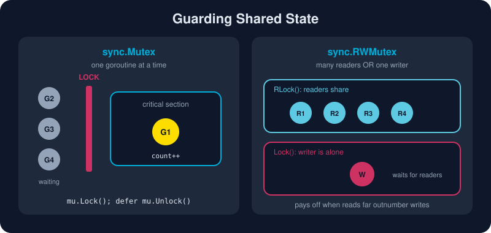

# Sync Primitives

*Channels handle orchestration. Locks protect state. Good Go code uses both.*



> **In 30 seconds:** A **data race** happens when two goroutines access the same variable at the same time and at least one of them writes. Its behavior is unpredictable.[^go-mem] Guard shared state with `sync.Mutex`, or `sync.RWMutex` when reads dominate. Use `sync.Once` for lazy one-time setup and `sync/atomic` types for lock-free counters and flags. Reserve `sync.Map` for special cases. Then run `go test -race` to prove it all works.

## The bug every concurrent program meets first

```go
count := 0
var wg sync.WaitGroup
for range 1000 {
    wg.Add(1)
    go func() { defer wg.Done(); count++ }() // DATA RACE
}
wg.Wait()
fmt.Println(count) // 1000? 974? 991? it changes from run to run
```

`count++` is really three steps: read, add and write. Two goroutines can read the same old value, and one increment is lost. Worse, the memory model gives *no guarantees at all* for racy programs.[^go-mem]

## `sync.Mutex`: one at a time

```go
type Counter struct {
    mu   sync.Mutex      // protects hits
    hits map[string]int
}

func (c *Counter) Inc(key string) {
    c.mu.Lock()
    defer c.mu.Unlock() // unlock on every return path, even a panic
    c.hits[key]++
}
```

House rules:

* Put the mutex **next to the fields it protects**, and say so in a comment.
* The zero value is an unlocked mutex, so no constructor is needed.
* **Never copy** a struct that contains a mutex once it's in use. Use pointer receivers. `go vet` catches many copies.
* Keep critical sections short. Don't do I/O while holding a lock.

## `sync.RWMutex`: many readers, one writer

```go
func (c *Config) Get(k string) string {
    c.mu.RLock()          // shared: other readers may enter too
    defer c.mu.RUnlock()
    return c.vals[k]
}

func (c *Config) Set(k, v string) {
    c.mu.Lock()           // exclusive: waits for all readers to leave
    defer c.mu.Unlock()
    c.vals[k] = v
}
```

An `RWMutex` pays off only when reads **heavily** outnumber writes and the critical sections are not tiny. Otherwise a plain `Mutex` is often just as fast. Measure before you choose.

## `sync.Once`: exactly once, even under a stampede

```go
var (
    once sync.Once
    db   *DB
)

func getDB() *DB {
    once.Do(func() { db = connect() }) // runs once; every caller waits for it to finish
    return db
}
```

Since Go 1.21, `sync.OnceFunc`, `sync.OnceValue` and `sync.OnceValues` wrap this pattern into a single line:[^sync-pkg]

```go
var getConfig = sync.OnceValue(func() *Config { return loadConfig() })
```

## `sync/atomic`: lock-free for simple values

For one counter or flag, typed atomics (Go 1.19+) are faster than a mutex and impossible to misuse by accident:[^atomic-pkg]

```go
var requests atomic.Int64
requests.Add(1)
n := requests.Load()

var ready atomic.Bool
ready.Store(true)

var cfg atomic.Pointer[Config]
cfg.Store(newCfg) // swap the whole config in one atomic step
```

> ⚠️ Atomics make *one* operation indivisible. When two fields must change together, you need a mutex.

## `sync.Map`: a specialist, not a default

`sync.Map` is tuned for two cases: keys that are written once and then read many times, or goroutines that work on *disjoint* sets of keys.[^sync-pkg] For everything else, a plain `map` guarded by a `Mutex` is simpler, type-safe and usually just as fast.

```go
var cache sync.Map
cache.Store("k", 1)
v, ok := cache.Load("k")
actual, loaded := cache.LoadOrStore("k", 2) // keeps 1, loaded == true
```

## Which tool when?

| Situation | Reach for |
|---|---|
| Passing data or ownership between goroutines | channel |
| Waiting for N goroutines to finish | `sync.WaitGroup` |
| Guarding a struct, map or slice | `sync.Mutex` |
| Read-mostly shared data | `sync.RWMutex` (measure!) |
| Lazy initialization | `sync.Once` / `sync.OnceValue` |
| Single counter, flag or pointer | `atomic.Int64` / `atomic.Bool` / `atomic.Pointer[T]` |
| Concurrent cache with stable keys | `sync.Map` |

## The race detector: your safety net

Add `-race` to `go test`, `go run` or `go build`:[^race]

```bash
go test -race ./...
go run -race ./ch04/syncprims
```

The detector watches memory accesses at runtime and prints both stack traces when it catches two goroutines colliding:

```text
WARNING: DATA RACE
Write at 0x00c000014108 by goroutine 8:
  main.main.func1() main.go:12 +0x44
Previous write at 0x00c000014108 by goroutine 7:
  main.main.func1() main.go:12 +0x44
```

It only finds races that actually *happen* during the run, so run it on your tests in CI. It needs cgo (`CGO_ENABLED=1` and a C compiler).

## Try it

From `assets/code`:

```bash
go run ./ch04/syncprims        # add -race if cgo is available
```

Expected output:

```text
mutex counter:  100
atomic counter: 1000
config region:  eu-west
(loading settings: this prints exactly once)
theme:          dark
sync.Map[2] = 4 | LoadOrStore kept: 4 loaded: true
```

## Watch out

* **Lock ordering deadlocks:** if goroutine A locks `x` then `y`, and B locks `y` then `x`, they can freeze forever. Always acquire locks in one global order.
* **Go mutexes are not re-entrant.** Calling `Lock` twice from the same goroutine deadlocks.
* **Returning internal maps or slices** from a locked method leaks unguarded access to them. Return copies.
* **"It passed without `-race`" proves nothing.** Races are timing-dependent.

## Key takeaways

* A data race means undefined behavior. Guard every shared, mutable value.
* `Mutex` for exclusive access, `RWMutex` for read-heavy data, `Once` for one-time setup.
* Typed atomics are the fastest safe choice for single values.
* `sync.Map` is a niche tool. Start with a map and a mutex.
* `-race` in CI is non-negotiable.

[^go-mem]: The Go Memory Model
[^sync-pkg]: Package sync
[^atomic-pkg]: Package sync/atomic
[^race]: Data Race Detector

---

⬅️ [Select](/04-concurrency/select.md) · 🏠 [Index](/index.md) · ➡️ [Context](/04-concurrency/context.md)
