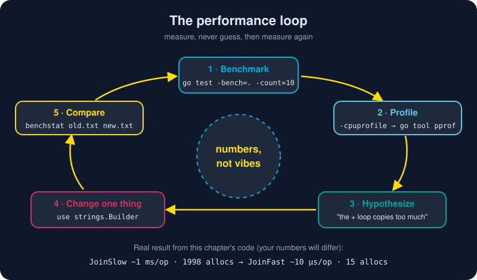

# Benchmarks and Profiling

*"Premature optimization is the root of all evil." So measure first. Go makes measuring so easy that you have no excuse to guess.*



> **In 30 seconds:** Write `func BenchmarkXxx(b *testing.B)` next to your tests and loop with **`for b.Loop() { … }`** (Go 1.24+) or the classic `for i := 0; i < b.N; i++`. Run with `go test -bench=. -benchmem`. Compare before and after with **`benchstat`**. When you need to know *why* code is slow, record a profile (`-cpuprofile`, `-memprofile`) and explore it with **`go tool pprof`**. For latency and scheduling problems, use **`go tool trace`**.

## Your first benchmark

Benchmarks live in `_test.go` files, right next to your tests:

```go
// Go 1.24+: the modern form.
func BenchmarkJoinSlow(b *testing.B) {
	// setup here runs once and is NOT timed
	for b.Loop() {
		JoinSlow(words)
	}
}

// The classic form: still valid, still everywhere in existing code.
func BenchmarkJoinFast(b *testing.B) {
	b.ReportAllocs() // same as passing -benchmem, for this benchmark only
	for i := 0; i < b.N; i++ {
		JoinFast(words)
	}
}
```

The harness increases the iteration count until the timing is statistically stable, then reports the cost **per operation**.[^pkg-testing]

### Why `b.Loop` is better

| | `for i := 0; i < b.N; i++` | `for b.Loop()` (Go 1.24+) |
|---|---|---|
| Setup before the loop | timed unless you call `b.ResetTimer()` | excluded automatically |
| Benchmark function runs | several times (once per `b.N` guess) | **once** |
| Dead-code elimination | compiler may delete an unused result | arguments and results are kept alive |
| Easy to get wrong | yes | much harder |

> 🧩 This repo's module says `go 1.23`, so the `b.Loop` benchmark lives in its own file with a `//go:build go1.24` line. That build constraint lets a single file use a newer language version. Look at [calc_loop_test.go](/assets/code/ch05/calc/calc_loop_test.go).

## Reading the output

```text
BenchmarkJoinSlow-24      1370     1291479 ns/op    7425585 B/op    1998 allocs/op
BenchmarkJoinFast-24    133770       10278 ns/op      34296 B/op      15 allocs/op
```

| Column | Meaning |
|---|---|
| `-24` | `GOMAXPROCS` (logical CPUs used) |
| `1370` | iterations the harness ran |
| `ns/op` | time per call: **lower is better** |
| `B/op` | bytes allocated per call |
| `allocs/op` | heap allocations per call: often the real culprit |

`JoinSlow` builds the string with `+=`, which copies the whole string on every step (quadratic work). `JoinFast` uses `strings.Builder`, which grows one buffer. The result: **about 100× faster and 1998 → 15 allocations**. The fix was one type; finding it took one command.

## benchstat: a single run proves nothing

A single benchmark run is noisy: CPU boost, background apps, and thermal throttling all move the numbers. Run each version many times and compare the distributions statistically:[^benchstat]

```bash
go install golang.org/x/perf/cmd/benchstat@latest

go test -run '^$' -bench Join -count=10 > old.txt   # before your change
# ...edit the code...
go test -run '^$' -bench Join -count=10 > new.txt   # after
benchstat old.txt new.txt
```

benchstat prints the median per benchmark, the variation (`± 2%`), the delta (`-99.2%`), and a p-value. If it says `~`, the difference is **not statistically significant**, so don't ship a "speedup" that is only noise.

## pprof: where does the time go?

A benchmark tells you **how slow**. A profile tells you **where**.[^diagnostics]

```bash
# Profile a benchmark
go test ./ch05/calc -run '^$' -bench JoinSlow -cpuprofile cpu.out -memprofile mem.out

# Explore it
go tool pprof -top cpu.out           # flat list: hottest functions
go tool pprof -top -cum cpu.out      # cumulative: hottest call paths
go tool pprof -http=:8081 cpu.out    # browser UI with a flame graph ← start here
```

A cumulative view from this chapter's code points straight at the culprit:

```text
      flat  flat%   sum%        cum   cum%
         0     0%     0%      0.83s 35.47%  gokb/ch05/calc.JoinSlow (inline)
         0     0%     0%      0.83s 35.47%  runtime.concatstring2
```

`concatstring2` is the runtime doing your `+=`. Below it sit `runtime.memmove` (copying bytes) and the garbage collector cleaning up 1998 throwaway strings.

| pprof term | Meaning |
|---|---|
| **flat** | time spent *in* this function itself |
| **cum** | time in this function *plus everything it calls* |
| `list Foo` | annotate the source of `Foo` line by line |
| `-sample_index=alloc_space` | rank memory profiles by bytes allocated |

### Profiling a whole program

[`ch05/profiling`](/assets/code/ch05/profiling/main.go) uses `runtime/pprof` directly:

```go
f, _ := os.Create(cpuPath)
pprof.StartCPUProfile(f)
// ...the work you want to measure...
pprof.StopCPUProfile()

runtime.GC()                  // up-to-date heap statistics
pprof.WriteHeapProfile(memFile)
```

### Profiling a live server

For a running service, one import mounts profiling endpoints on `http.DefaultServeMux`:[^pprof-http]

```go
import _ "net/http/pprof" // registers /debug/pprof/* handlers

// then:  go tool pprof http://localhost:6060/debug/pprof/profile?seconds=30
//        go tool pprof http://localhost:6060/debug/pprof/heap
```

> 🔐 Never expose `/debug/pprof` publicly. Serve it on a separate, internal-only port.

## The execution tracer: when *when* matters

pprof samples **where** CPU time goes. The tracer records **when** things happen: goroutines starting and blocking, GC pauses, syscalls, processors sitting idle. Use it when CPU is low but latency is high.

```bash
go test ./ch05/calc -run '^$' -bench JoinSlow -trace trace.out
go tool trace trace.out             # opens a timeline in your browser
```

## Bonus tools worth knowing

| Tool | Answers |
|---|---|
| `go build -gcflags=-m` | "Why does this escape to the heap?" (escape analysis) |
| `GODEBUG=gctrace=1 ./app` | "How often does the GC run, and how long does it take?" |
| `default.pgo` in your main package | Profile-guided optimization (Go 1.21+): a typical 2–14% gain at zero code cost |

## Try it

From `assets/code`:

```bash
go test ./ch05/calc -run '^$' -bench . -benchmem
```

```text
BenchmarkJoinSlow-24    1370    1291479 ns/op   7425585 B/op   1998 allocs/op
BenchmarkJoinFast-24  133770      10278 ns/op     34296 B/op     15 allocs/op
PASS
```

Then profile a whole program:

```bash
go run ./ch05/profiling
#  built 800000 bytes
#  cpu profile: /tmp/cpu.prof        (your OS temp dir)
#  heap profile: /tmp/mem.prof
go tool pprof -http=:8081 /tmp/cpu.prof
```

Your numbers will differ. The *ratio* between the two versions is what matters.

## Watch out

- **Benchmarking on a busy laptop.** Close the browser, plug in the charger, use `-count=10`, and let benchstat judge.
- **Forgetting `-run '^$'`.** Without it, every test runs before the benchmarks.
- **The compiler deleting your work.** With `b.N` loops, an unused pure result can be optimized away. Use `b.Loop`, or assign to a package-level sink variable.
- **Micro-optimizing cold code.** If pprof doesn't show it, it doesn't matter. Spend effort where the flame graph is wide.
- **Measuring with `-race` or a debugger attached.** Both add large overhead, so the numbers are meaningless.

## Key takeaways

- Benchmarks are `BenchmarkXxx(b *testing.B)` functions. Prefer **`for b.Loop()`** on Go 1.24+.
- Always add **`-benchmem`**: allocations are usually the hidden cost.
- Use **benchstat** with `-count=10` to separate real wins from noise.
- **pprof** shows where time and memory go, so start with the `-http` flame graph. The **tracer** shows when.
- The loop is always: **measure → profile → change one thing → compare.**

[^pkg-testing]: Package testing: benchmarks and B.Loop
[^diagnostics]: Diagnostics (official Go documentation)
[^pprof-http]: Package net/http/pprof
[^benchstat]: benchstat command

---

⬅️ [Testing in Go](/05-production-go/testing.md) · 🏠 [Index](/index.md) · ➡️ [HTTP Services](/05-production-go/http-services.md)
