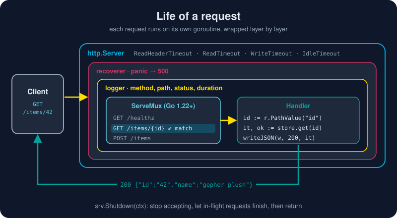

# HTTP Services

*Many languages need a framework before they can serve the web. Go's standard library ships a production-grade HTTP server, and since Go 1.22 its router is good enough that you may not need anything else.*



> **In 30 seconds:** An `http.Handler` is anything with `ServeHTTP(w, r)`. Register routes on an **`http.ServeMux`** with patterns like **`"GET /items/{id}"`** and read wildcards with **`r.PathValue("id")`**. Middleware is a function `func(http.Handler) http.Handler`. Always build an explicit **`http.Server` with timeouts**, and stop it with **`srv.Shutdown(ctx)`** so in-flight requests finish.

## The one interface behind everything

```go
type Handler interface {
	ServeHTTP(ResponseWriter, *Request)
}
```

Routers, middleware, file servers, and your own endpoints are all `Handler`s. `http.HandlerFunc` is the adapter that turns a plain function into one. That single small interface is why Go web code composes so well.

## Routing with Go 1.22+ patterns

Before Go 1.22, `ServeMux` matched only path prefixes, so people reached for third-party routers. Now patterns can include a **method** and **wildcards**:[^routing-blog]

```go
mux := http.NewServeMux()

mux.HandleFunc("GET /healthz", health)            // method + exact path
mux.HandleFunc("GET /items/{id}", getItem)        // {id} matches one path segment
mux.HandleFunc("POST /items", createItem)
mux.HandleFunc("GET /files/{path...}", serveFile) // {path...} matches the rest
mux.HandleFunc("GET /{$}", home)                  // {$} = exactly "/", nothing more
```

```go
func getItem(w http.ResponseWriter, r *http.Request) {
	id := r.PathValue("id") // "42" for GET /items/42
	// ...
}
```

What you get for free:

| Situation | Automatic response |
|---|---|
| Path matches, wrong method (`DELETE /items/42`) | **405 Method Not Allowed** with an `Allow` header |
| `GET` pattern receives a `HEAD` request | handled: `GET` patterns also match `HEAD` |
| Two patterns overlap (`/items/{id}` vs `/items/new`) | the **most specific** wins, wherever it was registered |
| Patterns that genuinely conflict | `panic` at registration, so you find out on startup, not in production |

## JSON in, JSON out

```go
mux.HandleFunc("POST /items", func(w http.ResponseWriter, r *http.Request) {
	r.Body = http.MaxBytesReader(w, r.Body, 1<<20) // never trust body size
	var it Item
	dec := json.NewDecoder(r.Body)
	dec.DisallowUnknownFields()                     // typos become 400s, not silence
	if err := dec.Decode(&it); err != nil || it.ID == "" {
		writeJSON(w, http.StatusBadRequest, map[string]string{"error": "invalid item"})
		return
	}
	s.put(it)
	writeJSON(w, http.StatusCreated, it)
})

func writeJSON(w http.ResponseWriter, status int, v any) {
	w.Header().Set("Content-Type", "application/json") // headers first...
	w.WriteHeader(status)                              // ...then status...
	json.NewEncoder(w).Encode(v)                       // ...then body
}
```

Struct tags control the wire names:[^pkg-json]

```go
type Item struct {
	ID   string `json:"id"`
	Name string `json:"name"`
	Note string `json:"note,omitempty"` // left out when empty
}
```

> ⚠️ **Order matters.** Headers set after `WriteHeader` (or after the first `Write`) are silently ignored. The sequence is always **headers → status → body**.

## Middleware: wrapping handlers like an onion

Middleware takes a handler and returns a new one that does something before and/or after it:

```go
func logger(next http.Handler) http.Handler {
	return http.HandlerFunc(func(w http.ResponseWriter, r *http.Request) {
		start := time.Now()
		rec := &statusRecorder{ResponseWriter: w, status: http.StatusOK}
		next.ServeHTTP(rec, r) // ← the wrapped handler runs here
		slog.Info("request", "method", r.Method, "path", r.URL.Path,
			"status", rec.status, "dur", time.Since(start))
	})
}

func recoverer(next http.Handler) http.Handler {
	return http.HandlerFunc(func(w http.ResponseWriter, r *http.Request) {
		defer func() {
			if v := recover(); v != nil {
				slog.Error("panic", "value", v)
				http.Error(w, "internal error", http.StatusInternalServerError)
			}
		}()
		next.ServeHTTP(w, r)
	})
}

handler := recoverer(logger(mux)) // outermost runs first
```

`statusRecorder` embeds `http.ResponseWriter` and overrides only `WriteHeader`. That is **embedding** from Chapter 3 doing real work: everything else passes straight through.

## The server: timeouts are not optional

`http.ListenAndServe(":8080", h)` is fine for a demo, but **it has no timeouts**. A client that sends one byte per minute can hold a connection, and a goroutine, forever. In production, build the server explicitly:[^pkg-http]

```go
srv := &http.Server{
	Addr:              ":8080",
	Handler:           handler,
	ReadHeaderTimeout: 5 * time.Second,  // defends against slowloris
	ReadTimeout:       10 * time.Second, // whole request, including body
	WriteTimeout:      10 * time.Second, // handler + response
	IdleTimeout:       60 * time.Second, // keep-alive connections
}
```

The same rule applies to clients: **`http.DefaultClient` has no timeout.** Create your own:

```go
client := &http.Client{Timeout: 3 * time.Second}
```

## Graceful shutdown

When your service is redeployed, you want in-flight requests to **finish**, not be cut off. Combine `signal.NotifyContext` with `Shutdown`:

```go
func main() {
	ctx, stop := signal.NotifyContext(context.Background(), os.Interrupt, syscall.SIGTERM)
	defer stop()

	srv := &http.Server{Addr: ":8080", Handler: handler /* + timeouts */}

	go func() {
		if err := srv.ListenAndServe(); err != nil && !errors.Is(err, http.ErrServerClosed) {
			log.Fatal(err)
		}
	}()

	<-ctx.Done() // Ctrl-C or SIGTERM from your orchestrator

	shutdownCtx, cancel := context.WithTimeout(context.Background(), 10*time.Second)
	defer cancel()
	srv.Shutdown(shutdownCtx) // stop accepting, drain in-flight requests, return
}
```

`ListenAndServe` returns `http.ErrServerClosed` as soon as `Shutdown` is called. That error is expected, not a failure. The [example program](/assets/code/ch05/httpserver/main.go) triggers the shutdown itself after a few demo calls, so `go run` exits cleanly.

## Respect the request context

Every request carries `r.Context()`. It is cancelled when the client disconnects or the server shuts down. Pass it to everything slow:

```go
rows, err := db.QueryContext(r.Context(), "SELECT ...")
```

If the user closes the tab, the database query is cancelled too, so no work is wasted. (See [Context](/04-concurrency/context.md).)

## Try it

From `assets/code`:

```bash
go run ./ch05/httpserver
```

```text
level=INFO msg=request method=GET path=/healthz status=200 dur=0s
GET    /healthz  -> 200 ok
level=INFO msg=request method=POST path=/items status=201 dur=519µs
POST   /items    -> 201 {"id":"42","name":"gopher plush"}
level=INFO msg=request method=GET path=/items/42 status=200 dur=0s
GET    /items/42 -> 200 {"id":"42","name":"gopher plush"}
level=INFO msg=request method=GET path=/items/7 status=404 dur=0s
GET    /items/7  -> 404 {"error":"item not found"}
level=INFO msg=request method=DELETE path=/items/42 status=405 dur=0s
DELETE /items/42 -> 405 Method Not Allowed
server stopped cleanly
```

The `405` came from the router, not from your code. Now run the in-process tests, which use no network at all:

```bash
go test ./ch05/httpserver -v
```

## Watch out

- **No timeouts.** This is the most common production Go HTTP bug, on both server and client.
- **Forgetting `return` after writing an error.** The handler keeps going and writes a second response, and you get `http: superfluous response.WriteHeader call` in the logs.
- **Not closing response bodies** on the client side: `defer resp.Body.Close()`, always.
- **Shared state without locks.** Handlers run concurrently, one goroutine per request. The example store uses `sync.RWMutex`.
- **Using `http.DefaultServeMux` in libraries.** Any imported package can register routes on it. Create your own `ServeMux`.

## Key takeaways

- `http.Handler` is the one interface everything is built on.
- Go 1.22+ `ServeMux` handles **methods, wildcards, and precedence**: `"GET /items/{id}"` + `r.PathValue`.
- Middleware is just `func(http.Handler) http.Handler`. Compose by wrapping.
- **Always set timeouts**, on servers *and* clients.
- **Graceful shutdown** = `signal.NotifyContext` + `srv.Shutdown(ctx)`.
- Test handlers in-process with **`httptest`**.

[^routing-blog]: Routing Enhancements for Go 1.22
[^pkg-http]: Package net/http
[^pkg-json]: Package encoding/json

---

⬅️ [Benchmarks and Profiling](/05-production-go/benchmarks-and-profiling.md) · 🏠 [Index](/index.md) · ➡️ [Project Layout](/05-production-go/project-layout.md)
