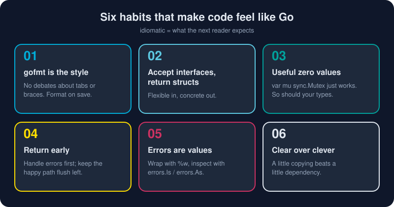

# Idioms and Style

*Go was designed for code that hundreds of people read and maintain for years. Its idioms are the shared habits that make a stranger's code feel like your own.*



> **In 30 seconds:** Let **`gofmt`** decide formatting. Use **short, clear names**, with longer names for longer-lived things. **Accept interfaces, return concrete types.** Make the **zero value useful**. **Handle errors first and return early**, so the happy path stays flush left. Prefer clear over clever. For logs, use **`log/slog`**: structured key/value records, not formatted strings.

## 1. gofmt is everyone's style

```bash
gofmt -l .        # list files that are not formatted
go fmt ./...      # format every package in the module
go vet ./...      # catch suspicious code: printf mismatches, copied locks, ...
```

Go ended the formatting debate by shipping one formatter. Tabs vs spaces, brace placement, and alignment are not up for discussion: *"Gofmt's style is no one's favorite, yet gofmt is everyone's favorite."* Turn on format-on-save, and code review can focus on logic instead of whitespace.

## 2. Naming: short where near, descriptive where far

Go favors short names when the scope is small and descriptive names when the scope is large:[^review-comments]

```go
for i, v := range items { ... }        // ✅ tiny scope, tiny names
func (s *Server) Start() error { ... } // ✅ receivers: 1–2 letters, consistent

var defaultRequestTimeout = 30 * time.Second // ✅ package-level: descriptive
```

| Convention | ✅ Go style | ❌ Not Go style |
|---|---|---|
| Visibility by case | `Parse` (exported), `parse` (internal) | `public`/`private` keywords |
| MixedCaps, never underscores | `maxRetries`, `HTTPServer` | `max_retries`, `HttpServer` |
| Initialisms stay uniform | `userID`, `ServeHTTP`, `parseURL` | `userId`, `ServeHttp` |
| Getters drop `Get` | `u.Name()` | `u.GetName()` |
| One-method interfaces end in `-er` | `Reader`, `Stringer`, `Notifier` | `IReader`, `ReaderInterface` |
| No stutter | `bytes.Buffer` | `bytes.BytesBuffer` |
| Errors | `ErrNotFound` variables; `fmt.Errorf("open config: %w", err)` | messages that are Capitalized or end with "." |

## 3. Accept interfaces, return structs

```go
// ✅ Accept the smallest interface you need: callers can pass a file,
// a network connection, a bytes.Buffer, or a test fake.
func CountLines(r io.Reader) (int, error) { ... }

// ✅ Return a concrete type: callers get every method, and you can add
// methods later without breaking anyone.
func NewStore(db *sql.DB) *Store { ... }
```

In Go, interfaces usually belong to the **consumer**, not the producer. Define the small interface where you *use* it, not next to the implementation. *"The bigger the interface, the weaker the abstraction."*

## 4. Make the zero value useful

A well-designed Go type works with no constructor at all:

```go
var mu sync.Mutex       // ready to Lock()
var buf bytes.Buffer    // ready to Write()
var sb strings.Builder  // ready to WriteString()
var wg sync.WaitGroup   // ready to Add()
```

Design your own types the same way: a `nil` map in a struct can be created lazily on first write, and a zero `Timeout` can mean "use the default". Fewer constructors means fewer ways to hold the type wrong.

## 5. Return early; keep the happy path flush left

```go
// ❌ The "arrow" shape: the real logic drowns in nested ifs.
func load(path string) (*Config, error) {
	f, err := os.Open(path)
	if err == nil {
		defer f.Close()
		cfg, err := parse(f)
		if err == nil {
			if cfg.Valid() {
				return cfg, nil
			} else {
				return nil, errors.New("invalid config")
			}
		} else {
			return nil, err
		}
	} else {
		return nil, err
	}
}

// ✅ Guard clauses: errors handled first, success reads straight down the left edge.
func load(path string) (*Config, error) {
	f, err := os.Open(path)
	if err != nil {
		return nil, fmt.Errorf("open config: %w", err)
	}
	defer f.Close()

	cfg, err := parse(f)
	if err != nil {
		return nil, fmt.Errorf("parse config %s: %w", path, err)
	}
	if !cfg.Valid() {
		return nil, errors.New("invalid config")
	}
	return cfg, nil
}
```

The second version also **adds context** to each error, so the final message reads like a breadcrumb trail: `parse config app.yaml: line 3: unknown key "prot"`.

## 6. The Go proverbs

In 2015, Rob Pike condensed Go's philosophy into short proverbs.[^proverbs] These are the ones you will hear most in code review:

| Proverb | What it means in practice |
|---|---|
| Don't communicate by sharing memory; share memory by communicating. | Pass ownership through channels instead of guarding shared state everywhere. |
| Concurrency is not parallelism. | Concurrency is *structure*; parallelism is *execution*. |
| The bigger the interface, the weaker the abstraction. | Prefer one- or two-method interfaces. |
| Make the zero value useful. | Types should work without a constructor. |
| `interface{}` says nothing. | `any` gives up type safety; use it sparingly. |
| Gofmt's style is no one's favorite, yet gofmt is everyone's favorite. | Don't argue about formatting. |
| A little copying is better than a little dependency. | Don't import a library for a 5-line function. |
| Clear is better than clever. | Optimize for the reader. |
| Errors are values. | Program with errors: wrap, inspect, aggregate. |
| Don't just check errors, handle them gracefully. | Add context, retry, or degrade instead of just `return err`. |
| Don't panic. | `panic` is for truly impossible states, not for control flow. |

## 7. Structured logging with `log/slog`

`fmt.Printf`-style logs are easy to write and hard to search. Since Go 1.21 the standard library includes **`log/slog`**: leveled, structured logging where every line is a message plus **key/value attributes**:[^slog-blog]

```go
// Human-friendly text in development...
text := slog.New(slog.NewTextHandler(os.Stdout, nil))
text.Info("server starting", "port", 8080, "env", "dev")

// ...machine-friendly JSON in production.
logger := slog.New(slog.NewJSONHandler(os.Stdout, &slog.HandlerOptions{
	Level: slog.LevelDebug,
}))

// Child loggers carry context into every line they write.
reqLog := logger.With("request_id", "req-7f3a", "user", "ada")
reqLog.Info("order placed",
	slog.Int("items", 3),
	slog.Group("payment", slog.String("method", "card"), slog.Float64("amount", 59.97)),
)
```

| Feature | Why it matters |
|---|---|
| Levels: `Debug`, `Info`, `Warn`, `Error` | filter noise per environment |
| Key/value attributes | query logs like a database: `status=500 path=/items` |
| `logger.With(...)` | attach a request ID once, and every line carries it |
| `slog.Group` | nested JSON objects |
| `slog.SetDefault(...)` | route the old `log.Printf` calls through slog too |
| Typed helpers (`slog.Int`, `slog.String`) | avoid allocations on hot paths |

## Try it

From `assets/code`:

```bash
go run ./ch05/slogdemo
```

```text
level=INFO msg="server starting" port=8080 env=dev
{"level":"DEBUG","msg":"cache lookup","request_id":"req-7f3a","user":"ada","key":"items:42","hit":false}
{"level":"INFO","msg":"order placed","request_id":"req-7f3a","user":"ada","items":3,"payment":{"method":"card","amount":59.97}}
{"level":"WARN","msg":"slow query","request_id":"req-7f3a","user":"ada","table":"orders","ms":812}
{"level":"ERROR","msg":"charge failed","request_id":"req-7f3a","user":"ada","err":"card declined"}
```

(The demo removes timestamps so the output is identical on every run. Real logs keep them.) Then check your own code:

```bash
gofmt -l . && go vet ./...
```

No output from both means clean code.

## Watch out

- **Java-isms:** `IUserService`, `AbstractFactory`, getters called `GetX`, and an interface declared for every struct "just in case".
- **Odd numbers of slog arguments.** `slog.Info("msg", "key")` logs `!BADKEY=key`. `go vet` catches this.
- **Logging and returning the same error.** Do one or the other, or the error shows up five times in the logs. Usually return it with context, and log once at the top.
- **`panic` for ordinary errors.** Return an `error`. Reserve `panic` for programmer bugs and impossible states.
- **Naked returns in long functions.** Named results are fine for documentation, but a bare `return` 40 lines down hides what is returned.

## Key takeaways

- **`gofmt` + `go vet`** on every save and in CI. The formatting debate is settled.
- Name by scope: **short near, descriptive far**. No stutter, no underscores, uniform initialisms.
- **Accept interfaces, return structs**, and define interfaces where they are used.
- **Useful zero values** and **early returns** make code that reads top to bottom.
- Log with **`log/slog`**: structured, leveled, and context-carrying.
- When unsure, read **Effective Go**.[^effective-go] It is still the best single page on writing idiomatic Go.

[^effective-go]: Effective Go
[^review-comments]: Go Code Review Comments
[^proverbs]: Go Proverbs (Rob Pike, Gopherfest 2015)
[^slog-blog]: Structured Logging with slog

---

⬅️ [Project Layout](/05-production-go/project-layout.md) · 🏠 [Index](/index.md) · ➡️ [Go Cheatsheet](/06-reference/cheatsheet.md)
