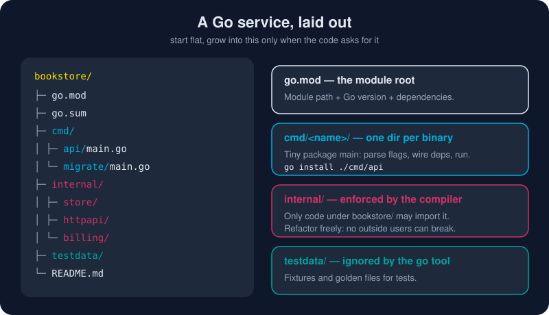

# Project Layout

*There is no official framework that dictates your folders, and that is deliberate. Go gives you a few rules the compiler enforces, plus a few conventions everyone recognizes. Everything else is up to you.*



> **In 30 seconds:** A **module** is a directory tree with a `go.mod`. Every **directory** in it is one **package**. Put each binary's `main` package under **`cmd/<name>/`**. Put code that no one outside your module should import under **`internal/`**, and the compiler enforces that. **Start flat**: a `go.mod` and a `main.go` are a complete, respectable Go project.

## The rules (enforced by the toolchain)

| Rule | What it means |
|---|---|
| One directory = one package | All `.go` files in a folder share a `package` clause (`_test` packages excepted) |
| Import path = module path + directory | `github.com/you/bookstore/internal/store` |
| `internal/` is private | Only code rooted at `internal/`'s **parent** may import it[^go-cmd-internal] |
| `testdata/` is ignored | The go tool skips it, so it is safe for fixtures and golden files |
| `_` or `.` prefixes are ignored | `_scratch/` will not be built |
| No import cycles | If `a` imports `b`, then `b` cannot import `a`, directly or indirectly |

## The official guidance, by project size

The Go team publishes [Organizing a Go module](https://go.dev/doc/modules/layout).[^modules-layout] Its core message is **match the layout to what you are building**.

### 1. A small command: start here

```text
hello/
├─ go.mod
└─ main.go
```

That is a complete project. Add files (`auth.go`, `store.go`) to the same package as it grows. **Don't create folders for organization's sake.**

### 2. A library (importable package)

```text
slugify/
├─ go.mod          // module github.com/you/slugify
├─ slugify.go      // package slugify
├─ slugify_test.go
└─ internal/
   └─ unicode/     // helpers your users cannot import (or depend on)
```

### 3. A server or multi-binary project

```text
bookstore/
├─ go.mod
├─ cmd/
│  ├─ api/main.go       // go install ./cmd/api
│  └─ migrate/main.go   // a second binary, sharing the same packages
├─ internal/
│  ├─ store/            // database access
│  ├─ httpapi/          // handlers + routes
│  └─ billing/          // domain logic
└─ testdata/
```

Keep each `cmd/<name>/main.go` **thin**: parse flags and config, build the dependencies, call `run()`. All the real logic lives in packages you can test.

```go
// cmd/api/main.go
func main() {
	if err := run(context.Background(), os.Args, os.Getenv); err != nil {
		fmt.Fprintln(os.Stderr, err)
		os.Exit(1)
	}
}
```

Passing `os.Args` and `os.Getenv` into `run` lets tests call `run` with fake arguments and a fake environment.

## The `internal/` superpower

```text
bookstore/internal/store   ✅ importable by bookstore/cmd/api
                           ✅ importable by bookstore/internal/httpapi
                           ❌ NOT importable by github.com/someone-else/app
```

Anything under `internal/` can be renamed, split, or rewritten without breaking anyone outside your module. When in doubt, **start in `internal/`**. Moving a package out later is easy. Taking back something you exported is not.

## The `pkg/` debate

You will see `pkg/` in many popular repos. It is a **community convention, not an official one**, and the Go team's guide doesn't use it. Its argument for: it separates importable code from "repo stuff" (docs, scripts, configs). Its argument against: it adds a meaningless word to every import path (`.../pkg/store`).

**Recommendation:** for new projects, prefer `internal/` for private code and put public packages at the module root. If your team already uses `pkg/`, keep it; consistency beats taste.

> 📌 Beware the popular "golang-standards/project-layout" repo. Despite its name, it is **not** an official Go standard, and the Go team has said so publicly. Treat it as one opinion among many.

## Naming packages well

Package names are part of every call site, so they should read well there:[^package-names]

| ✅ Good | ❌ Avoid | Why |
|---|---|---|
| `store.New()` | `store.NewStore()` | the package name already says "store" |
| `http.Client` | `http.HTTPClient` | no stutter |
| `strconv`, `bufio` | `utils`, `common`, `helpers` | names should say *what*, not *"misc"* |
| `user` | `users`, `userPkg` | short, lowercase, singular, no underscores |

Organize by **responsibility** (`billing`, `store`, `httpapi`), not by **kind** (`models`, `controllers`, `services`). Layers by kind create packages that all import each other, which in Go becomes an import-cycle compiler error.

## Multiple modules? Usually not

One repository → one `go.mod` is right for most teams. Use multiple modules only when parts must be **versioned and released separately**. For local development across several modules, `go work` (workspaces) ties them together without editing `go.mod` files.

## Try it

This repository is itself a module. Look at [`assets/code/go.mod`](/assets/code/go.mod) and notice how every example directory is its own `main` package:

```bash
cd assets/code
go list ./ch05/...
```

```text
gokb/ch05/calc
gokb/ch05/httpserver
gokb/ch05/profiling
gokb/ch05/slogdemo
```

Each line is an import path: the module path (`gokb`) plus the directory. Then scaffold your own service in a scratch folder:

```bash
mkdir bookstore && cd bookstore
go mod init example.com/bookstore
mkdir -p cmd/api internal/store
```

## Watch out

- **Over-structuring on day one.** Ten empty folders don't make a design. Let the structure emerge as the code grows.
- **`utils`/`common` packages.** They become junk drawers that everything imports. Name things by what they do.
- **Fat `main` packages.** Code in `package main` is hard to test and impossible to reuse. Keep `main` thin.
- **Import cycles from layered folders.** If `models` imports `services`, which imports `models`, merge them or invert the dependency with an interface.
- **Copying a big template blindly.** A layout designed for a 200-engineer monorepo will slow down a 3-person service.

## Key takeaways

- The toolchain enforces only a few rules: **one directory = one package**, **`internal/` is private**, **no import cycles**.
- **Start flat.** Add `cmd/` when you have binaries and `internal/` when you have private packages.
- `pkg/` is optional folklore. `golang-standards/project-layout` is not a standard.
- Name packages short, lowercase and specific, and organize by **responsibility**, not by layer.

[^modules-layout]: Organizing a Go module
[^go-cmd-internal]: go command: Internal Directories
[^package-names]: Package names (The Go Blog)

---

⬅️ [HTTP Services](/05-production-go/http-services.md) · 🏠 [Index](/index.md) · ➡️ [Idioms and Style](/05-production-go/idioms-and-style.md)
