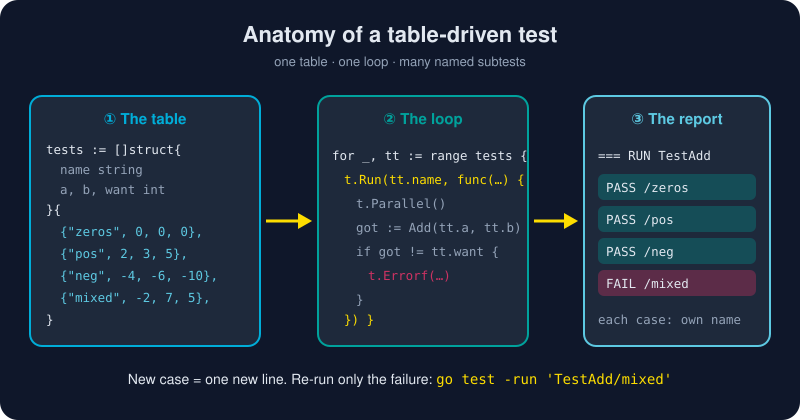

# Testing in Go

*No framework to install, no config file to write, no plugin to argue about. Just a file ending in `_test.go` and a command: `go test`.*



> **In 30 seconds:** A test is a function `func TestXxx(t *testing.T)` in a `_test.go` file. Put your cases in a **table** (a slice of structs), loop over it, and run each case with **`t.Run`** so it gets its own name. Mark helpers with **`t.Helper()`**, speed things up with **`t.Parallel()`**, let the **fuzzer** find edge cases, and check **coverage** with `-cover`.

## The smallest possible test

Go's testing rules are conventions the toolchain enforces:

| Rule | Example |
|---|---|
| Test files end in `_test.go` | `calc_test.go` sits next to `calc.go` |
| Test functions start with `Test` + capital letter | `func TestAdd(t *testing.T)` |
| Same package = white-box access to unexported names | `package calc` |
| `_test` package suffix = black-box, public API only | `package calc_test` |
| Test files are never compiled into your binary | zero production cost |

```go
package calc

import "testing"

func TestAddSimple(t *testing.T) {
	got := Add(2, 3)
	if got != 5 {
		// Errorf records the failure and KEEPS GOING.
		t.Errorf("Add(2, 3) = %d, want 5", got)
	}
}
```

Notice what is missing: no `assertEquals`. Go tests are ordinary Go code. You compare with `!=` and write a message in the **got / want** shape: `Add(2, 3) = 6, want 5`. When the test fails at 2 a.m., that message is all you get, so make it a good one.

| Method | Effect |
|---|---|
| `t.Error` / `t.Errorf` | mark failed, **continue** the test |
| `t.Fatal` / `t.Fatalf` | mark failed, **stop** this test now |
| `t.Log` / `t.Logf` | print only on failure or with `-v` |
| `t.Skip` | skip, e.g. "needs a database" |

Rule of thumb: use `Fatal` when continuing makes no sense (the setup failed, or a value you need is nil). Otherwise use `Error`, so one run shows you every failure.

## The table-driven pattern ⭐

This is the most recognizable idiom in Go testing. You describe the **data**, then write the **logic** once:

```go
func TestAdd(t *testing.T) {
	tests := []struct {
		name string
		a, b int
		want int
	}{
		{"zeros", 0, 0, 0},
		{"positives", 2, 3, 5},
		{"negatives", -4, -6, -10},
		{"mixed", -2, 7, 5},
	}
	for _, tt := range tests {
		t.Run(tt.name, func(t *testing.T) { // each case is a named subtest
			t.Parallel() // safe: since Go 1.22, tt is a fresh variable per iteration
			if got := Add(tt.a, tt.b); got != tt.want {
				t.Errorf("Add(%d, %d) = %d, want %d", tt.a, tt.b, got, tt.want)
			}
		})
	}
}
```

Why everyone uses it:

- **Adding a case is one line.** Edge cases are cheap, so you write more of them.
- **Each case has a name.** `t.Run` creates a subtest named `TestAdd/mixed`, which you can run on its own: `go test -run 'TestAdd/mixed'`.
- **Failures are isolated.** A `t.Fatal` inside one subtest stops only that case.

> 💡 **The Go 1.22 loop fix.** Before Go 1.22, all iterations shared one `tt` variable, so a parallel subtest could see the *last* case instead of its own. Old code worked around it with `tt := tt`. In modules declaring `go 1.22` or later, each iteration gets a fresh variable, and the workaround is no longer needed.

## Helpers that blame the right line

When a helper fails, the error should point at the **test that called it**, not at the helper. One line does that:

```go
func assertNoError(t *testing.T, err error) {
	t.Helper() // report failures at the caller's line
	if err != nil {
		t.Fatalf("unexpected error: %v", err)
	}
}
```

Two more built-ins remove a lot of boilerplate:

```go
dir := t.TempDir()                 // a fresh directory, deleted automatically
t.Cleanup(func() { db.Close() })   // runs after the test and all its subtests
t.Setenv("APP_ENV", "test")        // set an env var, restored afterwards
```

## Testing errors the right way

Compare errors with `errors.Is`, not with string matching. It keeps working when someone wraps the error with more context:

```go
t.Run("by zero", func(t *testing.T) {
	_, err := Divide(1, 0)
	if !errors.Is(err, ErrDivideByZero) {
		t.Fatalf("err = %v, want ErrDivideByZero", err)
	}
})
```

## Examples: documentation that cannot go stale

An `Example` function shows up in your package docs on pkg.go.dev **and** runs as a test. `go test` checks the `// Output:` comment:

```go
func ExampleReverse() {
	fmt.Println(Reverse("stressed"))
	// Output: desserts
}
```

If someone breaks `Reverse`, the docs fail the build. Documentation that is checked on every test run cannot quietly go out of date.

## Testing HTTP handlers without a network

`net/http/httptest` lets you call a handler directly: no ports, no sleeps, no flaky network. This is from [HTTP Services](/05-production-go/http-services.md):

```go
req := httptest.NewRequest("GET", "/items/1", nil)
rec := httptest.NewRecorder()
handler.ServeHTTP(rec, req)
if rec.Code != http.StatusOK {
	t.Fatalf("status = %d, want 200", rec.Code)
}
```

## Fuzzing: let the computer find your bugs

Table tests check the cases **you** thought of. A fuzzer generates thousands of inputs you never would.[^go-fuzzing] Instead of exact outputs, you state **properties** that must always hold:

```go
func FuzzReverse(f *testing.F) {
	for _, seed := range []string{"", "hello", "héllo", "日本語"} {
		f.Add(seed) // seed corpus; also runs during a plain `go test`
	}
	f.Fuzz(func(t *testing.T, s string) {
		if !utf8.ValidString(s) {
			t.Skip("Reverse is defined for valid UTF-8 only")
		}
		rev := Reverse(s)
		if Reverse(rev) != s { // property: reversing twice is a no-op
			t.Errorf("double reverse of %q = %q", s, Reverse(rev))
		}
	})
}
```

When the fuzzer finds an input that breaks a property, it saves it under `testdata/fuzz/FuzzReverse/`. From then on, that input runs as a regression test on every normal `go test`.

## Coverage: where are the blind spots?

```bash
go test ./ch05/calc -cover                          # one-line summary
go test ./ch05/calc -coverprofile=cover.out         # detailed profile
go tool cover -html=cover.out                       # browse it line by line
```

The HTML view colors each line green (ran) or red (never ran).[^cover-blog] Treat coverage as a **flashlight, not a score**. 100% coverage does not mean the code is correct, but red lines are untested for certain.

## Your most useful `go test` flags

| Command | What it does |
|---|---|
| `go test ./...` | test every package in the module |
| `go test -v` | verbose: show every test and log line |
| `go test -run 'TestAdd/mixed'` | run tests matching a regex (subtests use `/`) |
| `go test -count=1` | bypass the test cache |
| `go test -race` | detect data races (requires cgo) |
| `go test -short` | skip slow tests that check `testing.Short()` |
| `go test -failfast` | stop after the first failure |
| `go test -shuffle=on` | randomize order to catch hidden dependencies between tests |

## Try it

From `assets/code`:

```bash
go test ./ch05/calc -run 'TestAdd|Example' -v
```

```text
=== RUN   TestAdd
=== RUN   TestAdd/zeros
=== PAUSE TestAdd/zeros
...
--- PASS: TestAdd (0.00s)
    --- PASS: TestAdd/zeros (0.00s)
    --- PASS: TestAdd/negatives (0.00s)
    --- PASS: TestAdd/positives (0.00s)
    --- PASS: TestAdd/mixed (0.00s)
=== RUN   ExampleReverse
--- PASS: ExampleReverse (0.00s)
PASS
```

The `PAUSE` and `CONT` lines are `t.Parallel()` at work, and the finishing order changes from run to run. Now try coverage, then a short fuzz run:

```bash
go test ./ch05/calc -cover
#  ok   gokb/ch05/calc   0.166s   coverage: 100.0% of statements

go test ./ch05/calc -fuzz=FuzzReverse -fuzztime=10s
#  fuzz: elapsed: 3s, execs: 453339 (151068/sec), new interesting: 44 ...
#  PASS
```

Then run the in-process HTTP tests: `go test ./ch05/httpserver -v`.

## Watch out

- **`t.Fatal` from another goroutine is not allowed.** Call `t.Error` there, or send the error back over a channel and fail on the test goroutine.
- **Parallel subtests and shared state.** `t.Parallel()` cases must not mutate shared variables. The `httpserver` test is deliberately sequential because "fetch" depends on "create".
- **Testing implementation, not behavior.** Tests that break on every refactor get deleted. Test what callers observe.
- **Over-mocking.** In Go, a small interface and a hand-written fake usually beat a mocking framework.
- **Forgetting `-race` in CI.** Concurrency bugs hide until production. Run `go test -race ./...` in CI.

## Key takeaways

- `go test` is the entire framework: `_test.go` files, `TestXxx` functions, and plain `if` statements.
- **Table-driven tests with `t.Run` subtests** are the standard shape. Learn them once and use them everywhere.
- `t.Helper`, `t.Cleanup`, `t.TempDir` and `httptest` remove most of the boilerplate.
- **Examples** double as tested documentation, and **fuzzing** finds the inputs you didn't think of.[^pkg-testing]
- Read coverage for its **red lines**, and always run `-race` in CI.

[^pkg-testing]: Package testing (Go standard library)
[^go-fuzzing]: Go Fuzzing
[^cover-blog]: The cover story

---

⬅️ [Concurrency Patterns](/04-concurrency/concurrency-patterns.md) · 🏠 [Index](/index.md) · ➡️ [Benchmarks and Profiling](/05-production-go/benchmarks-and-profiling.md)
