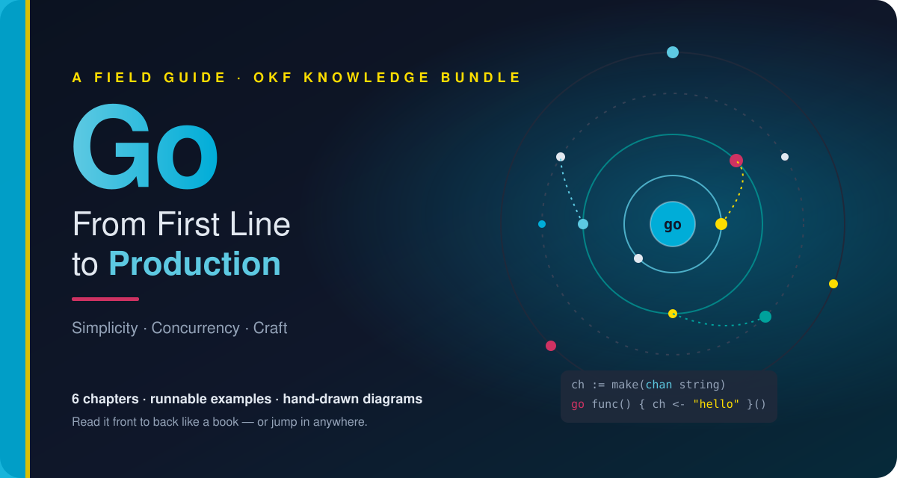
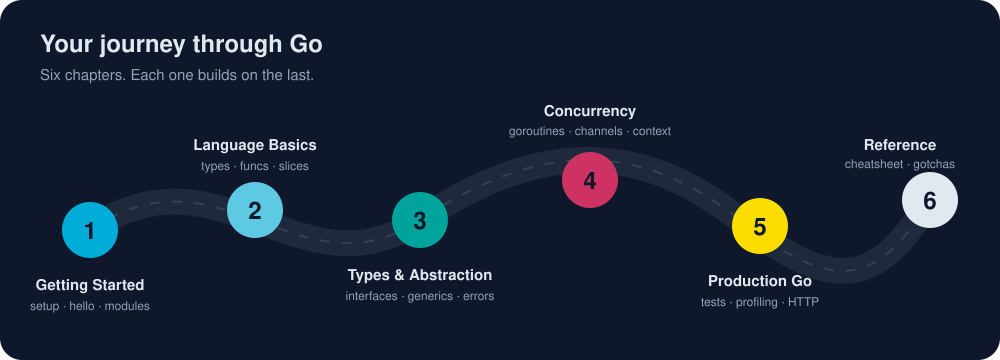

<p align="center">
  
</p>

<p align="center">
  
  
  
  
</p>

<h3 align="center"><i>“Clear is better than clever.”</i></h3>
<p align="center"><sub>— one of the Go Proverbs</sub></p>

<br>

## 📖 Before you turn the page

Somewhere right now, a single Go binary is serving a million requests and barely using any CPU.
Docker, Kubernetes, Terraform and a large part of the modern cloud are written in Go. The language
behind them is small. It has 25 keywords, one loop, and a formatter that ends arguments about style.

This book takes you from **a blank machine** to **production-grade concurrent services**, one short
chapter at a time. Every lesson has a picture, real code you can run, the traps to avoid, and
a short list of takeaways.

<table>
<tr>
<td align="center" width="25%"><h2>42</h2><sub>bite-sized lessons</sub></td>
<td align="center" width="25%"><h2>32</h2><sub>runnable programs</sub></td>
<td align="center" width="25%"><h2>36</h2><sub>original diagrams</sub></td>
<td align="center" width="25%"><h2>~6.4 h</h2><sub>cover to cover</sub></td>
</tr>
</table>

## 🧭 Choose your path

| If you are… | Start here | Then |
|---|---|---|
| 🌱 **New to Go and new to setup** | [Why Go?](/01-getting-started/why-go.md) | Read straight through. Every page links to the next. |
| 📦 **Confused by package vs module vs workspace?** | [Package vs Module vs Workspace](/01-getting-started/go-packages/package-module-workspace.md) | Then [What package main Means](/01-getting-started/go-packages/package-main.md). |
| ⌨️ **Want the `go` command explained** | [Go CLI](/01-getting-started/go-cli/) | `run` → `build` → `install` → `fmt` → `test` → `get`. |
| 🔁 **Coming from Python, Java, JS or C#** | [Environment Setup](/01-getting-started/environment-setup/) | Skim Chapter II, then dive into [Interfaces](/03-types-and-abstraction/interfaces.md) and [Concurrency](/04-concurrency/). |
| 🛠️ **Already writing Go** | [Concurrency Patterns](/04-concurrency/concurrency-patterns.md) | Go deep on [Production Go](/05-production-go/) and keep the [Gotchas](/06-reference/gotchas.md) close. |
| ⏱️ **In a hurry** | [Go Cheatsheet](/06-reference/cheatsheet.md) | All of Go on one page. |

<p align="center">
  
</p>

## ⚡ Your first 60 seconds

```sh
git clone https://github.com/bhagatabhijeet/golang-knowledge-bundle.git
cd golang-knowledge-bundle/assets/code
go run ./ch01/hello
```

```text
Hello, World! Welcome to Go.
```

No Go installed yet? Start with [Installing Go](/01-getting-started/environment-setup/installing-go.md).
After about 15 minutes you'll have Go, VS Code and a fully configured editor.

<br>

## 📚 Table of Contents

### 🚀 Chapter I · [Getting Started](/01-getting-started/)

> *Every journey starts with a single `go run`.*

| # | Lesson | Level | Time |
|:-:|---|---|--:|
| 1 | **[Why Go?](/01-getting-started/why-go.md)**<br><sub>The origin story of a language built at Google to make large-scale software boring to build, and how it quietly came to run much of the cloud.</sub> | 🟢 beginner | 6 min |
| 2 | **[Installing Go <sub>· setup</sub>](/01-getting-started/environment-setup/installing-go.md)**<br><sub>Go from zero to a working `go version` on Windows, macOS or Linux in about five minutes, then learn what GOROOT, GOPATH and PATH really mean.</sub> | 🟢 beginner | 9 min |
| 3 | **[Installing VS Code <sub>· setup</sub>](/01-getting-started/environment-setup/installing-vscode.md)**<br><sub>Install Visual Studio Code on any OS, put the `code` command on your PATH, and learn the dozen shortcuts that make it feel like an extension of your hands.</sub> | 🟢 beginner | 7 min |
| 4 | **[Configuring VS Code for Go <sub>· setup</sub>](/01-getting-started/environment-setup/configuring-vscode-go.md)**<br><sub>Turn VS Code into a Go powerhouse with the official extension, gopls, Delve and a battle-tested settings.json, so you get autocomplete, formatting on save, linting, debugging and one-click tests.</sub> | 🟢 beginner | 11 min |
| 5 | **[Hello, World!](/01-getting-started/hello-world.md)**<br><sub>Write, run and dissect your first Go program, and see why every line in it is there on purpose.</sub> | 🟢 beginner | 6 min |
| 6 | **[What package main Means <sub>· packages</sub>](/01-getting-started/go-packages/package-main.md)**<br><sub>The two types of Go package, executable (package main, which builds a runnable file) and reusable (helper code you import), and how a Go program starts up.</sub> | 🟢 beginner | 7 min |
| 7 | **[Import Statements <sub>· packages</sub>](/01-getting-started/go-packages/import-statements.md)**<br><sub>An import statement opens a door into another package, like "fmt", and gives your code its exported functions, types and constants, from the standard library, your own module, or the wider Go world.</sub> | 🟢 beginner | 8 min |
| 8 | **[Package vs Module vs Workspace <sub>· packages</sub>](/01-getting-started/go-packages/package-module-workspace.md)**<br><sub>Is a package the same as a project? Is a module a workspace? No, and once you see the four nesting levels of Go code, every import path and go.mod makes sense.</sub> | 🟢 beginner | 9 min |
| 9 | **[Modules and Packages <sub>· packages</sub>](/01-getting-started/go-packages/modules-and-packages.md)**<br><sub>Learn how Go organizes code (files into packages, packages into modules) and how a single capital letter decides what the world can see.</sub> | 🟢 beginner | 9 min |
| 10 | **[go run <sub>· go cli</sub>](/01-getting-started/go-cli/go-run.md)**<br><sub>Compile and launch your program in one breath, the fastest feedback loop in Go and the command you will type more than any other.</sub> | 🟢 beginner | 6 min |
| 11 | **[go build <sub>· go cli</sub>](/01-getting-started/go-cli/go-build.md)**<br><sub>Turn your source into one self-contained binary you can copy to any machine and run, with no runtime, no installer and no dependencies.</sub> | 🟢 beginner | 8 min |
| 12 | **[go install <sub>· go cli</sub>](/01-getting-started/go-cli/go-install.md)**<br><sub>Compile a program and drop it into your personal bin folder, so the command works from any terminal, whether it's your own tool or someone else's.</sub> | 🟢 beginner | 7 min |
| 13 | **[go fmt <sub>· go cli</sub>](/01-getting-started/go-cli/go-fmt.md)**<br><sub>One command, one style, zero arguments, so all Go code everywhere looks like it was written by the same careful person.</sub> | 🟢 beginner | 6 min |
| 14 | **[go test <sub>· go cli</sub>](/01-getting-started/go-cli/go-test.md)**<br><sub>Go's built-in test runner finds, compiles and runs your tests, examples and coverage with no framework to install and nothing to configure.</sub> | 🟢 beginner | 8 min |
| 15 | **[go get <sub>· go cli</sub>](/01-getting-started/go-cli/go-get.md)**<br><sub>Add, upgrade, downgrade and remove your project's dependencies with one command, recorded in go.mod and locked by checksums in go.sum.</sub> | 🟢 beginner | 8 min |
| 16 | **[A Tour of the Toolchain](/01-getting-started/toolchain-tour.md)**<br><sub>Meet the `go` command, the Swiss Army knife that builds, tests, formats, vets, documents and cross-compiles your code with no plugins required.</sub> | 🟢 beginner | 8 min |

<sub>⏱️ about 123 minutes of reading</sub>

### 🧱 Chapter II · [Language Basics](/02-language-basics/)

> *Twenty-five keywords. Infinite possibilities.*

| # | Lesson | Level | Time |
|:-:|---|---|--:|
| 1 | **[Variables and Types](/02-language-basics/variables-and-types.md)**<br><sub>Declare variables three ways, meet Go's built-in types, and discover why "zero values" mean Go never hands you garbage memory.</sub> | 🟢 beginner | 9 min |
| 2 | **[Control Flow](/02-language-basics/control-flow.md)**<br><sub>One loop, a smarter if, and a switch that doesn't fall through. Go's control flow fits on an index card and still covers everything.</sub> | 🟢 beginner | 7 min |
| 3 | **[Functions](/02-language-basics/functions.md)**<br><sub>Multiple return values, variadic parameters, first-class functions, closures that remember, and `defer`, the cleanup button you press in advance.</sub> | 🟢 beginner | 10 min |
| 4 | **[Pointers](/02-language-basics/pointers.md)**<br><sub>Pointers without the fear. Learn when Go copies, when it shares, and how escape analysis quietly decides between the stack and the heap.</sub> | 🟢 beginner | 8 min |
| 5 | **[Slices and Maps](/02-language-basics/slices-and-maps.md)**<br><sub>Go's two workhorse collections, explained from the inside out. See the three-word slice header that makes append fast and occasionally surprising.</sub> | 🟢 beginner | 12 min |
| 6 | **[Strings and Runes](/02-language-basics/strings-and-runes.md)**<br><sub>Why `len("世界")` is 6, what a rune really is, and how to slice, iterate and build text in Go without mangling a single emoji.</sub> | 🟢 beginner | 8 min |

<sub>⏱️ about 54 minutes of reading</sub>

### 🧩 Chapter III · [Types and Abstraction](/03-types-and-abstraction/)

> *Small interfaces, big ideas.*

| # | Lesson | Level | Time |
|:-:|---|---|--:|
| 1 | **[Structs and Methods](/03-types-and-abstraction/structs-and-methods.md)**<br><sub>Go has no classes, just structs with methods attached, and choosing between a value and a pointer receiver is the most important design call you will make about a type.</sub> | 🟢 beginner | 9 min |
| 2 | **[Interfaces](/03-types-and-abstraction/interfaces.md)**<br><sub>Go interfaces are satisfied silently, with no "implements" keyword, which makes the smallest abstractions in Go some of the most powerful in any language.</sub> | 🟡 intermediate | 12 min |
| 3 | **[Embedding and Composition](/03-types-and-abstraction/embedding-and-composition.md)**<br><sub>Go swaps inheritance trees for Lego bricks, letting you embed one type inside another and have its methods promoted for free.</sub> | 🟡 intermediate | 8 min |
| 4 | **[Generics](/03-types-and-abstraction/generics.md)**<br><sub>Type parameters let you write a function or data structure once and use it with any type the constraint allows, checked fully at compile time.</sub> | 🟡 intermediate | 11 min |
| 5 | **[Errors](/03-types-and-abstraction/errors.md)**<br><sub>In Go an error is just a value you return, wrap and inspect, and learning to build and read error chains is what separates scripts from production code.</sub> | 🟡 intermediate | 12 min |
| 6 | **[Iterators](/03-types-and-abstraction/iterators.md)**<br><sub>Since Go 1.23 your own functions can feed a for-range loop, which turns lazy sequences, infinite streams and custom collections into one-line loops.</sub> | 🔴 advanced | 10 min |

<sub>⏱️ about 62 minutes of reading</sub>

### ⚡ Chapter IV · [Concurrency](/04-concurrency/)

> *Don't communicate by sharing memory; share memory by communicating.*

| # | Lesson | Level | Time |
|:-:|---|---|--:|
| 1 | **[Goroutines](/04-concurrency/goroutines.md)**<br><sub>Launch thousands of lightweight concurrent tasks with one keyword and learn how Go's scheduler juggles them across your CPU cores.</sub> | 🟡 intermediate | 9 min |
| 2 | **[Channels](/04-concurrency/channels.md)**<br><sub>Typed pipes that let goroutines hand each other data safely, so they share memory by communicating instead of fighting over it.</sub> | 🟡 intermediate | 11 min |
| 3 | **[Select](/04-concurrency/select.md)**<br><sub>The switch statement for channels that lets one goroutine wait on many events at once and react to whichever happens first.</sub> | 🟡 intermediate | 8 min |
| 4 | **[Sync Primitives](/04-concurrency/sync-primitives.md)**<br><sub>Mutexes, read-write locks, Once, atomics and sync.Map are the precision tools for guarding shared state, and the race detector checks that you used them right.</sub> | 🟡 intermediate | 10 min |
| 5 | **[Context](/04-concurrency/context.md)**<br><sub>The one parameter that carries deadlines, cancellation signals and request-scoped values through every layer of a Go program.</sub> | 🟡 intermediate | 10 min |
| 6 | **[Concurrency Patterns](/04-concurrency/concurrency-patterns.md)**<br><sub>Pipelines, fan-out and fan-in, worker pools, semaphores and errgroup are the five patterns behind most concurrent Go code in production.</sub> | 🔴 advanced | 12 min |

<sub>⏱️ about 60 minutes of reading</sub>

### 🏭 Chapter V · [Production Go](/05-production-go/)

> *Code that ships, scales, and lets you sleep at night.*

| # | Lesson | Level | Time |
|:-:|---|---|--:|
| 1 | **[Testing in Go](/05-production-go/testing.md)**<br><sub>Go ships a test runner, coverage tool, benchmark harness, and fuzzer in the box, so learn the table-driven pattern once and every test you write after it is one line long.</sub> | 🟡 intermediate | 12 min |
| 2 | **[Benchmarks and Profiling](/05-production-go/benchmarks-and-profiling.md)**<br><sub>Stop guessing where your program is slow; Go's benchmark harness, benchstat, pprof, and the execution tracer show you exactly where the time and memory go.</sub> | 🔴 advanced | 11 min |
| 3 | **[HTTP Services](/05-production-go/http-services.md)**<br><sub>Build a production-shaped JSON API with nothing but the standard library, covering method-and-wildcard routing, middleware, timeouts, and graceful shutdown.</sub> | 🟡 intermediate | 13 min |
| 4 | **[Project Layout](/05-production-go/project-layout.md)**<br><sub>How to organize a Go repository with go.mod, cmd/ and internal/, based on the official guidance, and why you should start flat and add structure only when the code asks for it.</sub> | 🟡 intermediate | 9 min |
| 5 | **[Idioms and Style](/05-production-go/idioms-and-style.md)**<br><sub>The habits that make Go code feel like Go, including gofmt, naming, small interfaces, useful zero values, early returns, the Go proverbs, and structured logging with log/slog.</sub> | 🟡 intermediate | 12 min |

<sub>⏱️ about 57 minutes of reading</sub>

### 📎 Chapter VI · [Reference](/06-reference/)

> *The pages you'll wear out.*

| # | Lesson | Level | Time |
|:-:|---|---|--:|
| 1 | **[Go Cheatsheet](/06-reference/cheatsheet.md)**<br><sub>Every everyday Go construct on one page — syntax, idioms, and commands you will reach for a hundred times a week.</sub> | 🟢 beginner | 10 min |
| 2 | **[Gotchas](/06-reference/gotchas.md)**<br><sub>The traps that catch every Go programmer at least once, each with a reproduction, an explanation, and a fix.</sub> | 🟡 intermediate | 9 min |
| 3 | **[Glossary](/06-reference/glossary.md)**<br><sub>Plain-English definitions of every Go term in this book, from blank identifier to zero value.</sub> | 🟢 beginner | 7 min |

<sub>⏱️ about 26 minutes of reading</sub>

## 🧠 How every lesson is built

```text
 ┌──────────────────────────────────────────────────────────┐
 │  # Title              a one-line hook to pull you in      │
 │  🖼️  Diagram           the idea, drawn                     │
 │  > In 30 seconds      the whole lesson, compressed        │
 │  Sections + code      the teaching, with commented Go     │
 │  ## Try it            go run ./chNN/<example>             │
 │  ## Watch out         the traps, before they bite         │
 │  ## Key takeaways     what to remember tomorrow           │
 │  ⬅️ prev · 🏠 index · ➡️ next                              │
 └──────────────────────────────────────────────────────────┘
```

## 🗂️ Inside the bundle

This repository is an **[Open Knowledge Format (OKF) v0.2](https://github.com/GoogleCloudPlatform/knowledge-catalog/blob/main/okf/SPEC.md)**
bundle. People can read it on GitHub like a book. AI agents and tools can load it as structured knowledge.

```text
golang-knowledge-bundle/
├── README.md                 ← you are here (the cover)
├── index.md                  ← OKF root index (declares okf_version: "0.2")
├── log.md                    ← OKF update log, newest first
├── 01-getting-started/
│   ├── index.md
│   ├── why-go.md …
│   ├── environment-setup/    ← install Go · install VS Code · configure the Go extension
│   ├── go-packages/          ← package main · executable vs reusable · package vs module vs workspace
│   └── go-cli/               ← go run · build · install · fmt · test · get
├── 02-language-basics/
├── 03-types-and-abstraction/
├── 04-concurrency/
├── 05-production-go/
├── 06-reference/
└── assets/
    ├── images/               ← every diagram, as self-contained SVG
    └── code/                 ← one Go module (gokb), one runnable program per lesson
```

Each lesson is an OKF **concept**: Markdown with YAML frontmatter that tools can index, filter and trust-rank.

```yaml
---
type: Lesson
title: Channels
description: Typed pipes that let goroutines hand each other data safely…
tags: [go, concurrency, channels]
status: stable
level: intermediate
reading_time: 9 min
examples: [/assets/code/ch04/channels/main.go]
generated: { by: claude_code/claude-opus-5-5, at: 2026-11-06T00:00:00Z }
sources:
  - id: effective-go
    resource: https://go.dev/doc/effective_go
---
```

* 🗺️ **[index.md](/index.md)** lists every concept, chapter by chapter, for agents and readers.
* 📝 **[log.md](/log.md)** records each change to the book, by date.

## 🧪 Run every example

```sh
cd assets/code
go vet ./...        # static checks across all examples
go test ./...       # the testing and HTTP chapters include real tests
go run ./ch04/patterns
```

<br>

---

<p align="center">
  <sub>
    <b>Colophon.</b> Written in Markdown, illustrated in hand-built SVG, and checked against Go 1.26.<br>
    Every claim cites the official Go documentation. Every code block was compiled and run.<br>
    Go is a trademark of Google LLC. This is an independent, community learning resource.
  </sub>
</p>

<p align="center">
  <b><a href="/01-getting-started/why-go.md">Turn the page → Chapter I: Why Go?</a></b>
</p>
